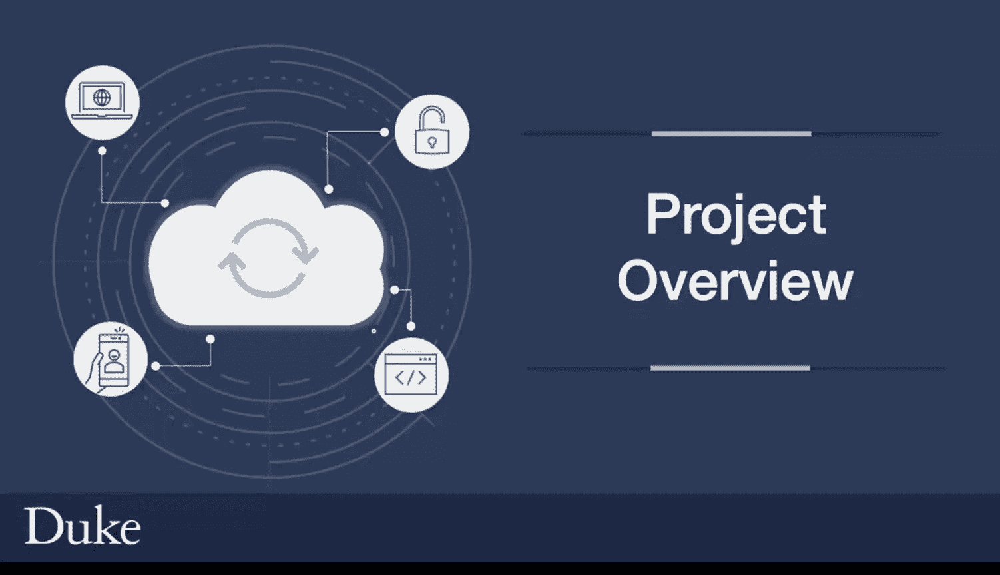
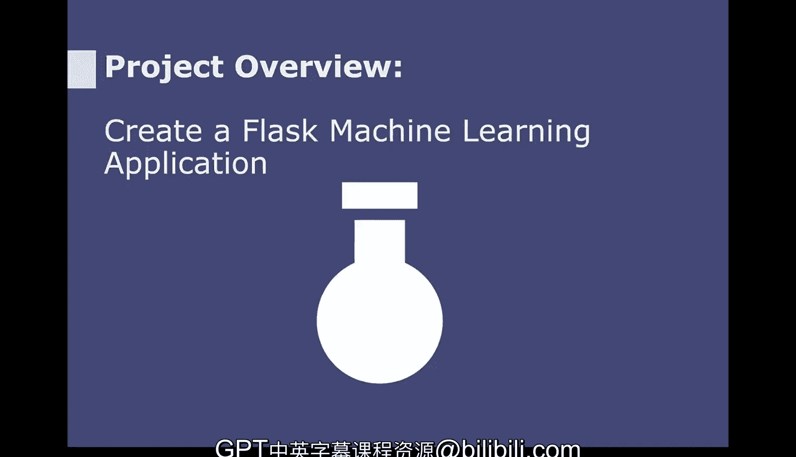
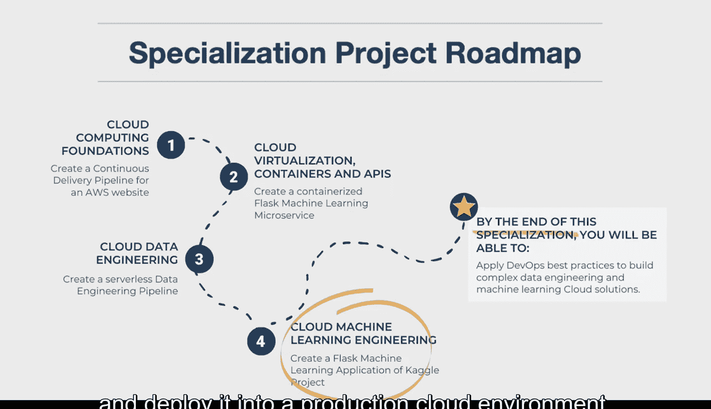
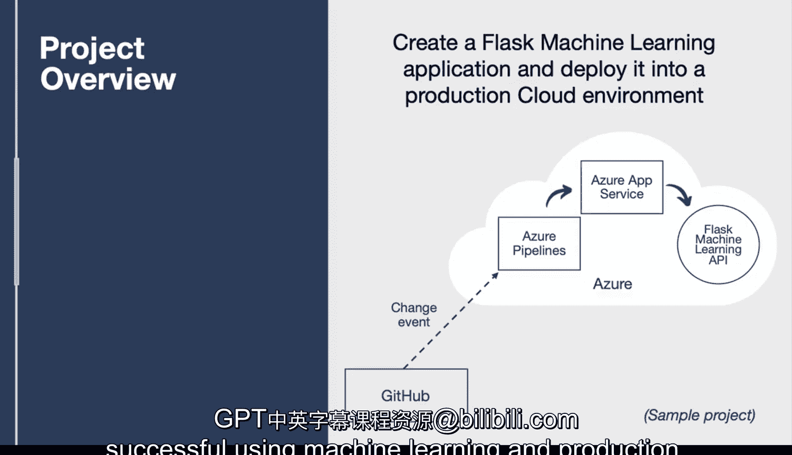

构建大规模云计算解决方案（数据工程、机器学习）：课程4：项目概览 🚀

在本节课中，我们将学习课程4的最终项目概览。你将创建一个Flask机器学习应用程序，并将其部署到生产云环境中。我们将探讨一个可行的架构示例，并了解成功部署所需的关键组件。

---

### 项目目标

在最终项目中，你需要完成以下三项核心交付物：
*   包含源代码的GitHub仓库。
*   展示部署过程的演示视频。
*   一个可正常运行的网站。

这个项目旨在让你为成为一名真正的机器学习工程师做好准备。

上一节我们明确了项目目标，本节中我们来看看一个可以采用的参考架构。

### 参考架构示例

以下是一个基于Azure的机器学习应用程序架构示例，该架构同样适用于其他主流云平台。

该架构的工作流程如下：
1.  **GitHub**：首先，将你的代码提交到GitHub仓库中。
2.  **Azure Pipeline**：代码随后会进入Azure Pipeline，这是一个持续交付（CD）系统。
3.  **Azure App Service**：Pipeline会将应用部署到Azure App Service，这是一个无服务器环境。
4.  **API可用**：最终，你的机器学习API将可供访问。

这个架构的核心思想具有普适性。事实上，你可以将其迁移到任何云平台。

以下是其他云平台的对应服务：
*   **AWS**：可以使用 **Elastic Beanstalk** 服务实现相同功能。
*   **Google Cloud**：可以使用 **Google App Engine** 实现相同功能。

### 最佳实践总结

总而言之，结合使用无服务器技术、持续交付流程以及Flask框架，是成功将机器学习模型投入生产环境的最佳实践之一。

---

本节课中我们一起学习了课程4的最终项目要求、一个可复用的云部署架构示例，以及跨平台实现此架构的关键服务。你已掌握了将机器学习应用从开发推向生产环境的核心路径。