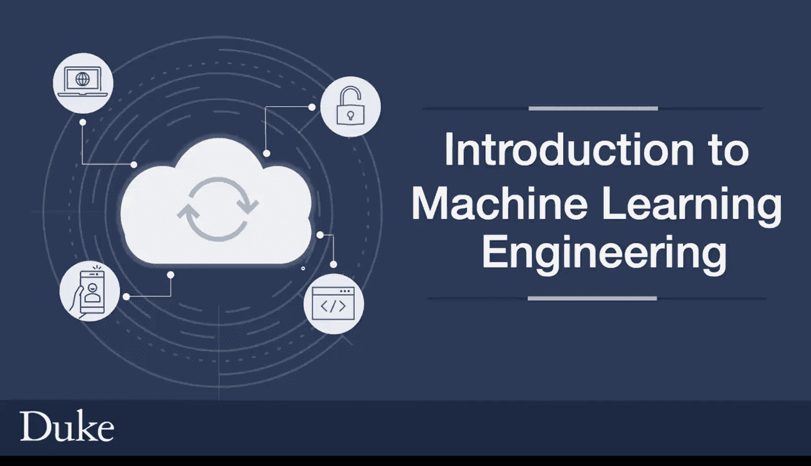
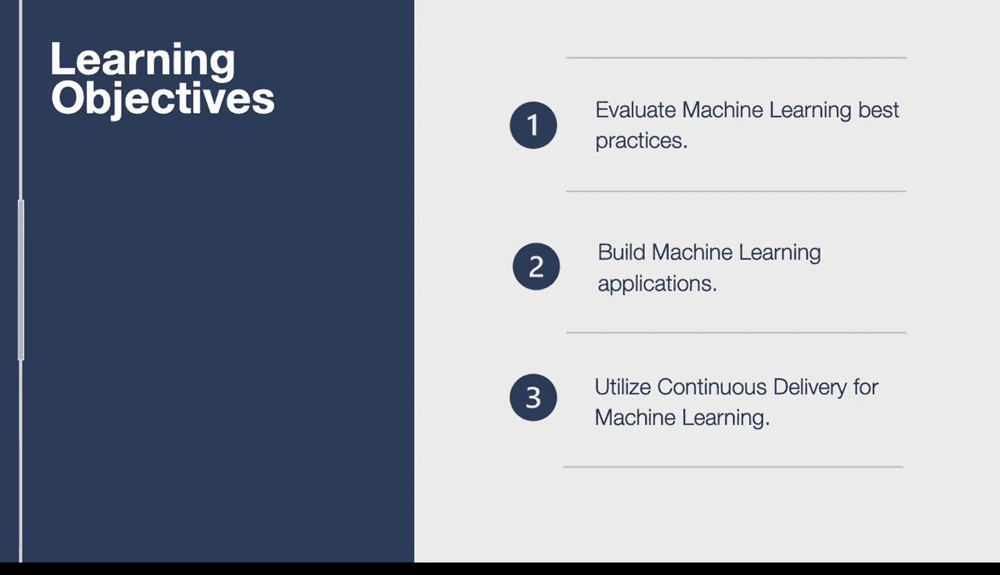

#  089：机器学习工程简介 🧠

在本节课中，我们将学习机器学习工程的核心概念。我们将探讨机器学习的最佳实践，学习如何构建机器学习应用，并了解如何为机器学习项目应用持续交付流程。

---

## 什么是机器学习工程？ 🤔



上一节我们明确了本课的学习目标，本节中我们来定义机器学习工程。

机器学习工程是将软件工程的原则和实践应用于机器学习系统，使其可靠、可维护且可扩展的学科。它关注于将数据科学模型转化为生产环境中的稳定服务。

---

## 学习目标 🎯

以下是本课程涵盖的三个主要学习目标：

1.  **评估机器学习最佳实践**：我们将学习如何评估和采用业界公认的机器学习开发与部署的最佳方法。
2.  **构建机器学习应用程序**：我们将掌握从数据准备到模型部署的完整机器学习应用构建流程。
3.  **为机器学习应用持续交付**：我们将学习如何利用持续集成与持续交付（CI/CD）管道，自动化机器学习模型的更新与发布过程。

---

## 核心概念与实践 🔧

在了解了学习目标后，我们来看看支撑机器学习工程的核心概念。

*   **模型训练与验证**：使用历史数据训练算法，并通过验证集评估其性能。一个简单的线性回归训练代码示例如下：
    ```python
    from sklearn.linear_model import LinearRegression
    model = LinearRegression()
    model.fit(X_train, y_train)
    predictions = model.predict(X_val)
    ```

*   **特征工程**：从原始数据中提取、转换和选择对模型预测最有用的特征。例如，将日期拆分为年、月、日等独立特征。

*   **模型部署**：将训练好的模型封装成API服务或其他形式，以便其他应用程序可以调用。这通常涉及将模型保存为文件（如使用`joblib`或`pickle`），并在服务器上加载。

*   **监控与维护**：持续监控生产环境中模型的性能指标（如预测准确率、延迟），并在性能下降时触发重新训练或调整。



*   **持续交付（CD）**：为机器学习项目建立自动化管道，当代码或数据更新时，自动执行测试、重新训练模型并将其部署到生产环境。其核心流程可以概括为：**代码提交 -> 自动测试 -> 模型训练与验证 -> 自动部署**。

---


## 总结 📝

本节课中，我们一起学习了机器学习工程的基础。我们明确了机器学习工程的定义，即应用工程化方法使机器学习系统产品化。我们设定了评估最佳实践、构建应用和实施持续交付三大目标，并简要介绍了模型训练、特征工程、部署、监控等核心环节。理解这些是构建可靠、可扩展的机器学习解决方案的第一步。