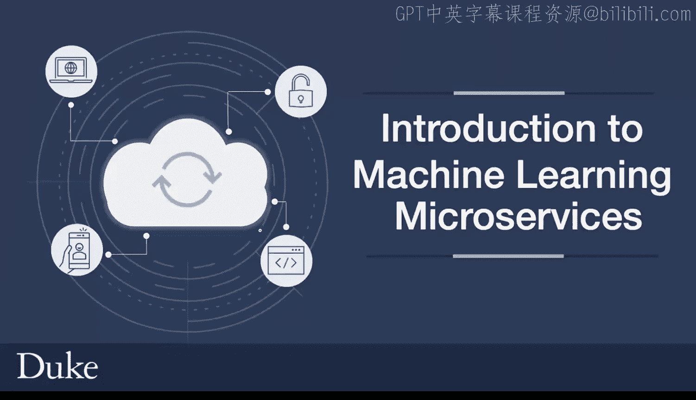
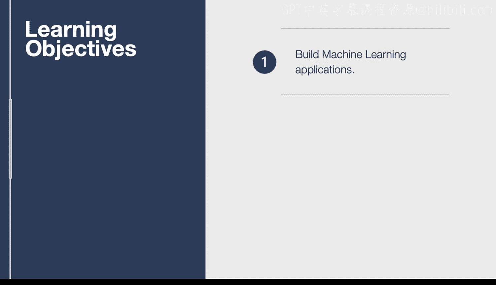

#  092：机器学习微服务简介 🚀

在本节课中，我们将学习如何构建机器学习微服务。这包括将基于Flask的Web应用程序与Scikit-Learn模型结合并投入生产，以及使用AWS SageMaker或Azure ML服务等云平台工具。本课程的核心是构建可投入实际应用的机器学习应用程序。

---



## 学习目标 🎯

上一节我们介绍了课程概述，本节中我们来看看具体的学习目标。本课程的核心目标是构建机器学习应用程序，这也是整个课程内容将围绕的重点。

以下是具体的学习目标：
*   构建可投入生产的机器学习应用。
*   将基于Flask的Web应用与Scikit-Learn模型集成。
*   了解并利用AWS SageMaker或Azure ML服务等云平台。

---

## 核心概念与工具 🛠️

了解了学习目标后，我们来看看实现这些目标所需的核心概念与工具。机器学习微服务的关键在于将训练好的模型封装成可通过网络调用的服务。

以下是主要涉及的技术：
*   **Web框架**：例如 **Flask**，用于创建接收请求并返回预测结果的API端点。
*   **机器学习库**：例如 **Scikit-Learn**，用于训练和加载机器学习模型。
*   **云机器学习平台**：例如 **AWS SageMaker** 和 **Azure Machine Learning**，提供托管服务来简化模型的部署、管理和扩展。

一个简单的Flask预测服务代码示例如下：

```python
from flask import Flask, request, jsonify
import joblib

app = Flask(__name__)
model = joblib.load('your_model.pkl') # 加载训练好的模型

@app.route('/predict', methods=['POST'])
def predict():
    data = request.get_json()
    prediction = model.predict([data['features']])
    return jsonify({'prediction': prediction.tolist()})

if __name__ == '__main__':
    app.run(debug=True)
```



---


## 总结 📝

本节课中，我们一起学习了机器学习微服务的基本概念。我们明确了构建可生产化机器学习应用的学习目标，并介绍了实现这一目标所需的核心工具，包括Flask、Scikit-Learn以及AWS SageMaker和Azure ML等云服务。接下来的课程将深入探讨如何具体实施这些技术。