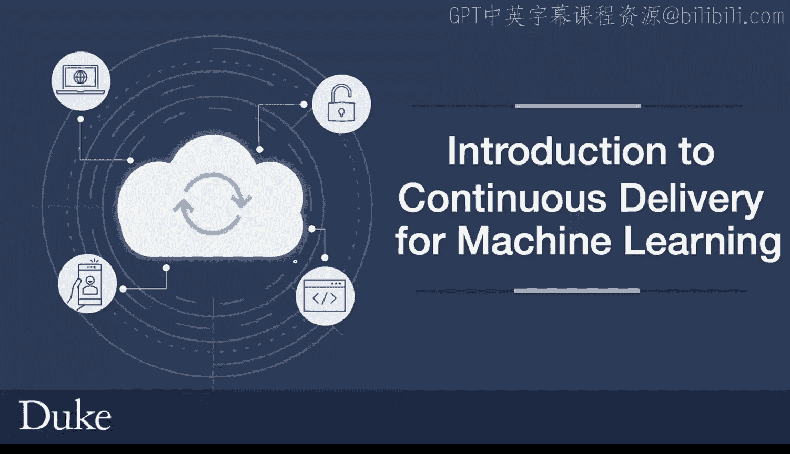
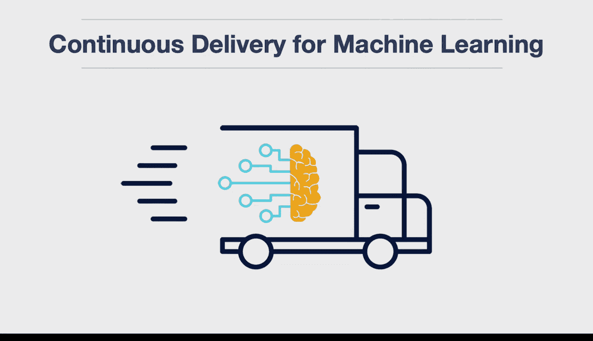
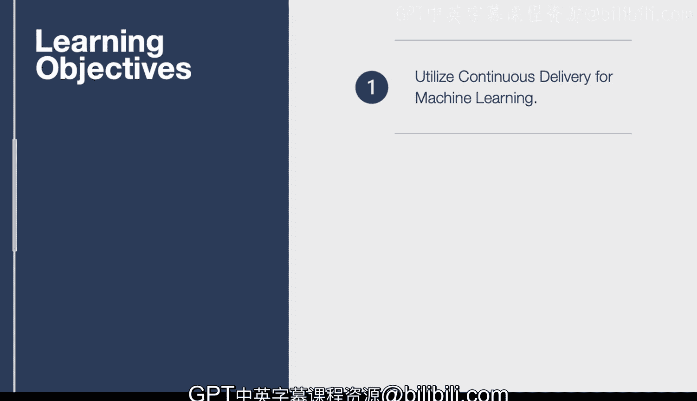

#  095：机器学习持续交付简介 🚀

在本节课中，我们将要学习如何为机器学习项目应用持续交付。这涉及到运用DevOps最佳实践和构建系统，来部署基础设施、软件以及模型本身。



上一节我们介绍了构建系统的基础知识，本节中我们来看看如何将其应用于机器学习场景。

## 学习目标 🎯

首先，我们将重点介绍如何为机器学习项目利用持续交付。这是本节课要掌握的核心能力，我们将结合构建服务器技术来实现。

以下是本课程的核心学习目标列表：

*   掌握为机器学习项目应用持续交付的方法。
*   学习使用构建服务器技术来自动化部署流程。

## 核心概念与实践



持续交付的核心在于自动化。对于机器学习项目，这意味着不仅要自动部署代码和基础设施，还要自动部署训练好的模型。我们可以通过以下**公式**来描述这个自动化流程：

`代码提交 -> 自动构建 -> 自动测试 -> 自动部署（基础设施 + 软件 + 模型）`

为了实现这一点，我们需要在构建服务器（如Jenkins, GitLab CI等）中配置相应的流水线。一个简化的流水线**代码**示例如下：

```yaml
pipeline:
  stages:
    - build
    - test
    - deploy
  build:
    - echo "构建应用程序..."
  test:
    - echo "运行单元测试和模型验证..."
  deploy:
    - echo "部署基础设施..."
    - echo "部署应用程序..."
    - echo "部署新模型..."
```

通过这样的设置，每次代码更新都能触发一个完整的、可重复的交付流程，确保模型能够快速、可靠地投入生产环境。



本节课中我们一起学习了机器学习持续交付的基本概念和目标。我们了解到，它通过自动化构建和部署流程，将DevOps实践延伸至模型领域，从而高效、可靠地交付机器学习解决方案。