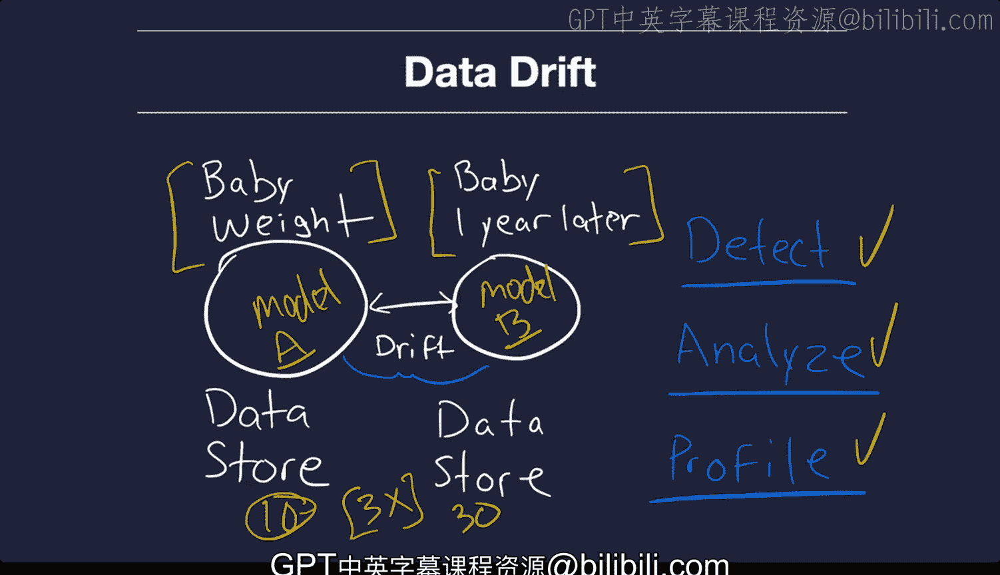

构建大规模云计算解决方案（数据工程、机器学习）：3-4课：什么是数据漂移 🧠

在本节课中，我们将要学习一个对机器学习运维至关重要的概念——数据漂移。我们将了解它的定义、重要性以及如何通过监控来确保机器学习模型的持续有效性。

---

数据漂移是机器学习运维中的一个核心概念。它允许你检测新数据集上的数据漂移并发出警报，分析历史数据中的漂移，并随着时间推移对新数据进行画像分析。

那么，为什么需要关注数据漂移呢？一个很好的例子是婴儿体重的观测数据。假设你记录了100万婴儿出生时的体重，数据存储在类似亚马逊S3的数据仓库中。一年后，你获得了另一组观测数据。

数据显示婴儿体重显著增加。例如，婴儿出生时可能是10磅，一年后可能达到30磅。这就是一个典型的数据漂移案例。体重发生了显著变化。

如果你最初基于出生时的数据（数据集A）训练了一个模型，那么这种变化将构成一个非常大的数据漂移。从10磅到30磅，数据的差值达到了三倍。这是一个非常显著的变化。

接下来会发生什么呢？如果你想训练一个新模型，这个新模型必须反映这些变化。这正是你可以设置警报的地方，以确保你的预测目标仍然准确。

例如，如果你试图预测哪些婴儿可能需要住院治疗，而你的模型是基于最初的婴儿出生数据训练的，那么这个模型可能不适用于一岁大的婴儿。

因此，数据漂移是一个极其重要的概念。你可以自行监控它，并定期设置警报。这就像飞行时检查轮胎气压或飞机高度一样，它是一种监控机制，但专门针对机器学习场景。

---

本节课中，我们一起学习了数据漂移的概念。我们了解到，数据漂移是指模型训练数据与实际生产数据之间的统计属性发生的变化。通过监控数据漂移，我们可以及时发现模型可能失效的迹象，并触发重新训练或调整，从而保证机器学习系统在动态变化的环境中的预测准确性和可靠性。