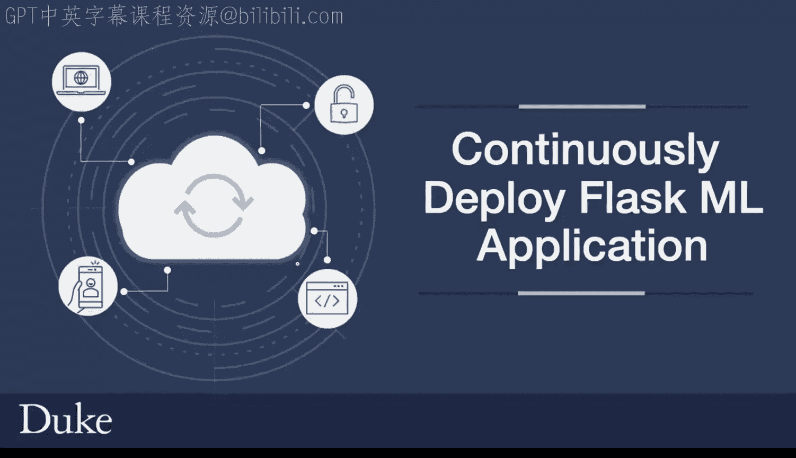
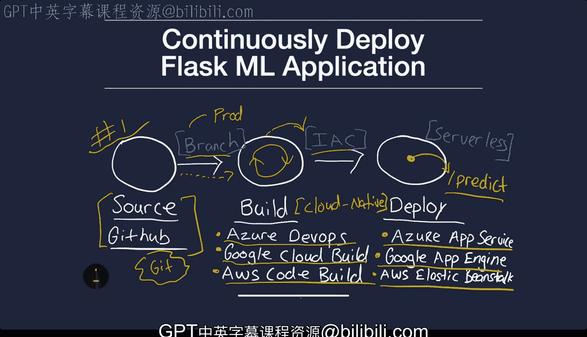

构建大规模云计算解决方案（数据工程、机器学习）：3-4：持续部署Flask机器学习应用

在本节课中，我们将学习如何为基于Flask的机器学习服务，在任何云平台上设置一个持续部署流水线。我们将了解从源代码管理到自动化构建、基础设施配置，再到最终部署的完整流程。

---

### 核心概念与流程概述

设置持续部署流水线的核心概念涉及几个关键组件。以下是实现这一目标的主要步骤。

**持续部署流水线核心流程**：
1.  **源代码**：存储在如GitHub、GitLab或云服务商托管的Git仓库中。
2.  **分支事件**：对特定分支（如`master`、`staging`或`production`）的代码推送会触发构建系统。
3.  **构建系统**：执行指令，如检查代码语法、运行基础测试，并触发基础设施即代码流程。
4.  **基础设施即代码**：使用工具（如Terraform、AWS CloudFormation或云服务商的YAML文件）配置远程部署环境。
5.  **云原生构建服务**：由云平台提供的专门构建服务（如Azure DevOps、Google Cloud Build、AWS CodeBuild）负责监听事件并执行构建与部署。
6.  **部署目标**：将应用部署到无服务器环境（如Azure App Services、Google App Engine、AWS Elastic Beanstalk）以提供预测服务。
7.  **部署后验证**：通过调用预测函数等方式验证服务是否正常运行。

---

### 详细步骤解析

上一节我们概述了持续部署的核心流程，本节中我们来详细看看每个步骤的具体内容。

#### 1. 源代码管理

一切始于源代码。你的Flask机器学习应用代码需要存储在一个版本控制系统中。

**常见的代码仓库选项**：
*   **GitHub**：一个非常普遍的公共或私有代码托管平台。
*   **GitLab**：另一个流行的自托管或云托管Git平台。
*   **云服务商原生托管服务**：例如AWS CodeCommit、Azure Repos或Google Cloud Source Repositories。

#### 2. 触发构建的事件

构建过程由源代码仓库中的特定事件触发。通常，这是对某个分支的代码推送（`push`）事件。

例如，当你向`production`分支推送新的代码更改时，这个事件就会启动后续的自动化流程。

#### 3. 构建系统与指令

事件触发后，构建系统开始工作。该系统内部预设了一系列指令。

**构建指令通常包括**：
*   **链接代码**：`link my code`
*   **语法检查**：确保代码没有语法错误。
*   **运行基础测试**：执行一些基本的单元或集成测试。
*   **触发基础设施即代码**：在测试通过后，自动调用基础设施配置工具。

#### 4. 基础设施即代码

这是自动化部署的关键环节。它使用代码来定义和管理云基础设施。

**常用工具示例**：
*   **Terraform**：`terraform apply`
*   **AWS CloudFormation**：`aws cloudformation deploy`
*   **云服务商特定的YAML/JSON配置**：例如用于Google Cloud Deployment Manager或Azure Resource Manager的模板。

这个步骤负责自动配置好运行Flask应用所需的远程服务器、网络、安全组等资源。

#### 5. 云原生构建服务

构建和部署任务通常由云平台自身提供的“云原生”构建服务来执行。它们专为各自平台优化，能无缝集成。

**各平台服务示例**：
*   **Microsoft Azure**：Azure DevOps Pipelines
*   **Google Cloud**：Google Cloud Build
*   **Amazon Web Services**：AWS CodeBuild

这些服务扮演中间人的角色，监听源代码控制事件，并协调执行构建、测试和基础设施部署的整个链条。

#### 6. 部署目标环境

当基础设施准备就绪且代码构建完成后，应用就会被部署到目标环境。对于Flask机器学习应用，通常选择无服务器环境，以简化运维。

**可用的无服务器选项**：
*   **Azure App Services**
*   **Google App Engine**
*   **AWS Elastic Beanstalk**

这些平台的共同点是，它们都能托管Flask应用，并且大部分底层基础设施管理由云平台负责，开发者只需关注应用代码。尽管名称不同，但其用于部署基于Flask的机器学习服务的产品概念非常相似。

#### 7. 部署后验证

部署完成后，进行验证至关重要。这可以是一个自动化步骤。

**常见的验证方法**：
*   配置一个**部署后动作**，自动调用应用的预测端点（例如`/predict`）。
*   验证服务是否返回了正确的预测结果，确保新部署的应用按预期工作。

---

### 流程的持续运行

整个流程是自动化和持续的。每次对源代码（无论是应用逻辑还是更新的机器学习模型）进行更改并推送到配置好的分支时，这个流水线就会自动触发。

**流程简化表示**：
`代码推送 -> 触发构建 -> 执行测试 -> 配置基础设施 -> 部署应用 -> 验证服务`

例如，一天内可能向生产环境推送五次更新。每次推送都会自动触发上述流程，实现应用的持续部署和更新。

---

### 总结

本节课中我们一起学习了为Flask机器学习应用设置持续部署流水线的完整过程。我们从**源代码管理**开始，探讨了如何通过**分支事件**触发**构建系统**，进而利用**基础设施即代码**工具自动化配置环境，并通过**云原生构建服务**执行部署，最终将应用发布到**无服务器部署目标**，并通过**部署后验证**确保服务可用。掌握这个流程，你可以实现机器学习模型的快速、可靠且自动化的迭代与发布。