#  099：AWS App Runner 高级PaaS持续交付 🚀

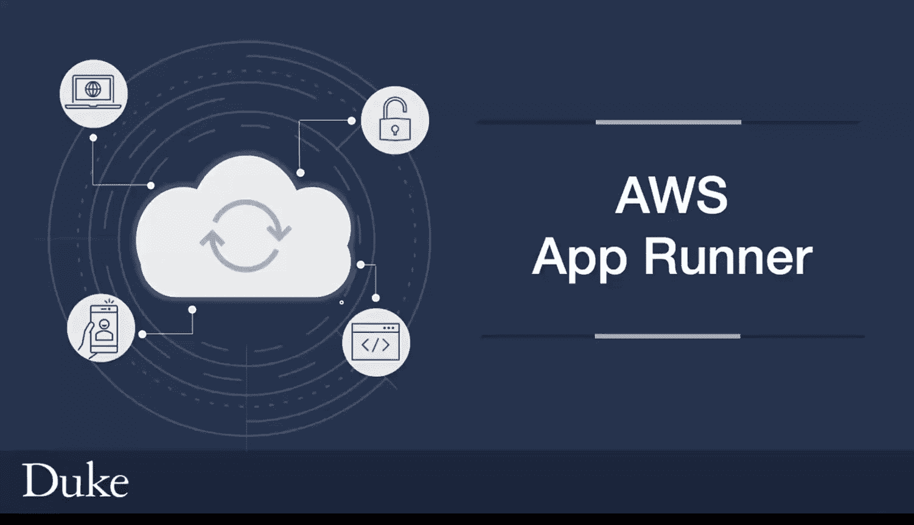

在本节课中，我们将学习如何使用 AWS App Runner 这一高级平台即服务（PaaS）来部署应用程序，并实现持续交付。我们将从创建一个简单的微服务开始，逐步过渡到部署一个机器学习应用，并演示如何利用其自动化功能。

## 概述

AWS App Runner 允许您快速构建、部署和扩展 Web 应用程序及 API。它简化了从源代码或容器镜像到生产就绪服务的流程，并集成了自动扩缩、健康检查和持续交付等关键功能。本节我们将通过两个具体示例来掌握其核心用法。

## 什么是 AWS App Runner？ 🤔

AWS App Runner 提供了一个简化的部署流程。首先，您需要添加一个源。您可以选择 GitHub 代码仓库，也可以选择一个容器镜像作为应用程序的源。接着，您可以配置构建和服务设置。您可以配置容器的 CPU 数量、内存大小、自动扩缩选项以及健康检查。最后，您可以复核所有设置是否正确。其优势在于，最终您会获得一个安全的 URL。例如，如果您想构建微服务或进行 MLOps，这是一种将应用程序部署到生产环境的强大新方法。

## 创建并部署第一个微服务 💰

上一节我们介绍了 AWS App Runner 的基本概念，本节中我们来看看如何实际操作。我们将从一个简单的“找零钱”微服务开始。

首先，我们登录 AWS 控制台并进入 App Runner 服务。可以看到已经有两个正在运行的服务。第一个服务名为 “CAAS”。访问其 URL，可以看到一个正在运行的应用程序。页面上提示，如果想进行更改，可以访问特定的路由。

为了演示，我们在浏览器中访问该路由并添加 URL 参数。例如，输入金额 `1` 美元 `34` 美分，应用程序会返回正确的找零组合。我们再测试另一个金额，如 `39` 美分和 `11` 美元，它会返回相应的硬币组合。这表明该微服务功能完整且可交互。

点击该服务，可以查看更多信息，包括默认域名和源代码链接。查看源代码，发现这是一个之前用于 Elastic Beanstalk 和 Fargate 的 Flask 应用。其核心逻辑是计算找零，代码非常简洁。

以下是该 Flask 应用的核心代码结构：
```python
from flask import Flask
app = Flask(__name__)

@app.route(‘/‘)
def hello_world():
    return ‘Hello, World!‘

@app.route(‘/change‘)
def make_change():
    # 计算找零的逻辑
    pass

if __name__ == ‘__main__‘:
    app.run(host=‘0.0.0.0‘, port=8080)
```

该应用运行在 8080 端口。接下来，我们将以类似的方式部署一个新服务。

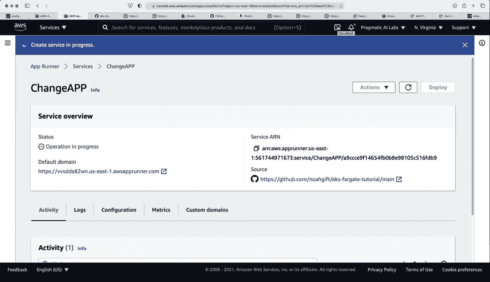

## 通过控制台部署新服务 🛠️

回到 App Runner 控制台，点击“创建服务”。在源和部署设置中，有两个主要选项：
1.  **容器注册表**：可以选择私有或公共的 Amazon ECR 镜像。
2.  **源代码仓库**：可以直接连接 GitHub 等仓库。

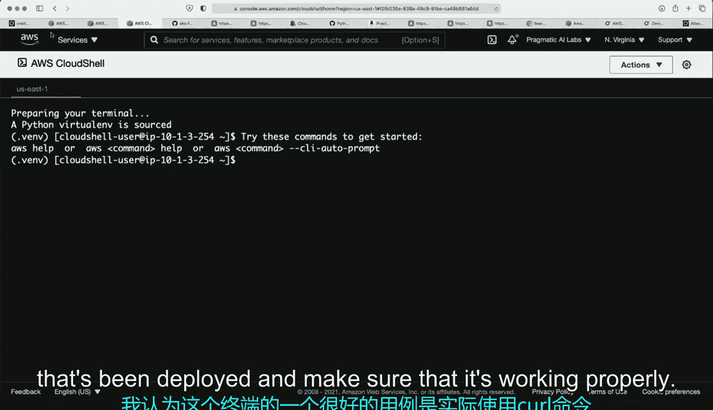

我们选择“源代码仓库”，并连接 GitHub 账户。我们搜索并选择一个名为 “EKS Fargate tutorial” 的仓库进行部署。

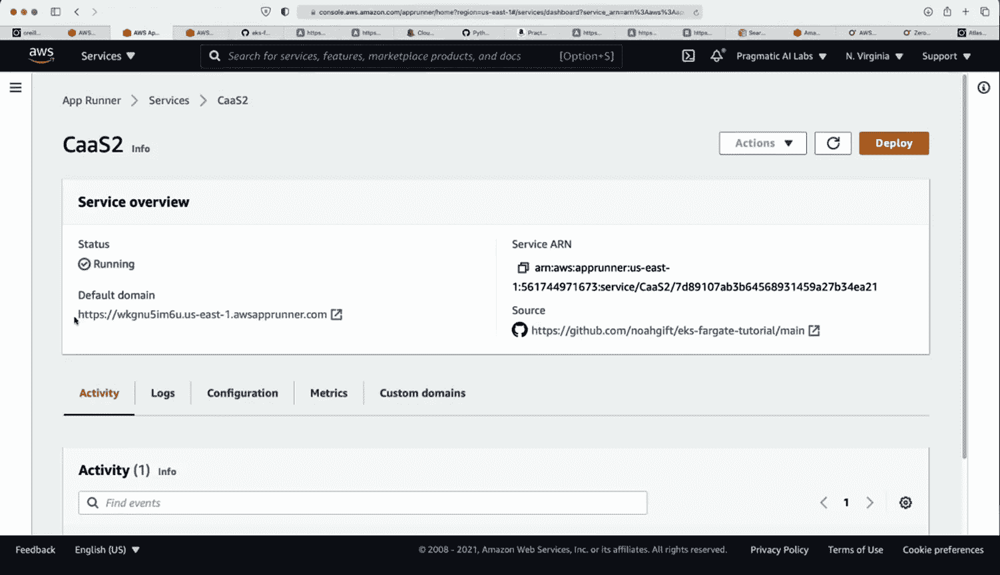

部署方式有两种：
*   **手动**：通过控制台或命令行工具触发部署。
*   **自动**：代码仓库发生变更时自动触发部署。

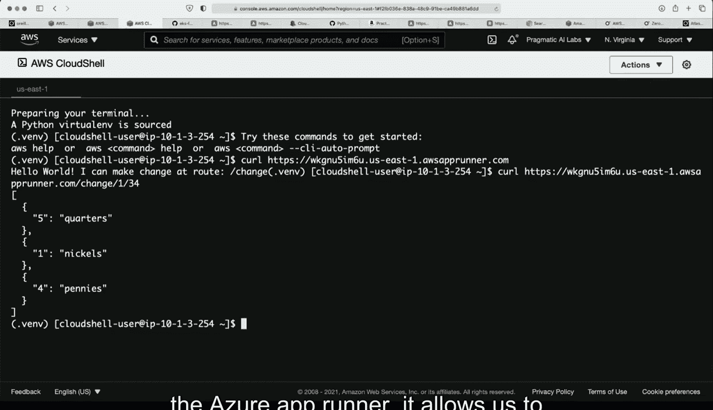

我们选择“自动”部署以体验持续交付。接下来，我们可以选择在构建服务器中配置所有设置，或使用配置文件。对于成熟项目，使用 `YAML` 文件是更好的选择。但本次演示我们选择在控制台中手动配置。

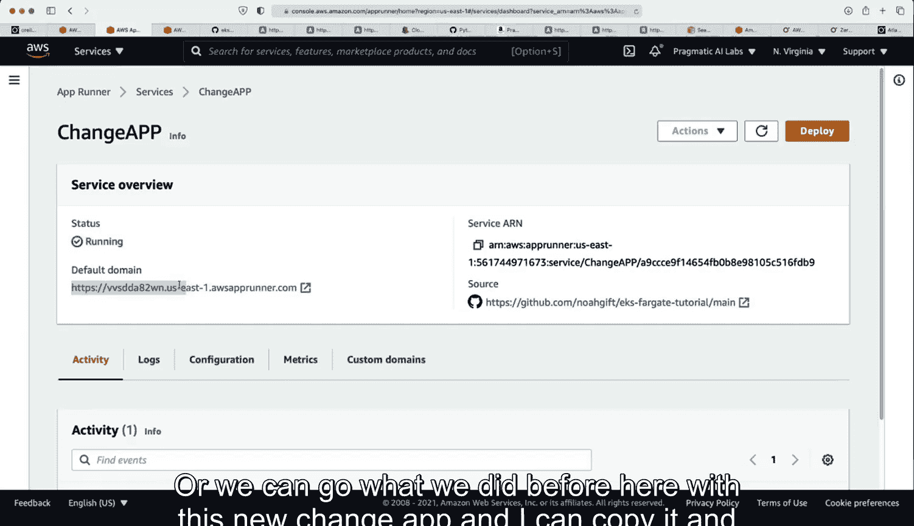

我们选择 Python 3 作为运行时。然后需要指定构建命令和启动命令。根据仓库中的 `Makefile`，构建命令是安装依赖：
```
pip install -r requirements.txt
```
启动命令是运行 Flask 应用：
```
python app.py
```
端口设置为 `8080`，与代码中一致。

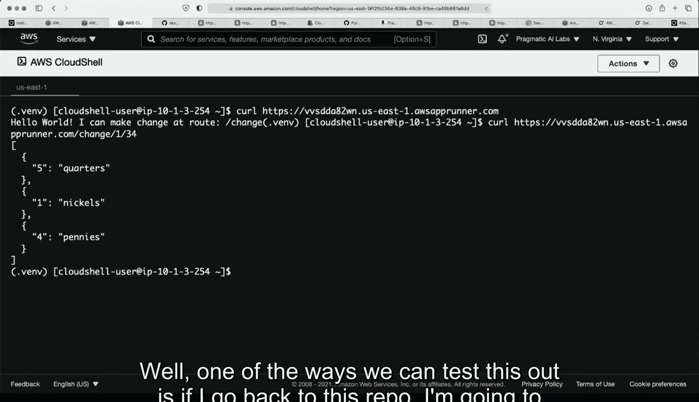

接下来，我们命名服务为 “change-app”。在配置页面，我们可以设置更高的计算规格（如果需要更多内存）、环境变量（用于连接数据库等）、自动扩缩能力（例如，处理最多 100 个并发请求，并可扩展到 25 个实例，总计 2500 个并发请求）。还可以配置健康检查路径和关联 IAM 角色以实现安全访问。

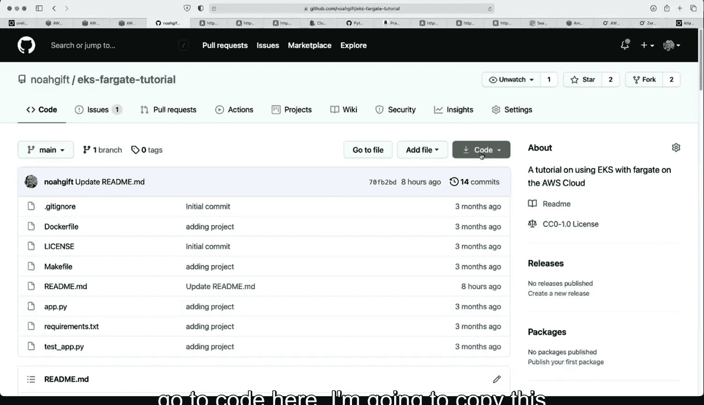

我们暂时保留所有默认设置。检查所有配置无误后，点击“创建并部署”。部署过程大约需要五分钟。在此期间，我们可以查看部署日志，实时了解构建和部署的每一步状态，这比管理虚拟机要直观得多。

## 使用 AWS CloudShell 进行测试 ☁️

在服务部署的同时，我们可以使用 AWS CloudShell 来测试现有服务。CloudShell 是一个浏览器内的命令行工具，可以直接在 AWS 环境中操作，非常适合测试和触发部署。

打开 CloudShell 后，我们可以用它来 `curl` 已部署的应用端点。复制之前运行的 “CAAS” 服务的 URL，在 CloudShell 中执行：
```
curl <服务URL>/change?dollar=1&cents=34
```
这将调用微服务并返回找零结果，验证了服务运行正常。结合 CloudShell 和 App Runner，我们能快速验证应用功能。

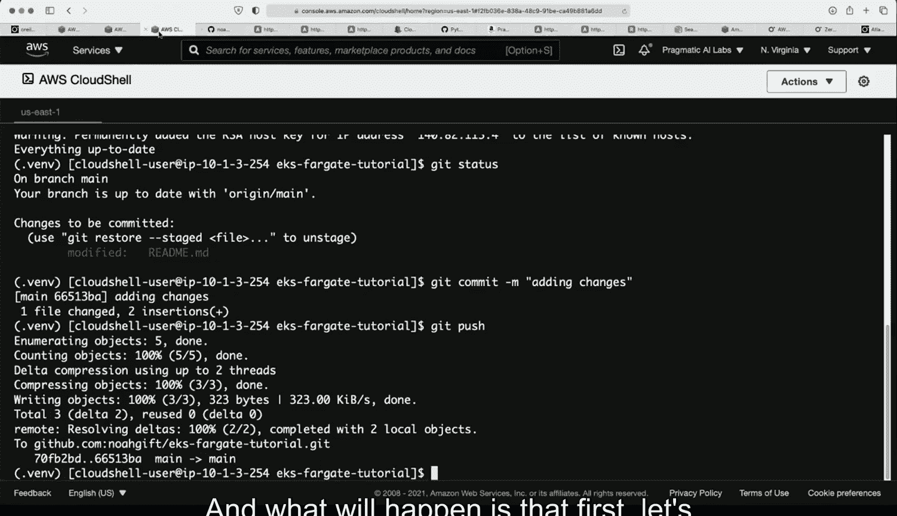

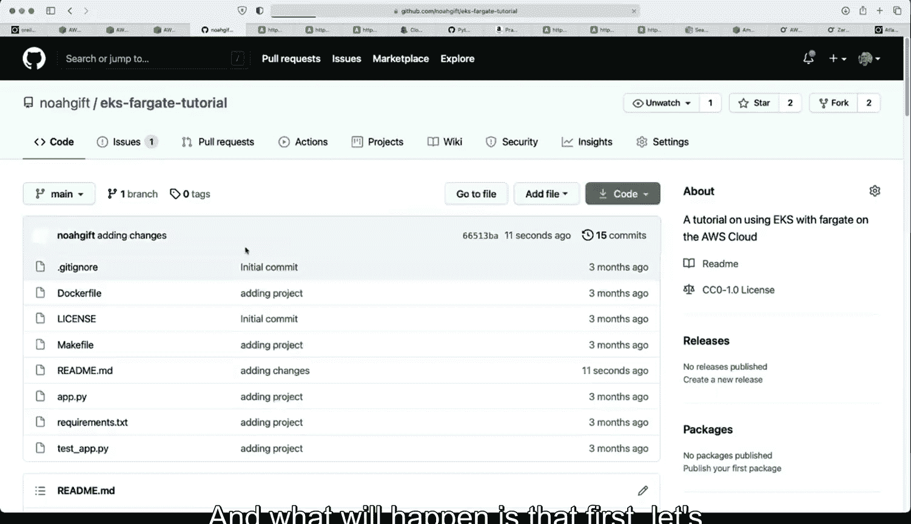

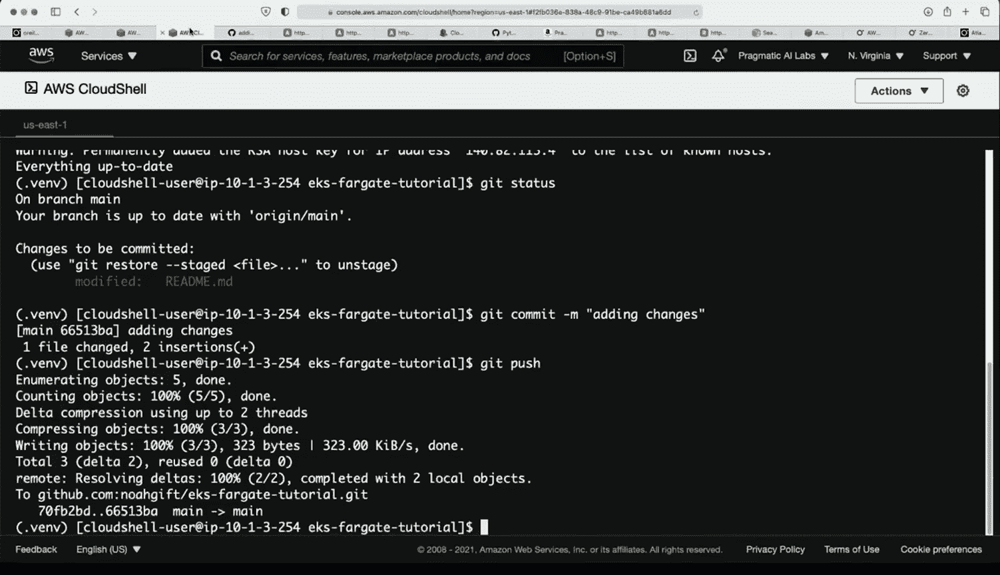

## 验证持续交付流程 🔄

现在，让我们测试自动持续交付是否生效。回到我们正在部署的 “change-app” 服务，它配置为监听 GitHub 仓库的变更。

首先，在 CloudShell 中克隆该 GitHub 仓库：
```
git clone <仓库SSH地址>
cd <仓库目录>
```
然后，我们做一个简单的更改，例如修改 `README.md` 文件，添加一条注释。使用 `vim` 编辑文件，保存后提交更改：
```
git add README.md
git commit -m “添加部署验证注释”
git push origin main
```
代码推送到 GitHub 后，我们回到 App Runner 控制台。观察 “change-app” 的服务详情，可以看到它立即触发了新的部署操作。这表明持续交付管道工作正常，代码提交后能自动部署到生产环境。

## 部署机器学习应用 🤖

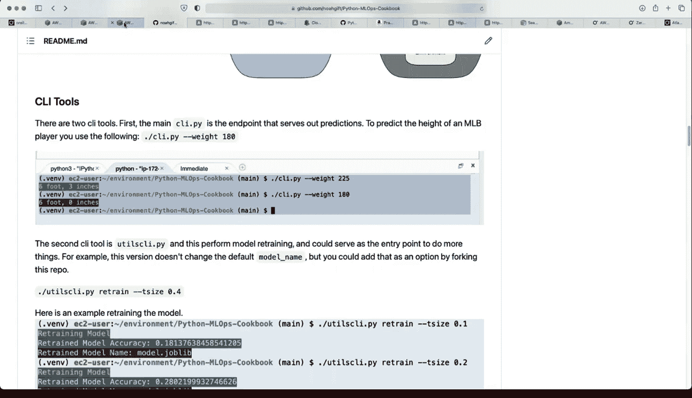

前面我们部署了一个简单的微服务，现在让我们看一个更复杂的例子：部署一个机器学习应用。我们将使用一个来自 *Practical MLOps* 书籍的示例项目。

该项目结构包含一个 Flask 应用、一个预训练的机器学习模型、一个用于测试的命令行工具以及依赖文件。核心应用 `app.py` 同样包含一个 “hello world” 路由和一个预测路由。预测路由调用一个库，根据输入的体重预测身高（基于 MLB 球员数据）。

以下是预测路由的简化逻辑：
```python
@app.route(‘/predict‘, methods=[‘POST‘])
def predict():
    weight = request.json[‘weight‘]
    # 使用加载的模型进行预测
    height = model.predict([[weight]])
    return jsonify({‘height‘: height})
```

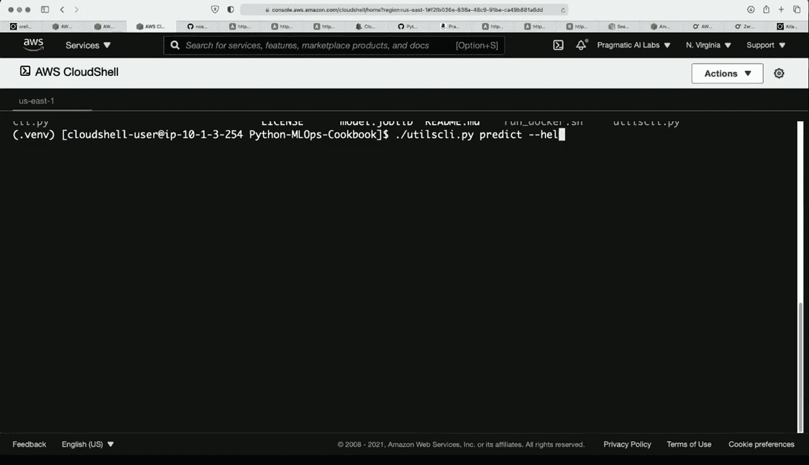

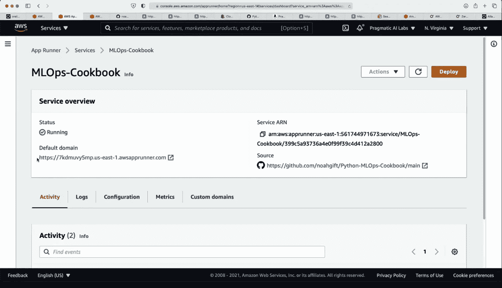

我们可以先在本地测试这个应用。使用项目提供的命令行工具，可以指定生产环境的端点进行预测测试。例如：
```
python cli.py predict --host <已部署的URL>/predict --weight 300
```
这将向生产环境发送请求，并返回预测的身高值。

## 部署 MLOps 应用到 App Runner 📦

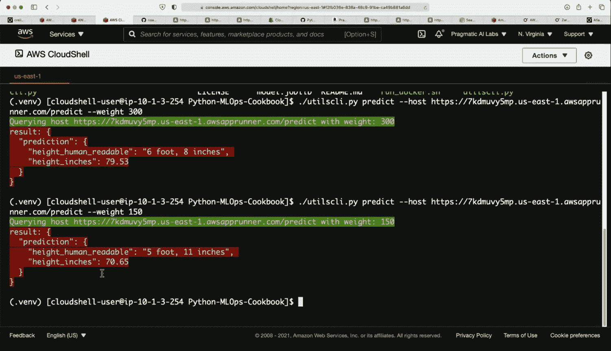

现在，我们将这个机器学习应用部署到 App Runner。步骤与之前类似：
1.  在 App Runner 控制台创建新服务。
2.  选择源代码仓库，找到 “Python MLOps Cookbook” 项目。
3.  选择“手动”部署（本次演示）。
4.  运行时选择 Python 3。
5.  构建命令：`pip install -r requirements.txt`
6.  启动命令：`python app.py`
7.  端口：`8080`
8.  将服务命名为 “mlops-demo”。

创建服务后，App Runner 将开始构建和部署。同样，我们可以在日志中观察进度。部署完成后，我们将获得一个新的安全 URL。我们可以使用之前提到的命令行工具，将 `--host` 参数指向这个新 URL，来测试生产环境的机器学习预测功能。

## 总结 🎯

本节课中我们一起学习了 AWS App Runner 的核心功能。我们首先了解了它作为一款 PaaS 服务如何简化从源代码到生产部署的流程。接着，我们动手部署了一个简单的找零钱微服务，并配置了自动持续交付，实现了代码变更自动部署。最后，我们将一个真实的机器学习应用部署到生产环境，并验证了其预测功能。

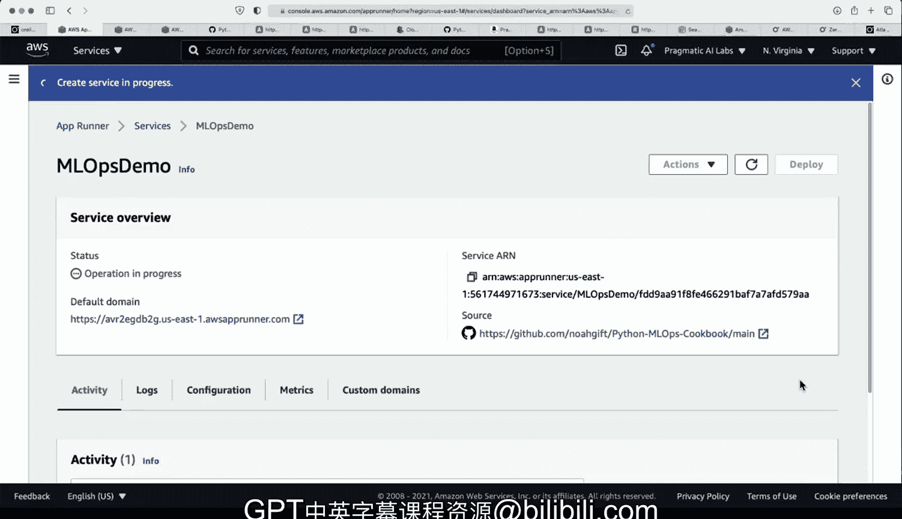


AWS App Runner 的核心优势在于其**简单性**和**自动化**。它抽象了底层基础设施的管理，让开发者能专注于代码。通过集成 GitHub 和容器仓库，它实现了强大的持续交付和持续部署（CI/CD）能力，是构建微服务和进行 MLOps 的理想选择。