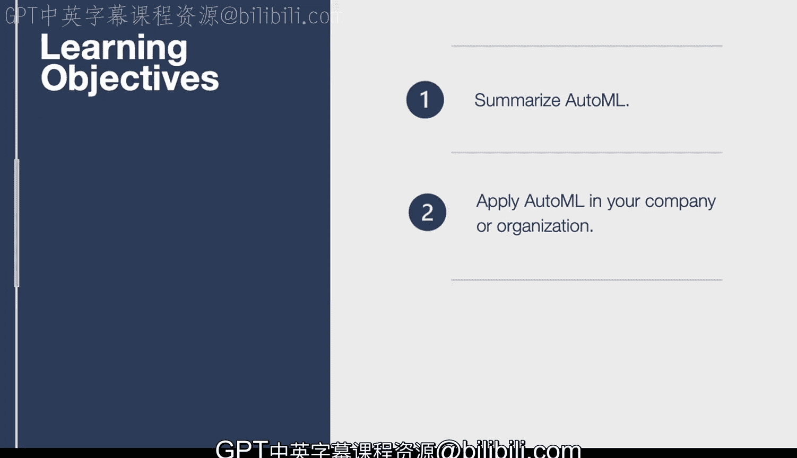

#  100：自动机器学习简介 🚀

在本节课中，我们将深入探讨自动机器学习的核心概念、其带来的变革以及最佳实践。我们将了解什么是真正的AutoML，以及它如何影响未来的机器学习领域。

---

## 什么是AutoML？🤖

上一节我们介绍了课程概述，本节中我们来看看AutoML的定义。AutoML，即自动机器学习，是一项新兴技术。它旨在将机器学习流程中的许多步骤自动化。

在技术发展史上，存在一个普遍规律：当某项技术被广泛讨论时，它通常最终会走向自动化。我们可以称之为“自动化定律”。因此，既然我们有了名为AutoML的技术，它无疑将在未来的机器学习领域扮演重要角色。

---

## AutoML的核心目标与价值 💡

了解了AutoML的基本定义后，本节我们将探讨其核心目标与带来的价值。AutoML的主要目标是降低机器学习的应用门槛，让数据科学家和工程师能更专注于问题本身，而非繁琐的流程。

以下是AutoML旨在实现的关键转变：

*   **自动化模型选择**：系统自动尝试多种算法，寻找最适合给定数据集和任务的模型。
*   **自动化特征工程**：自动进行特征创建、选择和转换，以提升模型性能。
*   **自动化超参数调优**：自动搜索模型的最佳参数设置，无需手动反复试验。
*   **简化端到端流程**：将数据预处理、建模、评估和部署等多个步骤整合到一个自动化流水线中。

---

## AutoML最佳实践与应用 🛠️

在理解了AutoML的能力之后，本节我们将关注如何有效地应用它。为了在项目中成功应用AutoML，遵循一些最佳实践至关重要。

以下是在公司或项目中应用AutoML时需要考虑的关键点：

*   **明确问题与数据**：AutoML不是万能药。清晰定义业务问题和理解数据特性是成功的前提。
*   **设定合理的评估指标**：根据业务目标选择合适的评估标准（如准确率、精确率、召回率、AUC等），以指导AutoML的优化方向。
*   **理解自动化流程**：虽然过程自动化了，但使用者仍需理解AutoML工具做出的关键决策（如选择了哪种模型、为何进行某些特征转换），以确保结果的可解释性和可靠性。
*   **迭代与验证**：将AutoML视为一个强大的起点，而非终点。对其输出的模型进行仔细验证，并在必要时进行人工调整和迭代。
*   **集成到现有工作流**：规划如何将AutoML流程与公司现有的数据基础设施、模型部署和监控系统相结合。

---

## 总结 📝

本节课中我们一起学习了自动机器学习的基础知识。我们首先定义了AutoML，并探讨了其作为一项遵循“自动化定律”的新兴技术的重要性。接着，我们详细分析了AutoML旨在实现的核心自动化环节，包括模型选择、特征工程和超参数调优。最后，我们讨论了在公司中应用AutoML的最佳实践，强调明确问题、理解流程和持续验证的重要性。掌握AutoML将帮助您更高效地构建和部署机器学习解决方案。