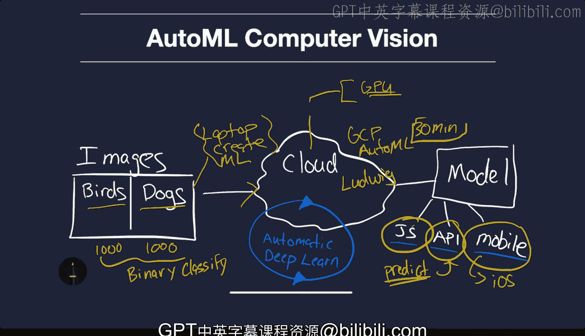

构建大规模云计算解决方案（数据工程、机器学习）：3-4：自动机器学习计算机视觉

在本节课中，我们将学习自动机器学习（AutoML）计算机视觉流水线，并了解如何利用它来构建可用于生产环境的模型。

自动机器学习（AutoML）旨在自动化机器学习模型构建过程中的关键步骤，例如特征工程、模型选择和超参数调优。对于计算机视觉任务，AutoML可以简化从原始图像数据到部署模型的整个流程，使非专家也能构建高质量的模型。

上一节我们介绍了AutoML的基本概念，本节中我们来看看一个具体的计算机视觉应用实例：构建一个区分鸟类和狗类的图像分类器。

### 数据准备与上传

首先，你需要准备源数据。例如，你可能拥有1000张鸟类的图片和1000张狗类的图片。你的目标是训练一个能够进行二元分类的机器学习模型。该模型的功能是：给定一张图片，判断它是鸟还是狗。

准备好数据后，你可以将其上传到一个基于云的环境中进行处理。以下是几种可能的环境选择：

*   **云端服务**：例如谷歌云平台的AutoML Vision。
*   **开源解决方案**：例如Ludwig，它是一个支持自动计算机视觉的AutoML工具。
*   **本地设备**：甚至可以在你的笔记本电脑上运行，例如使用苹果公司的Core ML（CML）框架，它也能实现AutoML功能。

核心思想是，你只需要提供原始数据，并指定你想要完成的模型任务（在本例中是分类鸟和狗），然后选择“训练”即可。系统将自动开始训练过程。

### 模型训练过程

选择“训练”后，系统将开始运行。训练所需的时间取决于数据量和模型复杂度。在云端训练时，可能会涉及一些特定配置：

*   系统可能会自动使用**GPU**来加速训练，或在固定时间内尽可能提升模型精度。
*   在后台，系统可能会自动尝试和选择多种不同类型的模型架构。

整个过程的核心特点是**“无接触”自动化**。不需要数据科学家手动调整神经网络结构或超参数，其易用性类似于使用Excel。

### 模型部署与应用

假设模型训练完成（例如，耗时30分钟），接下来就是部署阶段。根据所使用的AutoML技术框架，部署方式有多种：

以下是几种常见的部署方式：

*   **下载模型文件**：例如，使用谷歌AutoML时，你可以下载一个`.tflite`或适用于移动端的模型文件。
*   **云端API服务**：模型可以托管在云端，通过API接口直接提供预测服务。
*   **集成到移动应用**：例如，可以将模型集成到iOS应用程序中，在设备端进行实时预测。

目前，AutoML技术，尤其是在计算机视觉这类已较为成熟的问题上，已经发展到更侧重于业务逻辑实现的阶段。只要你明确要解决的业务问题，就可以利用AutoML解决方案自动训练模型，并且随着新数据的获取，持续自动地更新和优化模型。

本节课中我们一起学习了AutoML计算机视觉流水线的完整流程，从数据准备、自动化训练到模型部署。关键在于，AutoML降低了机器学习的应用门槛，让开发者能够更专注于业务逻辑而非复杂的模型调优细节。