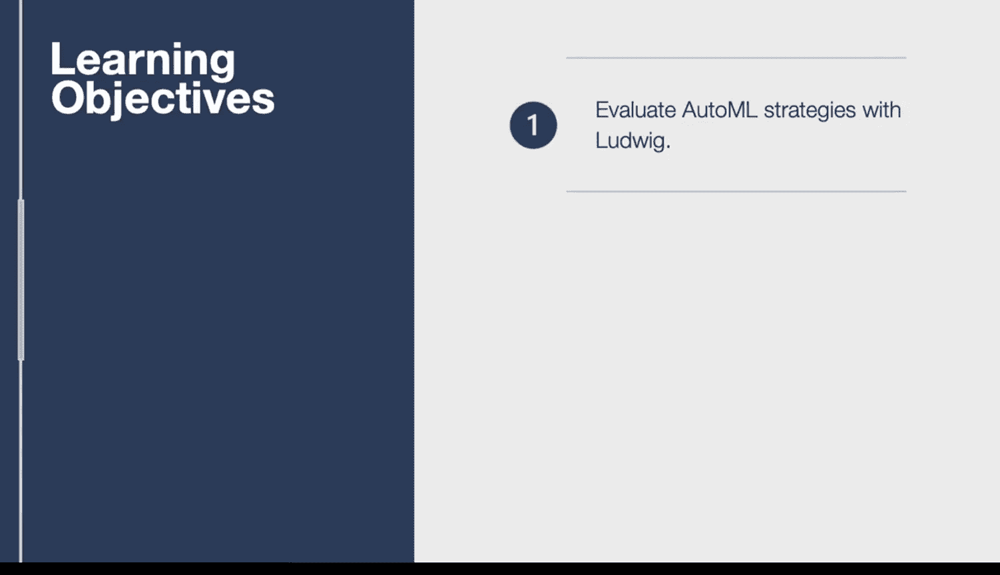

#  107：Ludwig自动机器学习简介 🚀

在本节课中，我们将学习Ludwig，一个基于代码的开源自动机器学习系统。我们将探讨如何通过简单的配置文件来训练模型，而无需手动编写神经网络代码。


## 概述

Ludwig是一个开源的、基于代码的系统。使用Ludwig时，你无需编写神经网络本身，只需组合一个配置文件，然后告诉该配置文件数据的位置，即可训练一个机器学习模型。Ludwig有许多优点，你可以从GitHub下载它，也可以在我稍后分享的Colab笔记本中使用它。

接下来，我们来谈谈本课的学习目标。

## 学习目标

首先，我们将使用Ludwig评估自动机器学习策略，并讨论Ludwig能够处理的一些不同任务，包括文本和图像。总的来说，Ludwig拥有许多开源“配方”，这些配方同样只需一个配置文件即可进行训练。

让我们开始吧。

## 核心概念与启动

Ludwig的核心在于其声明式的配置方法。你通过一个YAML文件来定义模型的结构、输入特征和输出目标。例如，一个处理文本分类任务的基本配置文件可能如下所示：

```yaml
input_features:
  - name: review_text
    type: text
    encoder: bert

output_features:
  - name: sentiment
    type: category
```

这个配置文件定义了一个使用BERT编码器处理文本输入`review_text`，并预测分类`sentiment`的模型。

上一节我们介绍了Ludwig的基本理念，本节中我们来看看如何实际启动一个Ludwig项目。

## 使用步骤

以下是开始使用Ludwig的基本步骤：

1.  **安装Ludwig**：通过pip命令`pip install ludwig`进行安装。
2.  **准备数据**：将你的数据整理成CSV等Ludwig支持的格式。
3.  **创建配置文件**：编写一个YAML文件，定义模型架构。
4.  **训练模型**：使用`ludwig train`命令并指定配置文件和数据集路径来启动训练。
5.  **评估与预测**：使用训练好的模型在新数据上进行预测或评估性能。



## 总结


本节课中，我们一起学习了Ludwig自动机器学习工具。我们了解到Ludwig通过配置文件简化了模型构建流程，支持文本、图像等多种数据类型，并提供了丰富的预置“配方”。这使得初学者和专家都能快速构建和实验机器学习模型。