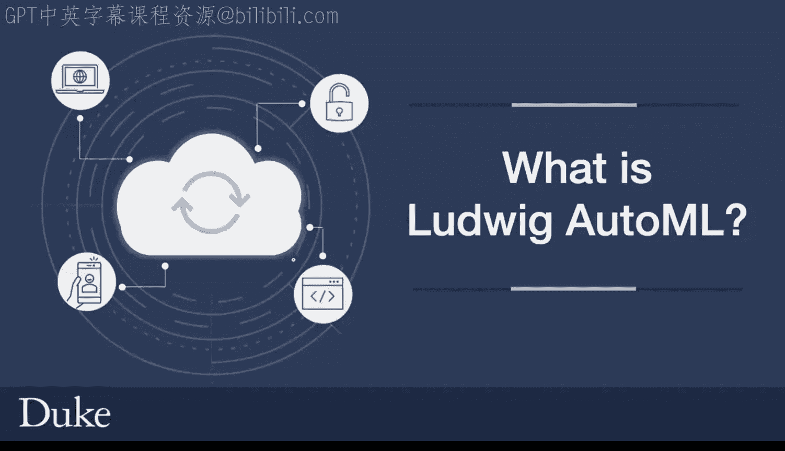

#  108：什么是Ludwig自动机器学习 🧠

在本节课中，我们将学习一个名为Ludwig的开源工具。它允许你在不了解机器学习全部细节（例如神经网络架构或代码操作）的情况下训练模型。你只需要准备好数据和配置文件即可。

## 什么是Ludwig？ 🤔

Ludwig是一个开源工具，它让你无需了解机器学习的全部细节（例如神经网络架构或具体的代码操作）就能训练模型。本质上，你只需要一个配置文件和你的数据，就可以使用Ludwig。

具体来说，Ludwig支持多种数据类型，包括：
*   **二进制类型**
*   **分类**
*   **数值**
*   **集合**
*   **序列**

这些是你可以使用的部分可用数据类型。其核心思想是，将你的数据和一个YAML配置文件放在一起，然后运行一个脚本，这就是训练机器学习模型的完整流程。

## Ludwig的优势 ⚖️

上一节我们介绍了Ludwig的基本概念，本节中我们来看看它相较于专有系统的优势。

以下是Ludwig对比专有系统的主要优点：
*   你**无需**为可能收取高额费用的云端API付费。
*   你可以在本地机器上完成所有操作。
*   如果你能使用GPU，你还可以根据自身特定需求，获得高性能的开源自动机器学习体验。

---

本节课中我们一起学习了Ludwig自动机器学习工具。我们了解到它是一个通过配置文件和数据进行模型训练的开源框架，支持多种数据类型，并且具有成本低、灵活性高的优势。