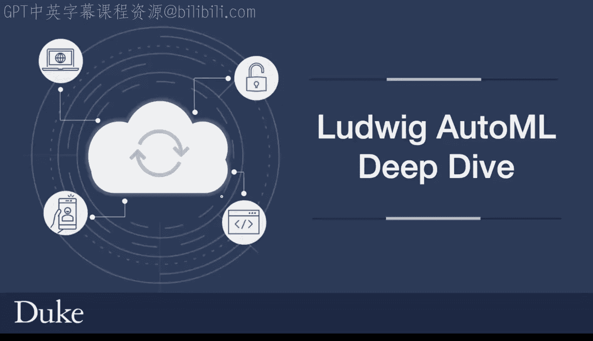
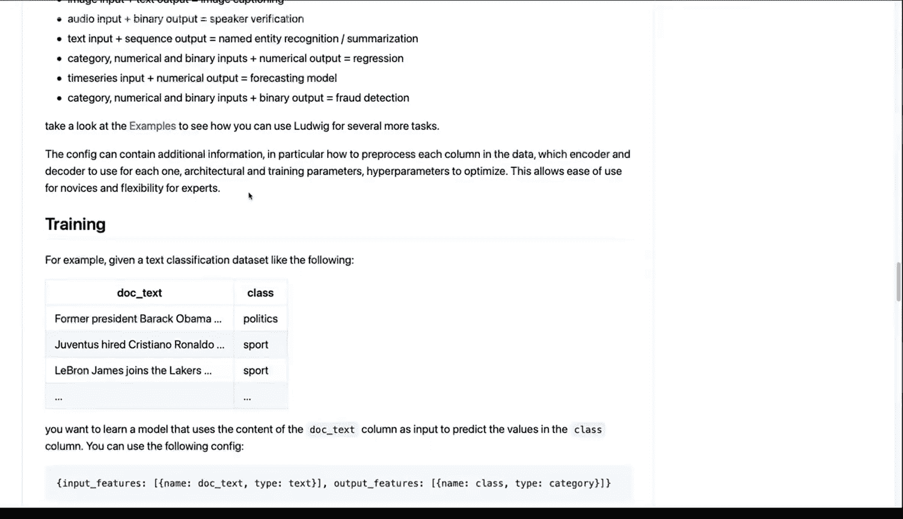
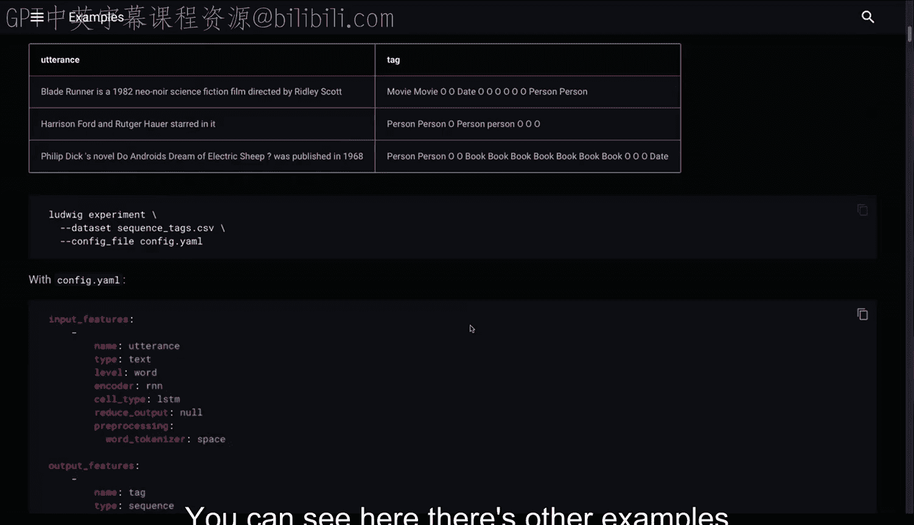
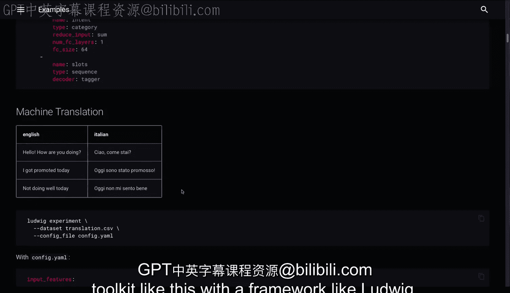

构建大规模云计算解决方案（数据工程、机器学习）：3-4：Ludwig自动机器学习深入解析

在本节课中，我们将要学习一个名为Ludwig的自动机器学习工具箱。我们将了解它是什么、它的核心优势以及如何通过简单的配置来训练深度学习模型，而无需编写复杂的代码。

## 什么是Ludwig？🧰

Ludwig是一个工具箱，它允许用户在不编写代码的情况下训练和测试深度学习模型。它最初由Uber公司开发，构建在TensorFlow之上。

## Ludwig的核心优势与用例 🎯

Ludwig支持多种不同的使用场景。为了更直观地理解，我们可以查看其示例目录。以下是Ludwig能够处理的一些任务示例：

*   **文本分类**：此任务接收一段文本，并判断文本的主题。例如，判断文本是关于盈利、收购还是咖啡。
*   **自然语言理解**：处理更复杂的语言理解任务。
*   **机器翻译**：例如，将文本从英语翻译成意大利语。

这些任务都可以在你的本地笔记本电脑或云计算环境中运行，无需为外部API付费。使用像Ludwig这样的开源工具包框架具有巨大优势。

## 如何使用Ludwig构建模型？ ⚙️

Ludwig本质上是一个基于配置的自动机器学习框架。你不需要自己编写代码，只需通过配置文件说明模型的输入和期望的输出。

例如，对于一个文本分类任务，配置文件需要定义：
*   **输入特征**：指定输入数据的类型和编码方式。例如，`text`类型，使用`level`为`word`的编码器，并启用`parallel`处理。
*   **输出特征**：指定你希望模型完成的任务。例如，`category`类型，用于对文本进行分类。

构建模型时，你只需通过命令行工具传入数据集文件（输入文件）和这个配置文件。Ludwig会自动根据配置构建并训练模型。

## 总结 📝

本节课中我们一起学习了Ludwig自动机器学习工具箱。我们了解到Ludwig是一个基于配置、无需编码的深度学习框架，它支持文本分类、机器翻译等多种任务，并能本地运行以节省成本。其核心使用方式是：通过一个定义清晰的**配置文件**来指定输入特征和输出目标，然后使用命令行工具启动训练过程。