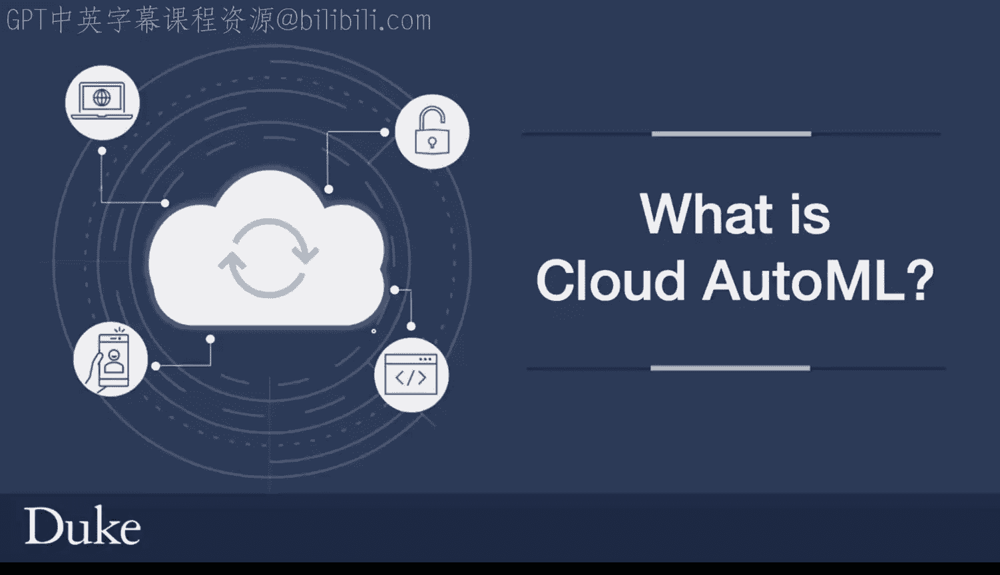

#  112：什么是云自动机器学习

在本节课中，我们将要学习云自动机器学习（AutoML）的概念。我们将探讨其定义、核心优势以及它在从全托管平台到预训练API的整个技术光谱中所处的位置。课程最后将总结云作为实现不同级别机器学习自动化的核心机制。

## 什么是云自动机器学习？

云自动机器学习是一种基于云的解决方案，旨在自动为机器学习算法寻找正确的参数值。这些算法可用于计算机视觉、文本分类或翻译等任务。

云自动机器学习的一个显著优势在于它提供了一个**梯度化**的选择范围。这意味着用户可以根据自身需求和技术水平，选择不同自动化程度的服务。

## 自动化程度的选择梯度

上一节我们介绍了云AutoML的梯度化特性，本节中我们来看看这个梯度上的具体选项。

以下是三个主要的自动化层级：

1.  **使用托管机器学习平台**：例如Amazon SageMaker。这类平台可以自动化机器学习的许多方面，如特征工程、模型选择和超参数调优。其核心是提供一个**集成环境**，简化从数据准备到模型部署的全流程。

2.  **使用预训练模型API**：这是自动化程度的另一个极端。用户无需训练模型，直接通过API调用云服务商提供的预训练模型（如视觉识别、自然语言处理API）。其交互方式通常类似于一个简单的函数调用：`result = call_API(input_data)`。

3.  **使用自动训练工具**：这是介于上述两者之间的中间地带。这类工具允许用户通过极简操作自动训练模型。例如，对于计算机视觉问题，用户只需将图像文件上传到云系统，然后**点击一个按钮**即可开始训练。训练完成后，可以下载最终模型，并将其部署到移动设备或物理硬件上。

## 模型部署与边缘计算

在中间地带自动训练出的模型，其最终价值在于部署和应用。一个常见的应用场景是将其部署到资源受限的边缘设备上。

以下是一些典型的边缘计算硬件示例：

*   **Coral TPU**：一种专用边缘计算设备，可在笔记本电脑、无人机等设备上进行基于边缘的机器学习推理。
*   **Intel Movidius神经计算棒**：类似U盘的设备，可将训练好的模型部署到物理硬件上，实现本地化智能处理。

很多时候，这些边缘设备体积小巧、功耗低，非常适合在物理世界中实时运行机器学习模型。

## 总结

本节课中我们一起学习了云自动机器学习。我们了解到，云AutoML的核心是提供一个从“自己动手”到“完全自动”的连续服务光谱。云作为关键机制，使用户能够灵活选择：使用全托管的机器学习平台、利用自动训练工具简化流程，或者直接调用预训练模型API。最终，训练好的模型可以便捷地部署到从云端到边缘设备的任何地方。