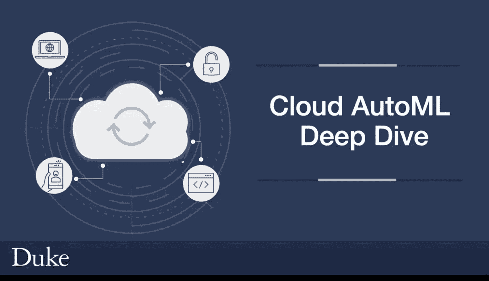
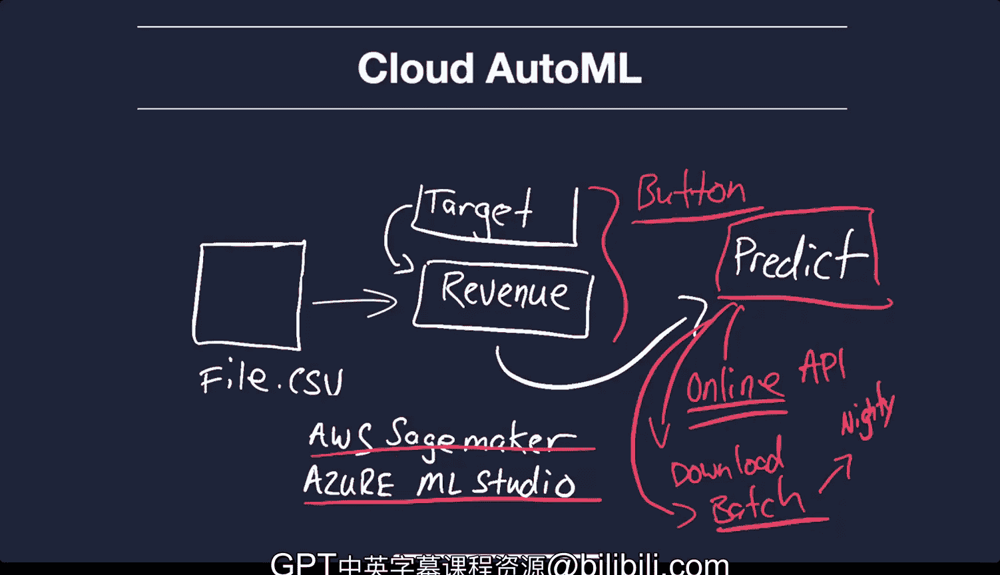

#  113：云自动机器学习深入解析 🚀

在本节课中，我们将深入解析典型的基于云的自动机器学习工作流程。我们将了解如何像使用电子表格一样，通过简单的点击操作，完成从数据准备到模型部署的整个过程。

---

## 典型工作流程概述

上一节我们介绍了自动机器学习的基本概念，本节中我们来看看一个具体的云端工作流程。所有云服务提供商现在都提供了类似的能力，让用户能够以处理电子表格的思维方式来操作。

假设你有一个CSV文件，其中包含许多不同的列。你的目标是根据一系列特征（例如销售的产品数量、购买时间或产品类型）来预测该文件中的“收入”列。

## 工作流程步骤详解

以下是完成此预测任务的核心步骤：

1.  **数据准备与目标指定**
    首先，你需要将数据导入平台，并指定“收入”列作为预测目标。

2.  **平台选择**
    接着，选择一个自动机器学习平台。例如，这可以是Azure ML Studio、Amazon SageMaker或Google的AutoML Tables。这些都是AutoML系统的实例。

3.  **启动训练**
    然后，点击平台上的启动按钮（我们暂且称之为“那个按钮”）。系统将自动开始训练过程。

4.  **获取预测结果**
    训练完成后，系统会生成预测结果。

## 模型部署与使用方式

模型训练好之后，你可以选择多种方式来使用它：

*   **在线实时预测**：将模型部署为云端的API服务，可供应用程序实时调用。
*   **模型下载**：将训练好的模型文件下载到本地环境使用。
*   **批量预测**：进行基于批处理的预测。例如，可以设置每晚自动对进入数据管道的特定产品进行收入预测。

---

## 核心总结

本节课中我们一起学习了云端自动机器学习的典型工作流程。**AutoML系统的核心在于机器学习的自动化**。它将机器学习中许多不直接创造价值的繁琐步骤自动化，最终呈现为一种“点击按钮”式的技术，极大地降低了使用门槛。