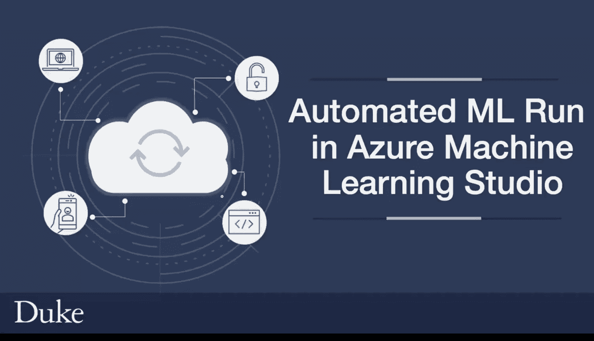
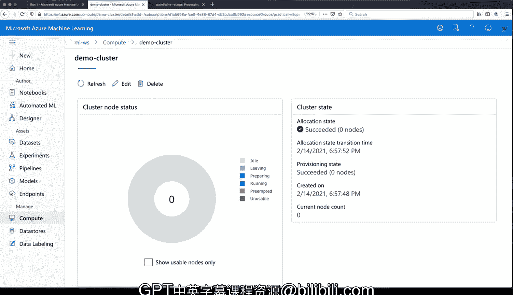

#  117：在Azure机器学习工作室中运行自动化机器学习

## 概述
在本节课中，我们将学习如何在Azure机器学习工作室中配置并启动一个自动化机器学习（AutoML）运行。我们将从选择数据集开始，配置计算集群，最终启动一个AutoML实验来训练模型。

---

## 选择数据集与启动AutoML运行

我们回到Azure机器学习工作室的主页。点击左侧导航栏的“自动化ML”部分，选择“新建自动化ML运行”。

之前我们已经创建并探索了几个数据集。现在，我们选择“Github dataset wine ratings”这个数据集。在数据准备阶段，我们已经删除了一些无用的列。点击该数据集，然后点击“下一步”。

现在，所有数据集信息已加载完毕。点击“下一步”后，界面会加载并展示如何配置此次运行的概览。

**总结来说**：我们启动了一个新的自动化ML运行，选择了所需的数据类型，将数据导入Azure，并筛选了重要的列，删除了无用的列。现在，我们准备配置此次运行。

我们已选中数据集“Github data wine ratings”。该数据集来源于一个公开的GitHub仓库原始URL。该仓库还附带了一个有用的Jupyter笔记本。

---

## 配置实验与目标

现在回到配置界面。我们需要为此次运行选择一个实验名称。为了清晰区分，我们创建一个新的实验，将其命名为“demo wine ratings”。

接下来，我们需要选择目标列。该数据集包含诸如名称、产区、品种、评分和品酒笔记等信息。我们知道“评分”这个字段很有用，因此选择“rating”作为我们的目标列。

---

## 配置计算集群

现在需要选择计算集群。点击“选择计算集群”后，我们发现当前没有可用的集群。我们需要创建一个。

你可以通过两种方式创建计算集群：
1.  在当前配置界面点击“创建新计算”。
2.  从左侧“管理”菜单进入“计算”部分。

为了避免中断当前的配置流程，我们选择打开一个新标签页来创建集群。在“计算”页面，有四种计算类型。对于自动化ML运行，我们需要的是“计算集群”。

如果你从配置界面点击“创建新计算”，系统会直接引导你到创建计算集群的页面。点击“新建”开始配置。

计算集群本质上是一台配置好的虚拟机。首先，你需要选择虚拟机优先级：“专用”或“低优先级”。我们稍后再讨论这个区别。

接着选择机器类型，例如偏好CPU还是GPU。目前选择CPU即可。然后选择虚拟机大小。

默认选择是“Standard_DS3_v2”（4核，14GB内存，28GB存储）。这是一个通用型配置，适用于经典的ML模型训练、自动化ML运行和管道运行等。

默认的专用优先级价格是每小时0.29美元。为了降低成本，我们可以考虑切换到“低优先级”。将优先级改为“低优先级”后，价格降至每小时0.07美元，这是一个显著的差异。

**那么，专用和低优先级的区别是什么？**
低优先级虚拟机更便宜，但不保证计算节点的可用性。你的作业可能会被抢占，这意味着作业可能需要等待更长时间才能被调度和执行。而专用优先级为你付费保留了节点的独占使用权，确保在你需要时节点已启动并准备就绪。

低优先级非常适合创建拥有强大节点但成本可控的集群。我们选择“低优先级”，每小时0.07美元的价格非常划算。

接下来配置集群详细信息：
*   **计算名称**：可以任意命名，例如“demo-cluster”。
*   **最小节点数**：建议设置为`0`。这可以避免在无作业运行时产生费用。集群会在需要时从0开始扩展。
*   **最大节点数**：这定义了集群可以弹性扩展的上限。你可以根据需求设置为2、3或5等。需要注意你的账户配额是否支持所需的核数。
*   **缩减前空闲秒数**：这个设置决定了节点在空闲多长时间后开始缩减到最小节点数。通常使用默认值即可。
*   **高级设置**：如启用SSH访问、配置虚拟网络或分配托管标识，这些属于高级设置，目前我们不需要配置。

点击“创建”。集群创建需要一些时间才能完成。

---

## 关联集群并完成配置

由于我们已经提前创建了一个名为“demo-cluster”的集群，现在可以回到自动化ML的配置界面。

在“选择计算集群”的下拉菜单中，现在可以看到“demo-cluster”可用。选中它，然后点击“下一步”。

现在进入自动化ML运行的任务类型配置。我们的目标是预测葡萄酒的“评分”，这是一个具体的数值，因此任务类型选择“回归”。这与预测分类（如是/否）的“分类”任务不同，也不同于“时序预测”。

确认所有配置无误后，点击“完成”。系统将开始创建并启动这个自动化ML运行。

运行创建后，并不会立即开始训练。你可以通过以下方式查看状态：
*   在“计算”页面查看“demo-cluster”，初始时可用节点数可能为`0`。
*   在“自动化ML运行”的详情页或“作业”页面，可以看到该运行的状态已变为“正在运行”或“已排队”。

当你启动运行后，计算集群会自动从最小节点数（我们设置为`0`）开始扩展，分配节点来执行训练任务。这个过程可能需要一些时间。

---

## 总结

本节课中，我们一起学习了在Azure机器学习工作室中运行自动化机器学习的完整流程：
1.  **启动与选数据**：从自动化ML界面启动新运行，并选择已准备好的数据集。
2.  **配置实验**：创建新实验并指定要预测的目标列。
3.  **配置计算资源**：核心步骤是创建并配置一个计算集群。我们重点理解了**专用**与**低优先级**虚拟机的区别（成本 vs. 可用性），并设置了集群的**最小节点数**（如`0`以节省成本）和**最大节点数**（以控制弹性扩展上限）。
4.  **启动运行**：将配置好的计算集群与AutoML运行关联，选择正确的任务类型（如回归），最终启动自动化模型训练过程。

通过以上步骤，你成功地将数据集、计算资源和机器学习任务关联起来，启动了自动化模型训练流程。