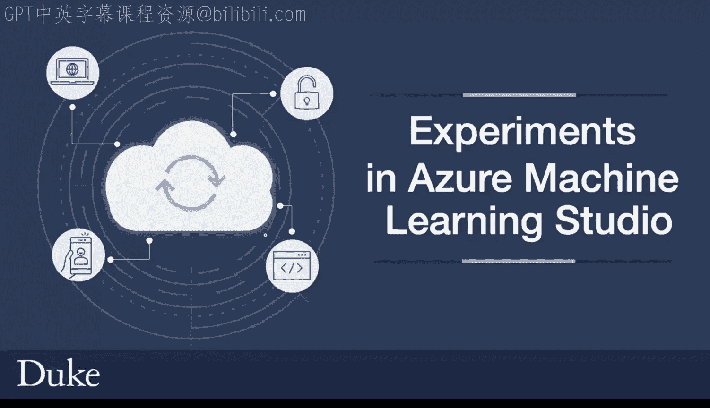
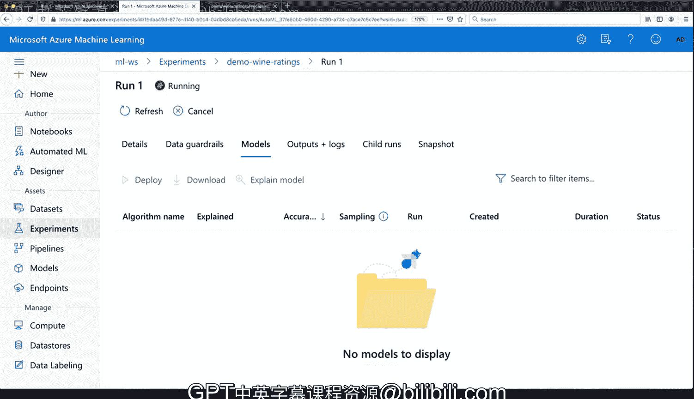

#  118：Azure机器学习工作室中的实验

在本节课中，我们将学习如何在Azure机器学习工作室中监控一个正在运行的自动化机器学习实验。我们将观察实验的运行状态、计算集群的准备过程，并了解实验仪表板如何提供实时反馈。

---

上一节我们介绍了如何启动一个自动化机器学习运行。本节中，我们来看看如何监控这个正在进行的实验。

我们回到了Azure机器学习工作室界面。我们已经选择了数据集，创建了计算集群，并且启动了自动化机器学习运行。

如果点击“主页”下的“我最近的资源”，可以看到运行仍在进行中。点击该运行，系统显示它仍在尝试将任务提交到计算集群。从启动到现在只过去了几分钟，因此整个过程需要一些时间。

运行所需的时间取决于多个因素：
*   数据集的大小和复杂度。
*   所选计算集群的类型。
*   集群中可用节点的数量。

我们之前选择了最经济的集群类型，并且节点需要被创建，这增加了运行所需的总时间。

---

现在，让我们检查计算集群的状态。回到“计算”部分，查看“计算集群”。可以看到名为“demo-cluster”的集群。目前有一个节点，其状态为“准备中”。这个准备过程需要时间。

这里就涉及到一个成本效益分析：如果你希望任务运行得超级快，就需要预先支付费用来保持一些节点处于运行状态，而不是像现在这样处于“准备中”的状态。

---

除了计算集群，我们还可以在“实验”部分查看运行详情。现在，“实验”列表中已经有了我们的“demo-wine-ratings”实验，其最新运行是“number two”。这里提供了一个类似仪表板的视图，展示了当前正在进行的活动。

以下是实验仪表板当前显示的信息：
*   我们有一个运行正在进行中。
*   关联的计算集群是“demo-cluster”。
*   系统提示有“不安全更改”，但这可能是界面显示问题，因为我们并未修改任何配置。

运行正在进行中，此处最终会显示训练出的模型。目前还没有模型出现，因为运行尚未完成。

---

如果点击运行，进入“详情”页面，可以看到更详细的状态信息。这里提供了近乎实时的后台进程日志，例如：
*   检查Docker镜像。
*   准备作业。
*   在集群模式下准备作业。

这些日志让你能清晰地了解幕后发生的所有事情。在“数据转换”和“模型”标签页下，目前还没有内容显示，这是正常的，因为运行还在初期阶段。

---

为了对比，我们可以查看“模型”部分。这里目前没有新内容，显示的是之前实验运行的模型。将每次运行都记录在独立的实验中非常重要，这有助于清晰地区分和管理不同次尝试的结果。

现在，我们点击当前正在进行的运行。一旦运行成功，模型就会开始出现在这里。原因是自动化机器学习运行的工作原理是尝试多种不同的算法和参数组合，最佳模型会随着进程逐步生成并显示。

---

以上就是一个非常快速的概览，展示了在后台训练模型的这一时刻，系统正在做什么。我们的数据集正在我们选择的计算集群配置下，按照自动化机器学习设置进行训练。我们现在需要等待这个过程完成。

---

本节课中，我们一起学习了如何在Azure机器学习工作室中监控一个自动化机器学习实验。我们查看了实验的整体状态、计算集群节点的准备过程，并探索了实验详情页提供的实时日志。理解这些监控界面对于管理长时间运行的任务和分析成本与效率的平衡至关重要。