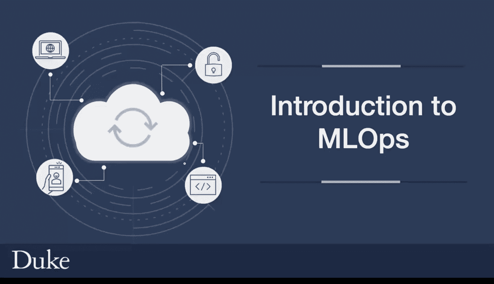
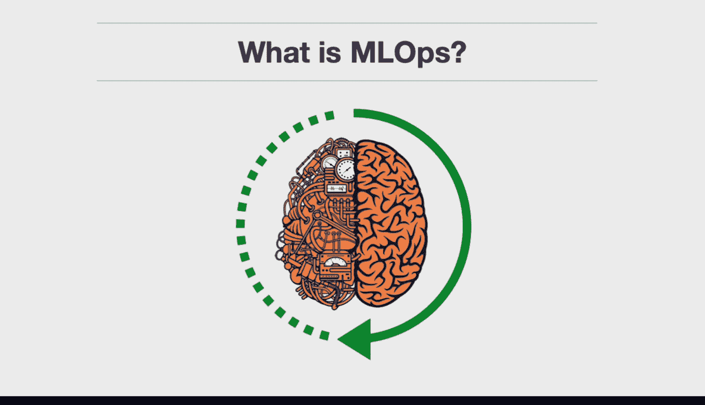
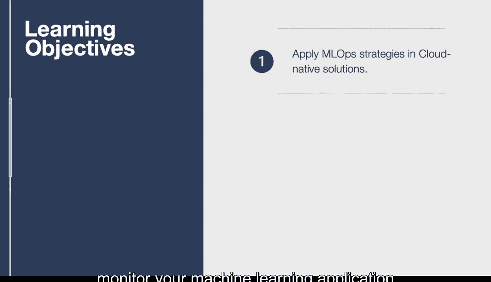
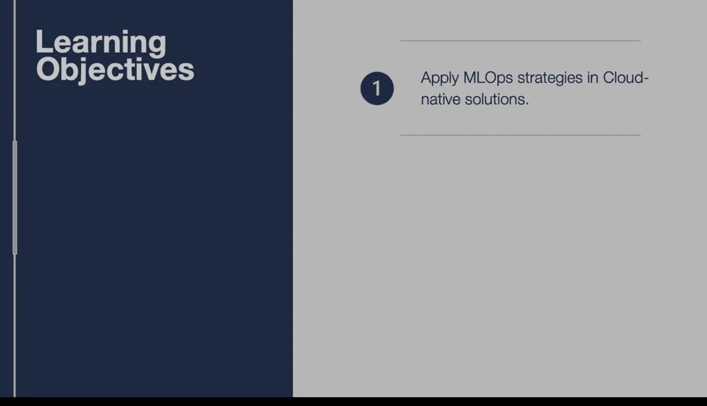

#  121：MLOps简介 🚀

在本节课中，我们将学习什么是MLOps。MLOps是一种将机器学习开发与运维相结合的新兴方法。我们将探讨如何将这些主题整合运用，以简化机器学习策略，包括如何开始使用构建服务器、理解数据漂移以及监控机器学习应用以确保其成功。

---

## 什么是MLOps？🤔



上一节我们介绍了本课的学习目标，本节中我们来看看MLOps的具体定义。

MLOps是**机器学习**（Machine Learning）与**运维**（Operations）的结合。它借鉴了软件工程中DevOps的理念，旨在为机器学习项目创建一个可重复、可扩展且可靠的端到端生命周期管理流程。

其核心目标是**自动化**和**监控**机器学习系统的所有步骤，包括：
*   数据集成与验证
*   模型训练与调优
*   模型部署与发布
*   性能监控与维护

---

## 如何开始：构建服务器 🛠️

理解了MLOps的概念后，我们来看看实践的第一步：建立自动化流程。一个关键的起点是设置构建服务器。

构建服务器（或持续集成/持续部署，CI/CD服务器）用于自动化代码测试、模型构建和部署流程。以下是设置构建服务器通常涉及的几个关键步骤：

1.  **版本控制**：使用Git等工具管理代码、数据和模型版本。
2.  **自动化测试**：编写单元测试和集成测试，确保代码和模型质量。
3.  **自动化构建与训练**：配置流水线，在代码变更时自动触发模型训练。
4.  **自动化部署**：将验证通过的模型自动部署到生产环境。

一个简单的构建流水线配置示例如下（以概念性代码描述）：
```yaml
# 示例 CI/CD 流水线配置
pipeline:
  - trigger_on: git_push
  - steps:
      - run_tests
      - train_model:
          script: python train.py
      - evaluate_model
      - if evaluation_passed:
          deploy_to_production
```

---



## 核心挑战：数据漂移 📊

上一节我们介绍了自动化构建，本节中我们来看看模型上线后可能遇到的主要挑战之一：数据漂移。

模型在训练时基于特定的数据分布。当生产环境中的实时数据分布逐渐偏离训练数据分布时，就会发生**数据漂移**，导致模型性能下降。

监控数据漂移至关重要。以下是几种常见的监控方法：

*   **统计检验**：使用如**Kolmogorov-Smirnov检验**等方法来比较特征分布差异。
    *   公式示例：计算两个分布之间的差异度量。
*   **模型性能监控**：持续跟踪生产环境中模型的准确率、精确率等指标。
*   **数据质量检查**：监控缺失值、异常值和新类别出现的频率。

---

## 确保成功：应用监控 📈

处理了数据漂移问题后，我们需要建立一个全面的监控系统来确保机器学习应用的长期健康运行。

监控不应只限于模型本身，而应涵盖整个应用生态系统。一个完整的监控体系通常包括以下层面：



1.  **基础设施监控**：CPU、内存、网络等资源使用情况。
2.  **模型输入/输出监控**：记录预测请求和结果，用于分析和调试。
3.  **业务指标监控**：将模型预测与实际的业务成果（如用户点击率、收入）相关联。
4.  **警报机制**：为关键指标设置阈值，当出现异常时自动触发警报。

---



## 总结 🎯

本节课中，我们一起学习了MLOps的基础知识。我们了解到MLOps是融合机器学习与运维的实践框架，旨在实现机器学习流程的自动化与标准化。我们从设置构建服务器开始，探讨了如何建立自动化流水线。接着，我们深入了解了模型上线后的核心挑战——数据漂移，并学习了监控它的方法。最后，我们构建了一个全面的应用监控视角，以确保机器学习系统持续、可靠地创造价值。掌握这些概念是构建和维护成功的大规模机器学习解决方案的关键一步。