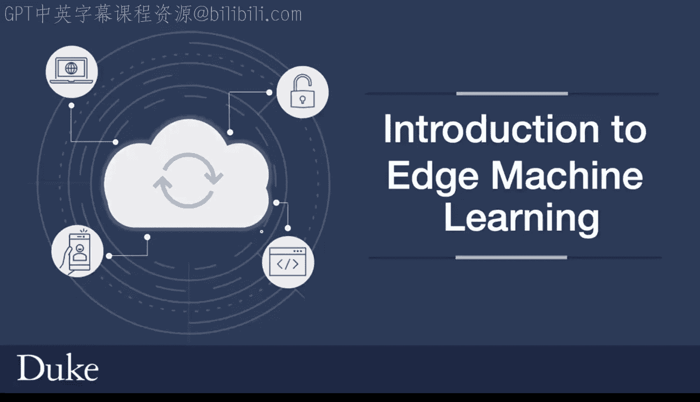
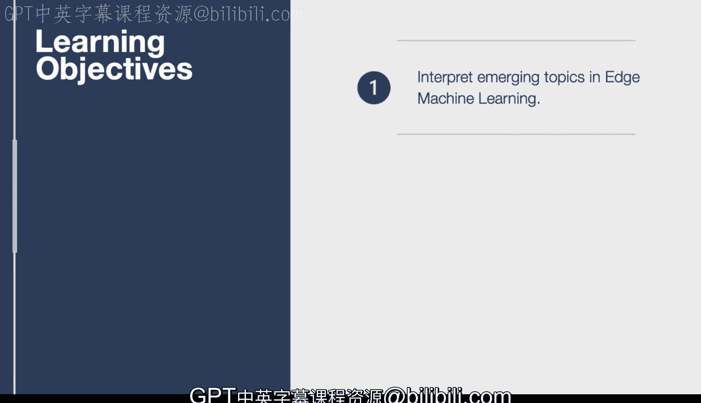

#  124：边缘机器学习简介 🚀

在本节课中，我们将要学习边缘机器学习。这是一种令人兴奋的新技术，它允许你将模型部署到物理设备上，或者部署到靠近云端运行位置的某个地点。这项技术开启了新的可能性，例如，你可以拥有使用机器学习的无人机，或者在你的笔记本电脑或移动设备上进行机器学习的小型设备。让我们开始学习本课的目标。

## 概述

上一节我们介绍了边缘机器学习的基本概念。本节中，我们将深入探讨边缘机器学习中的新兴主题。具体来说，我们将讨论诸如 **Coral TPU**、**Intel Movidius** 以及 **AWS DeepLens** 等其他技术。

## 核心概念与技术

以下是边缘机器学习领域的一些关键硬件与平台技术：

*   **Coral TPU**：这是由谷歌开发的一款专用硬件加速器，专为在边缘设备上高效运行TensorFlow Lite模型而设计。其核心优势在于低功耗和高性能的推理能力。
*   **Intel Movidius**：这是英特尔推出的一系列视觉处理单元（VPU），旨在为计算机视觉应用提供强大的、低功耗的AI推理能力，广泛应用于摄像头、无人机等设备。
*   **AWS DeepLens**：这是亚马逊AWS提供的一款深度学习的无线视频摄像头。它集成了计算能力，允许开发者直接在设备上运行、训练和部署计算机视觉模型。

## 总结

本节课中，我们一起学习了边缘机器学习的基础及其新兴技术。我们了解到，通过将模型部署到边缘设备（如Coral TPU、Intel Movidius芯片或AWS DeepLens摄像头），可以在数据产生源头就近进行实时分析和决策，从而降低延迟、节省带宽并增强隐私保护。这为构建更智能、更响应迅速的物联网和移动应用开辟了道路。