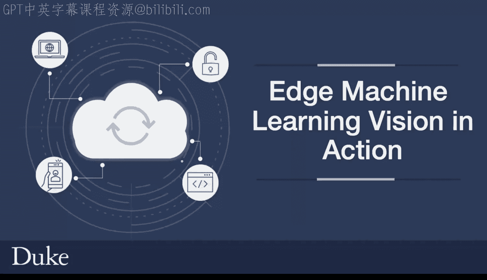
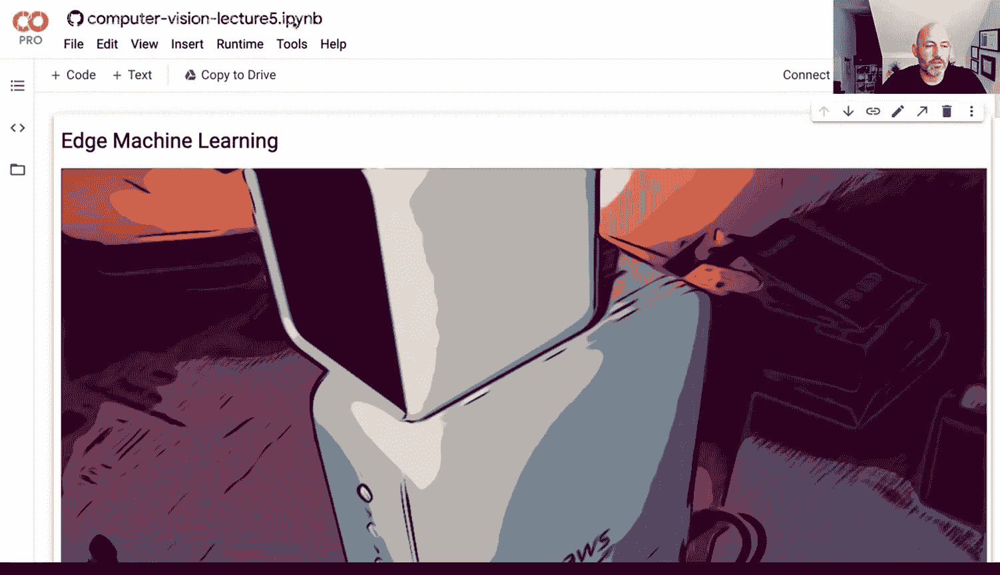
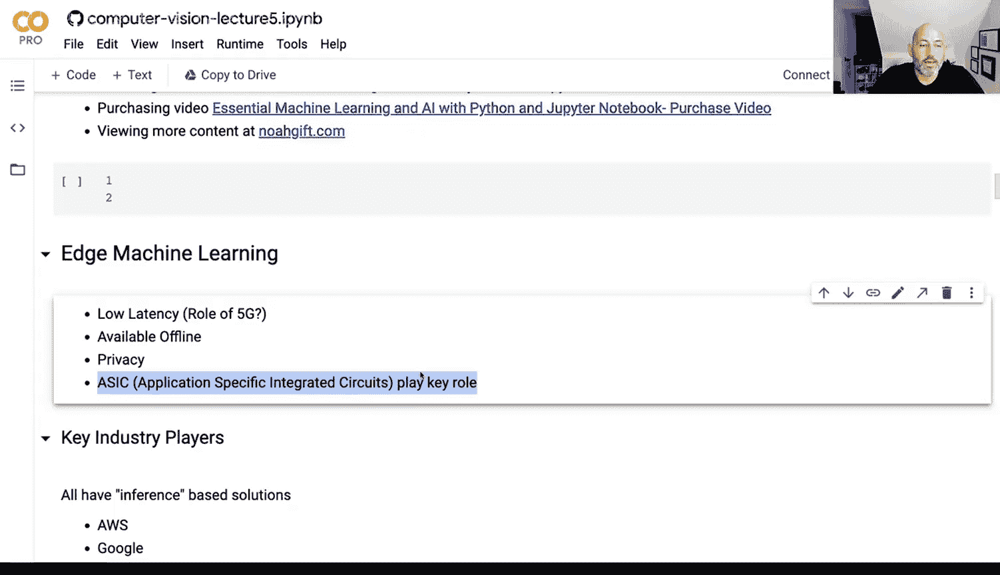
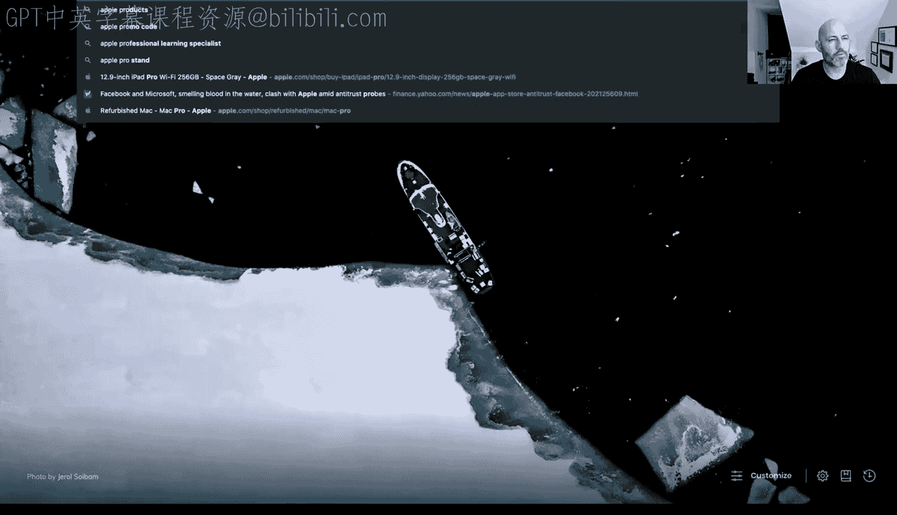
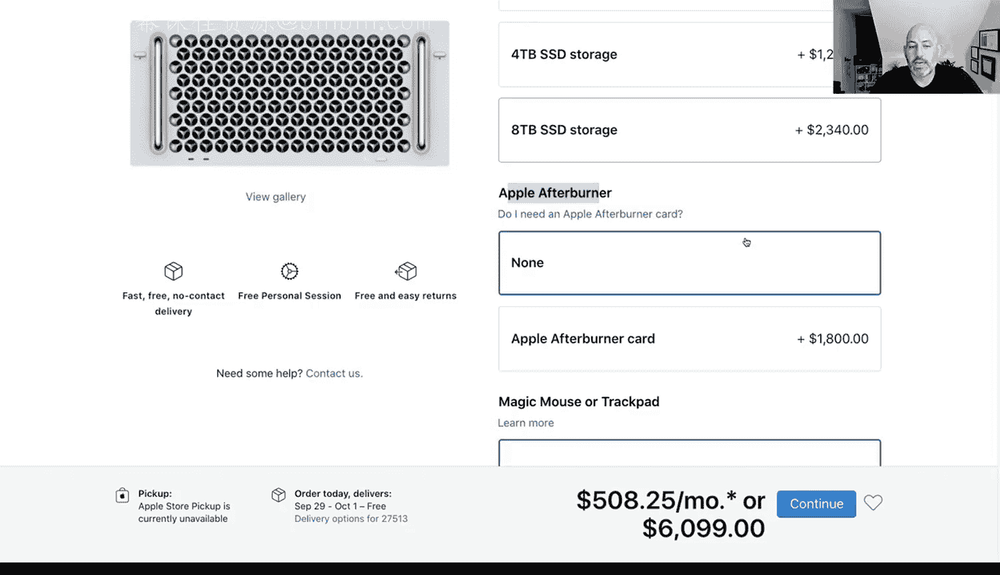
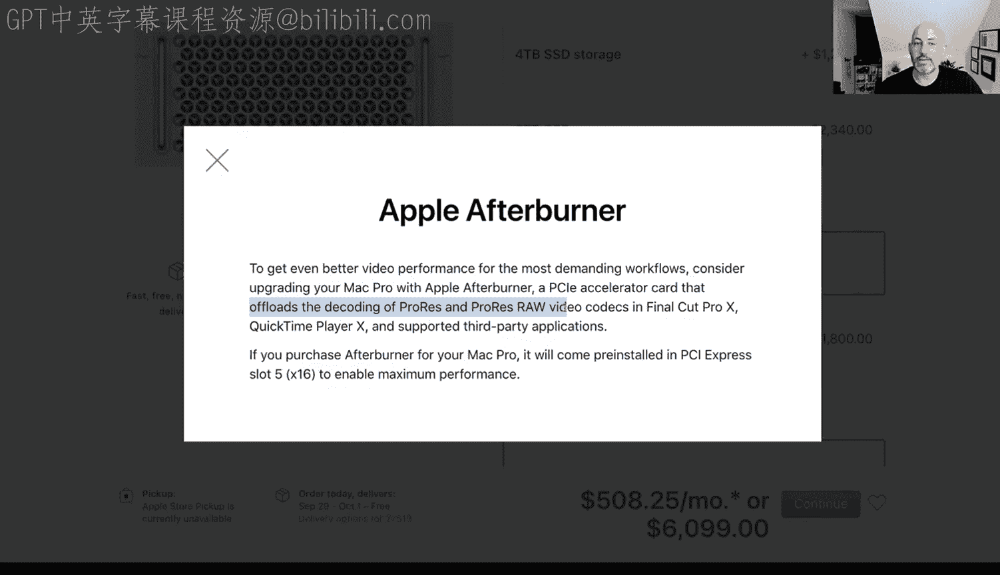
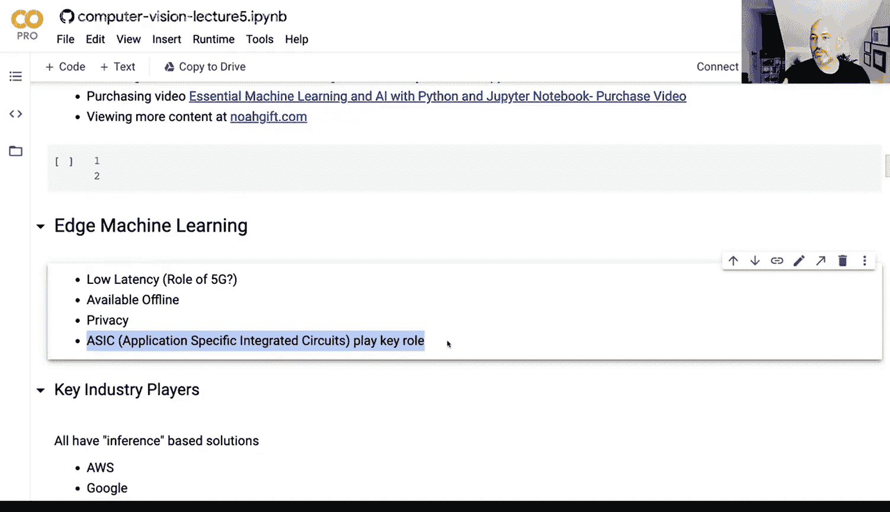

#  126：边缘机器学习视觉实战

## 概述

在本节课中，我们将要学习边缘机器学习，特别是其在计算机视觉领域的应用。我们将探讨边缘计算的理论基础、其重要性以及当前市场上的一些具体硬件设备。课程将涵盖从5G网络的影响到隐私问题，再到专用集成电路（ASIC）的发展。

## 边缘机器学习的兴起

当前正处于一个非常激动人心的时期，适合学习本课程，因为相关创新层出不穷。我们首先将介绍边缘机器学习背后的理论，并讨论其发展现状。

其中一个非常有趣的领域是5G环境。5G的潜在优势在于，它可能取代光纤网络。例如，家庭中的光纤虽然能提供高速数据传输，但5G能达到光纤的速度，且无需物理连接到户。此外，这些设备可以被部署在同样能享受光纤速度的位置。这为我们打开了一个未知的新机遇领域，人们将用它做什么，目前尚不明确。

## 离线能力与关键应用

边缘机器学习离线方面的一个关键点在于，在许多情境下，例如自动驾驶汽车或无人机，设备需要做出关乎生死的决策。如果设备在空中无法连接到网络，同时又不能进行本地预测，那将是一个大问题。因此，设备必须能够在本地进行预测，以确保在完全没有网络连接的情况下也能正常工作。这是一个非常重要的特性。

## 隐私趋势与设备端计算

我认为，这可能是2020年及以后最大的趋势之一，即隐私保护的理念。苹果公司尤其在这一领域扮演着重要角色。在美国，隐私已成为一个重要议题。在2010年至2020年初，人们可能还愿意提供个人数据，但现在他们更加关注数据的使用情况。苹果是该领域的佼佼者之一，他们开发的硬件可以让所有预测都在设备本地完成。这就是一种边缘设备。

你的手机，以及像新款Apple Watch这样的iOS设备，它们都能在设备上进行预测，而无需将数据发送给第三方。这可能会为应用开发打开许多机会。你可以开发在其他地方训练、但包含所有预测所需信息和数据的应用，然后将其部署到设备上。这样，设备就无需将数据回传。

即使你不关心隐私，从商业角度看，这也可能是有利可图的。因为许多国家的客户正在寻找能够进行安全预测的方案，即数据无需离开本地网络。

## 专用集成电路（ASIC）

我们也会讨论一下这个概念：专用集成电路。这些是为特定解决方案构建的独特芯片。

例如，英特尔正在推出的Movidius芯片就能进行预测。许多这类解决方案的出现，源于一个事实：CPU的速度不再像以前那样快速提升了。

一个很好的例子是苹果的Mac Pro电脑。这是一台极其昂贵的电脑，价格可能高达5万美元。这台电脑就是一个很好的例子，它展示了当前技术的发展方向。

如果我们仔细观察其中的一些组件，会发现有趣的现象。以其中一个部件为例，请注意，即使它拥有28核处理器（这本身就很强大），但这只是故事的一部分。另一部分是，它还允许你选择显卡。这些显卡可用于视频转码、GPU编程等任务，而且价格非常昂贵。

更进一步，它们还有一个叫做“Afterburner卡”的部件。这是一张专门用于视频解码的特定卡，本质上是一个专用芯片。所以，这台电脑本身包含了一张价值2000美元、专用于视频编辑的卡。如果你从事电影等行业，还可以再花5000美元升级显卡。而这甚至还不包括作为核心的28核处理器芯片。

这充分说明了当前的发展趋势：这些专用卡正在承担更多工作，因为我们无法在机器中放入更多处理器。CPU的性能提升已经遇到瓶颈，速度无法再显著提高，一台机器能容纳的处理器数量也有限。因此，这些公司必须开发其他专门针对特定任务的技术，例如视频编辑、深度学习或边缘计算。

## 核心硬件设备示例

以下是当前市场上两种重要的边缘机器学习硬件设备：

*   **AWS DeepLens设备**：这是一个集成了摄像头、具备本地预测硬件能力，并能连接到云环境的整体解决方案示例。它代表了机器学习未来的发展方向之一。
*   **基于Coral的边缘设备**：这种设备可以在物理设备上进行计算机视觉预测。在执行这些特定任务时，其性能比普通笔记本电脑更强大，这也是人们使用它们的原因。

## 总结

本节课中，我们一起学习了边缘机器学习，特别是其在视觉领域的实战应用。我们探讨了推动边缘计算发展的关键因素，包括5G网络带来的新可能性、对离线操作和实时决策的硬性需求、日益增长的隐私保护趋势，以及为突破通用CPU性能瓶颈而发展的专用集成电路。最后，我们了解了像AWS DeepLens和Coral设备这样的具体硬件，它们将摄像头、本地预测能力和云连接整合在一起，代表了机器学习解决方案的未来形态。