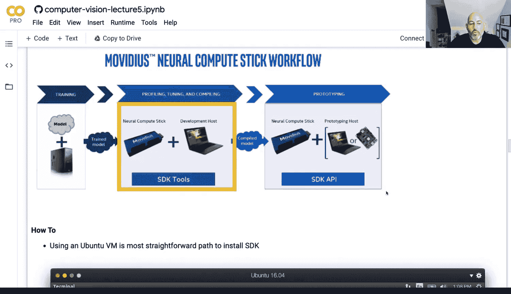
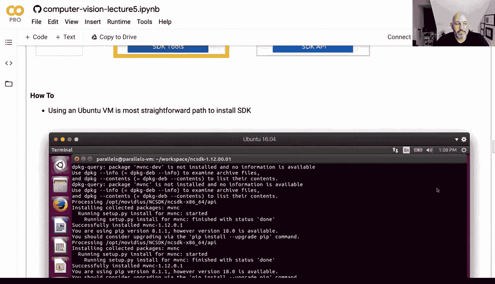
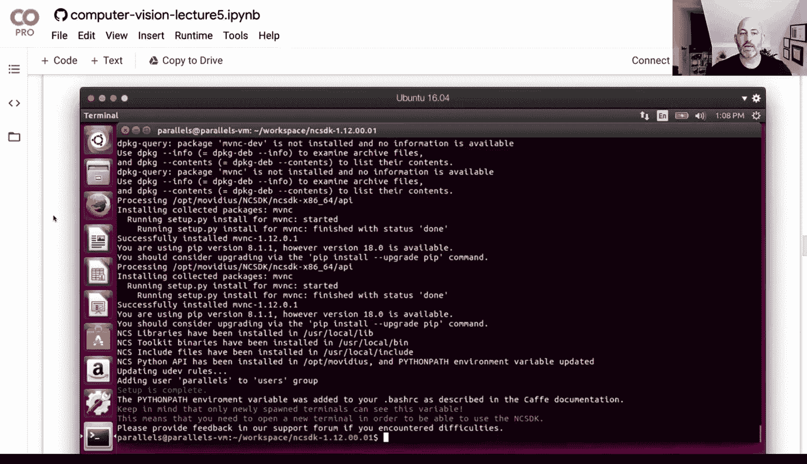
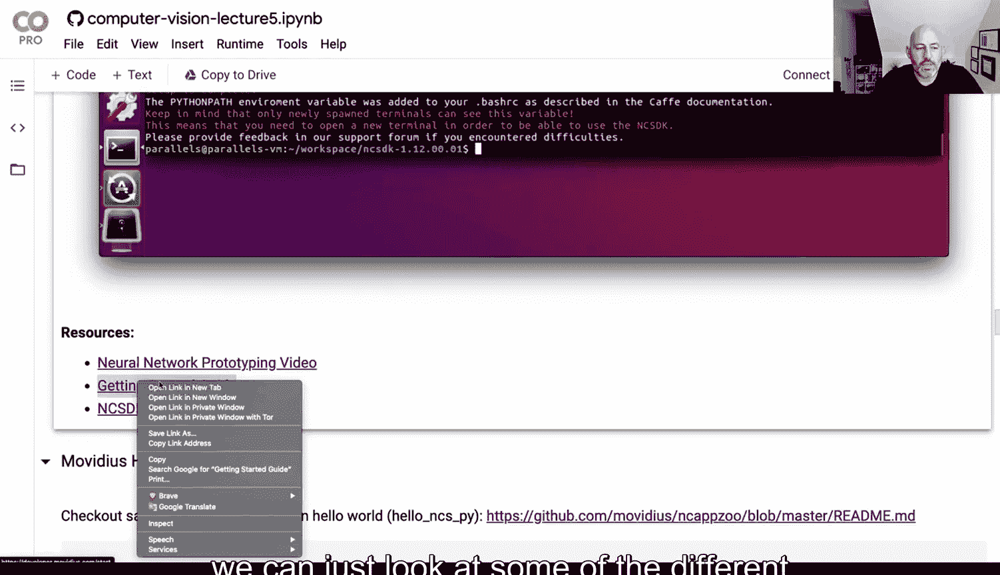
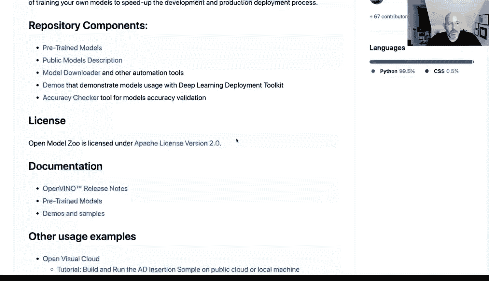
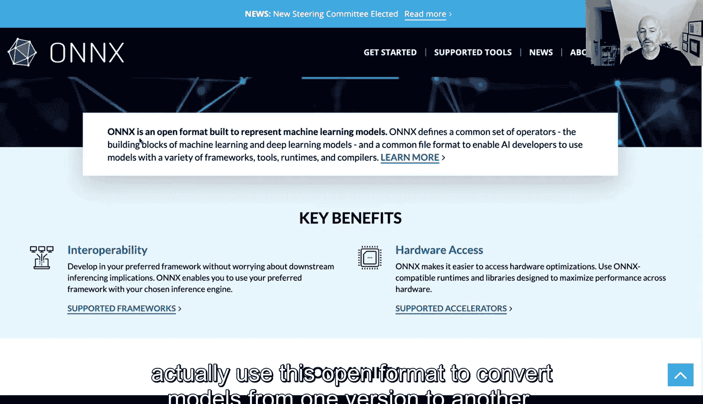
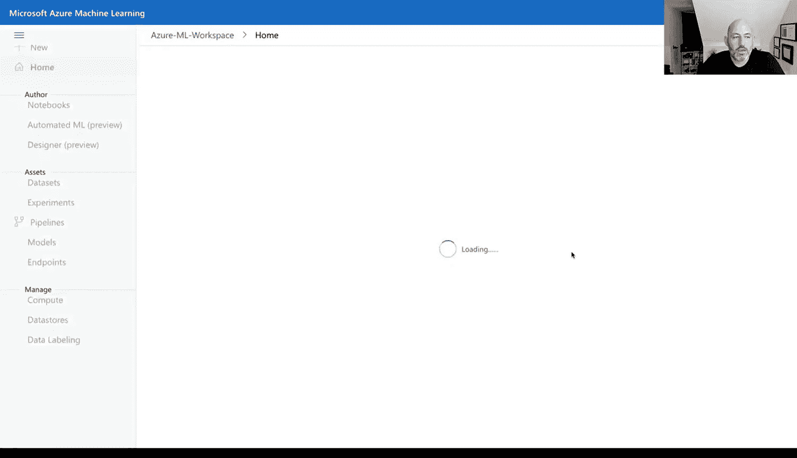
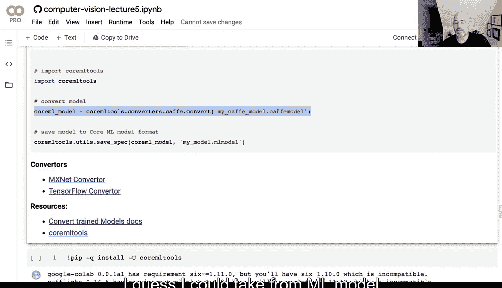
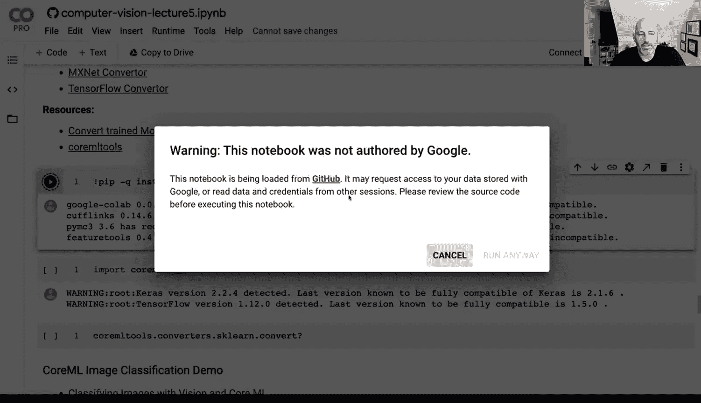
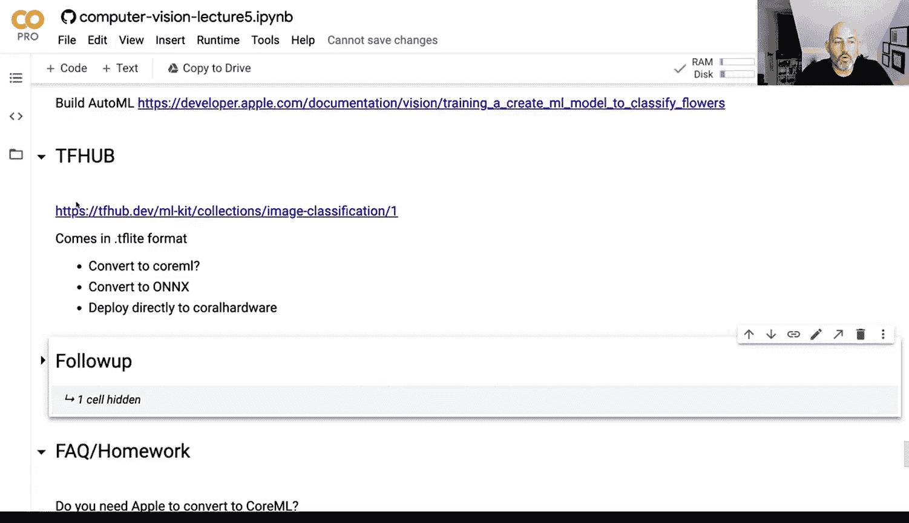

#  127：边缘机器学习中的硬件推理模型解决方案 🧠


在本节课中，我们将学习边缘机器学习中的硬件推理模型解决方案。我们将了解行业中的主要硬件方案，并通过具体示例（如英特尔 Movidius 神经计算棒）来演示如何设置开发环境、运行示例项目，并探索模型转换工具（如 ONNX 和 Core ML）以实现跨平台部署。

---

## 行业现状

在边缘机器学习领域，每家主要的科技公司都提供了自己的硬件推理解决方案。







*   **AWS** 和 **Google** 都拥有各自的专用芯片系列。
*   **Apple** 在其设备生态中集成了强大的机器学习能力。
*   **Intel** 也提供了边缘计算硬件。

接下来，我们将重点介绍其中一种解决方案。




---

## 英特尔 Movidius 神经计算棒示例 🖥️

上一节我们概述了行业现状，本节中我们来看看一个具体的硬件示例：英特尔 Movidius 神经计算棒。

这是一种基于 USB 的深度学习设备，专为边缘 AI 编程设计。其优点是即插即用，为计算机提供了强大的预测算力。这种形态的设备预计会越来越普及。


它的典型工作流程是：下载模型 -> 进行开发与调试 -> 将训练好的模型部署到 Raspberry Pi、笔记本电脑、无人机等各种边缘设备上。

### 开发环境设置

为了获得可控且可复现的开发环境，建议在 **Ubuntu 虚拟机** 中进行开发。这样做可以隔离环境，方便为不同的硬件创建独立的虚拟机副本，这在硬件开发中非常重要。

设置好虚拟机后，需要下载并安装 Movidius 的 **SDK**。



### 从“Hello World”开始

以下是开始使用该硬件的推荐步骤：

1.  **获取示例代码**：SDK 或相关资源库中提供了丰富的示例项目，包括多设备协作和简单的 Python 脚本。
2.  **运行基础测试**：首先运行一个最简单的示例（如 `make run`）来验证硬件连接是否正常。这一步至关重要，可以避免因驱动或连接问题而误认为是代码错误。
3.  **探索示例项目**：在确认基础功能正常后，可以运行其他示例项目来了解设备的潜力。例如，**性能基准测试** 项目可以帮助你评估在当前配置下能达到的帧率（FPS）或推理速度，这对于构建实时计算机视觉应用（如车牌识别、垃圾分类）很有帮助。
4.  **利用预训练模型**：许多示例（如性别年龄检测）附带了来自 **Model Zoo** 的预训练模型。你可以直接运行这些模型，并基于其 Python 代码进行扩展，例如将识别结果保存到文件、发送到 API 或构建图形界面。





---

## 模型转换与互操作性工具 🛠️

上一节我们介绍了如何使用具体的硬件，本节中我们来看看如何让模型在不同平台和硬件间通用。这就需要用到模型转换工具。

### ONNX：开放的模型格式

**ONNX** 是一个用于表示机器学习模型的开放标准，旨在提高框架之间的互操作性。

其核心价值在于，你可以将来自任何框架的模型转换为 ONNX 格式，然后部署到任何支持 ONNX 的运行时环境中。例如，你可以将其他框架的模型转换为 ONNX，然后部署到云端服务（如 Azure ML）进行推理。

一个典型的转换流程代码如下：

```python
# 假设已安装 onnx 和 coremltools 库
import onnx
import coremltools

# 1. 从某处下载或加载一个原始模型（例如Caffe格式）
# original_model = ...

# 2. 使用工具将其转换为ONNX格式
# onnx_model = onnx.utils.convert_model(original_model)



# 3. 保存ONNX模型
# onnx.save_model(onnx_model, "converted_model.onnx")
```


### Core ML：Apple 设备上的优化框架

**Core ML** 是 Apple 的机器学习框架，针对 iOS 设备进行了性能和内存优化。它使用 `.mlmodel` 格式的模型。

你可以使用 `coremltools` 库将其他格式的模型转换为 Core ML 格式，从而集成到 iOS 应用中。

```python
# 安装：pip install coremltools
import coremltools

# 将模型转换为 Core ML 格式
# coreml_model = coremltools.converters.caffe.convert('model.caffemodel')
# coreml_model.save('MyModel.mlmodel')
```

在 Xcode 项目中，你可以直接使用转换后的 `.mlmodel` 文件，并通过 Vision 框架方便地调用。



---


## 利用现有模型与自动化训练 🚀



我们了解了如何转换模型，但模型从何而来？本节介绍两种获取模型的途径：使用公开模型库和自动化训练平台。

### TensorFlow Hub 模型库

你无需从头训练所有模型。**TensorFlow Hub** 提供了大量预训练模型，涵盖图像分类、目标检测等任务。许多模型提供了 **TensorFlow Lite** 格式，专为移动和边缘设备设计。你可以直接下载这些模型，并根据需要转换为 ONNX 或 Core ML 格式进行部署。

### 自动化机器学习平台

各大云服务商都提供了自动化机器学习服务：

*   **Google AutoML**
*   **Amazon SageMaker**
*   **Azure Machine Learning**
*   **Apple Create ML**

通过这些平台，你只需上传数据并点击操作，即可训练出定制化的模型。训练完成后，可以导出为相应格式（如 `.mlmodel` 或 ONNX），然后部署到设备或云端。

这意味着，构建一个边缘AI应用的完整链条可以是：使用自动化平台训练模型 -> 转换为通用格式 -> 部署到边缘硬件。

---

## 总结

本节课中我们一起学习了边缘机器学习硬件推理方案的多个方面：

1.  **硬件多样性**：业界有多种专为边缘推理设计的硬件方案，如英特尔的 Movidius 神经计算棒。
2.  **开发流程**：建议在隔离的虚拟环境中进行开发，并从运行最简单的“Hello World”示例开始，确保硬件连接正常。
3.  **模型互操作性**：**ONNX** 作为开放的模型格式，是实现跨框架、跨平台模型转换和部署的关键工具。
4.  **平台特定框架**：**Core ML** 是针对 Apple 设备优化的框架，可通过转换工具集成各类模型。
5.  **模型来源**：可以利用 **TensorFlow Hub** 等模型库获取预训练模型，或使用各大云平台的 **自动化机器学习** 服务快速训练定制模型。




掌握这些工具和流程，能够帮助你更灵活地构建和部署适用于不同硬件的边缘机器学习解决方案。