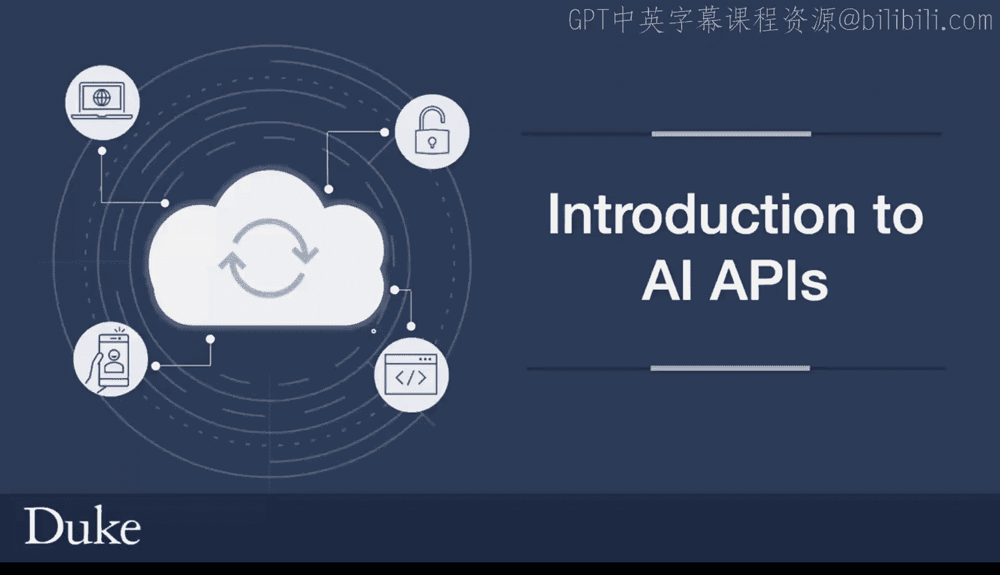
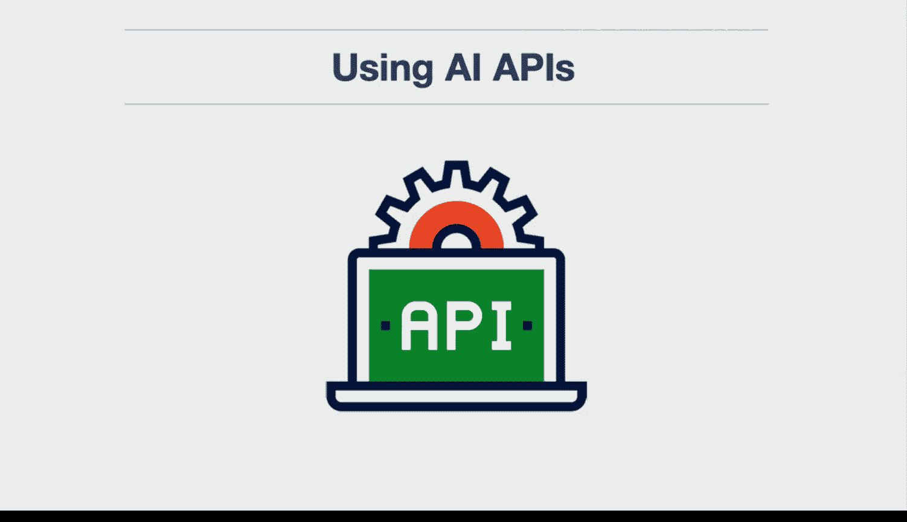
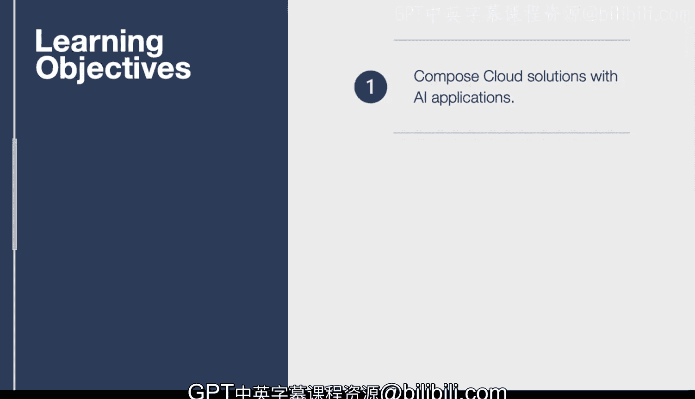
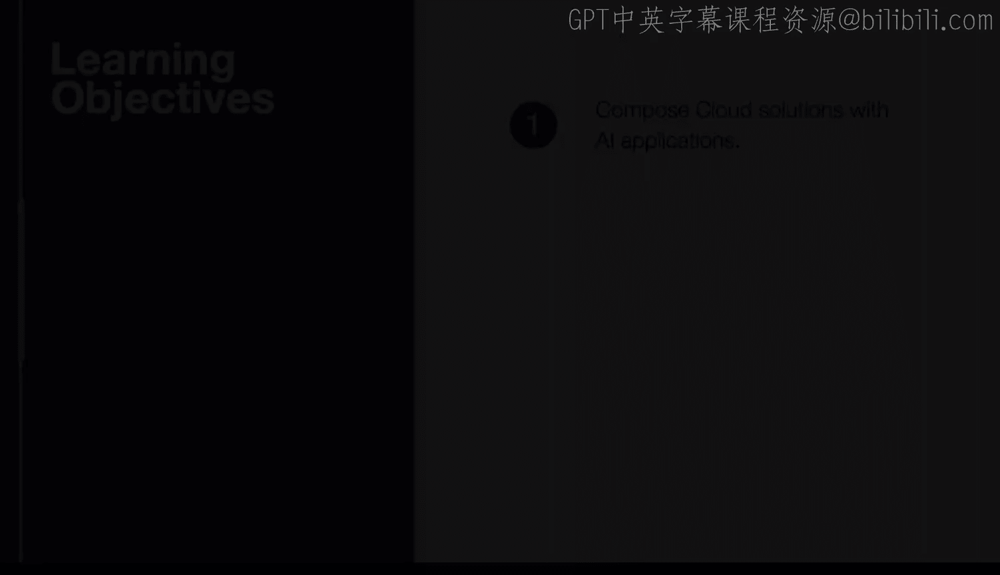

构建大规模云计算解决方案：3-4：人工智能API简介

在本节课中，我们将学习如何使用人工智能API。这些API提供了预训练的模型，能够执行诸如标签检测、物体识别、翻译等多种任务。利用云端的这些预训练API有诸多优势，它们允许你借助大型科技公司的研发成果，这些公司拥有更多的研发资源来开发此类先进技术。接下来，我们将详细探讨本课的学习目标。

---

上一节我们概述了AI API的用途与优势，本节中我们来看看具体的学习目标。

在本课程中，我们将学习如何组合使用AI应用来构建解决方案，并了解诸如AWS Comprehend和AWS Rekognition等服务。

*   **AWS Comprehend**：一项自然语言处理服务，可用于分析文本中的情感、实体、语言等。
*   **AWS Rekognition**：一项图像与视频分析服务，可用于检测图像或视频中的标签和物体。

---

本节课中，我们一起学习了人工智能API的基本概念及其在云计算中的应用。我们了解到，使用云服务商提供的预训练AI API（如AWS的Comprehend和Rekognition），可以快速集成强大的AI功能，而无需从头训练模型。这为构建大规模、智能化的云解决方案提供了高效路径。