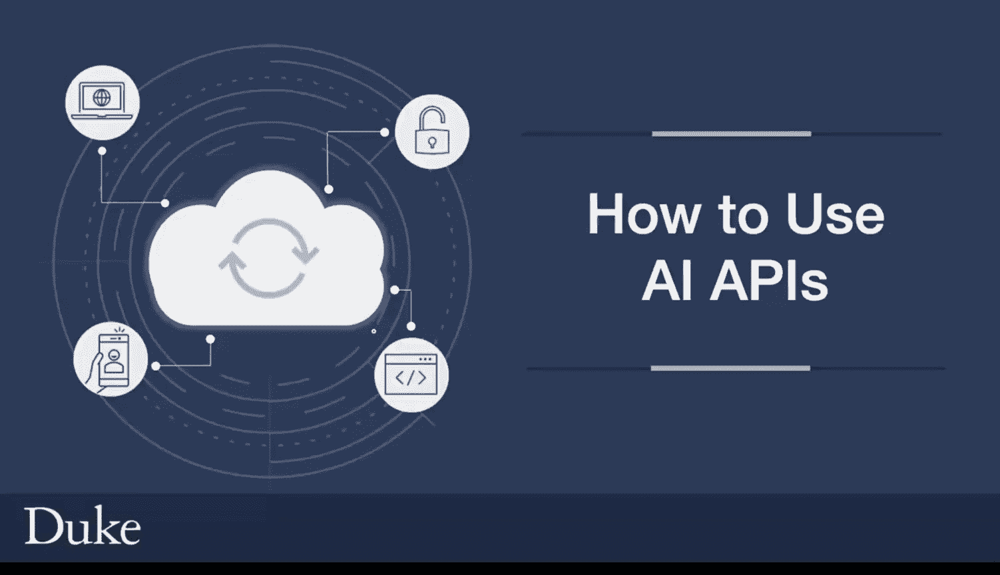
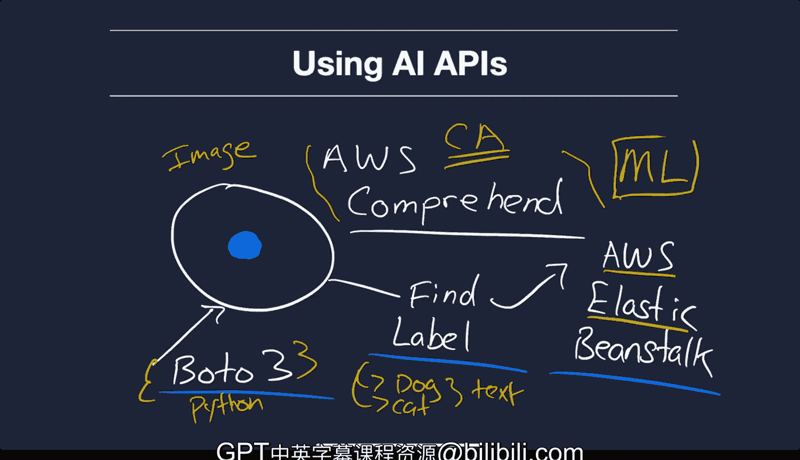

#  131：如何使用人工智能API 🧠



在本节课中，我们将学习如何利用人工智能API来节省大量工作，并解决公司中的实际问题。我们将通过一个具体的例子，了解如何将AI能力集成到你的应用程序中，并理解其背后的核心优势。

---

上一节我们讨论了云计算的基础架构，本节中我们来看看如何将现成的人工智能服务集成到你的解决方案中。

假设你有一个需求：开发一个功能，能够分析一张图片并识别其中的内容，例如判断图片中是狗还是猫，或者提取图片中的文字。从头开始训练一个图像识别模型需要大量的数据、算力和专业知识。

此时，你可以选择使用云服务商提供的人工智能API。例如，AWS提供了名为Comprehend的服务（虽然Comprehend主要处理文本，但AWS用于图像识别的服务是Rekognition，此处我们理解其核心概念）。使用这些服务，你无需关心底层复杂的模型训练过程。

以下是使用Python库`boto3`调用AWS AI服务的基本思路：

```python
import boto3

# 创建客户端连接至AWS的AI服务（例如Rekognition）
client = boto3.client('rekognition')

# 调用API分析图片
response = client.detect_labels(
    Image={'Bytes': image_bytes}
)

# 处理返回的标签信息
labels = response['Labels']
for label in labels:
    print(f"检测到物体: {label['Name']}, 置信度: {label['Confidence']:.2f}%")
```

通过这种方式，你只需几行代码就能获得强大的图像识别能力。识别出的文本或标签信息，可以被进一步整合到完整的无服务器应用程序中，例如部署在AWS Elastic Beanstalk上。

---

那么，使用AI API的核心优势究竟是什么？关键在于**比较优势**。

比较优势是一个经济学概念，它建议：专注于你最擅长的事情，而将那些别人更擅长的事情交给他们去做。

我们可以通过一个生活中的类比来理解：

*   **家庭维修类比**：如果你家的水管出现了复杂问题，你会聘请专业的水管工。他可能在一小时内就能解决你需要花费一整天还可能搞砸的问题。同样，建造一个新房间，你会找专业的木匠。

*   **应用到软件开发**：在构建软件时，你的核心优势是**工程实现、业务逻辑整合和系统架构**。而提供高度精准的AI模型（如最先进的图像识别模型）是云服务商（如AWS、Google、Azure）的核心优势。

因此，明智的做法是：
1.  将你的时间和资源集中在创造价值的软件工程工作上。
2.  支付一部分费用，调用专业云服务商提供的、经过海量数据训练的AI API来完成特定的智能任务（“重活累活”）。

这使你能够快速、低成本地为产品添加高级AI功能，同时保证了功能的质量和性能。



---


本节课中我们一起学习了如何利用人工智能API来增强应用程序。我们了解了通过`boto3`这样的工具可以轻松调用云服务，并深入探讨了其背后的“比较优势”原理：即专注于自身的核心工程能力，而将专业的模型能力外包给顶级的云服务提供商。这是一种高效、经济的现代软件开发策略。