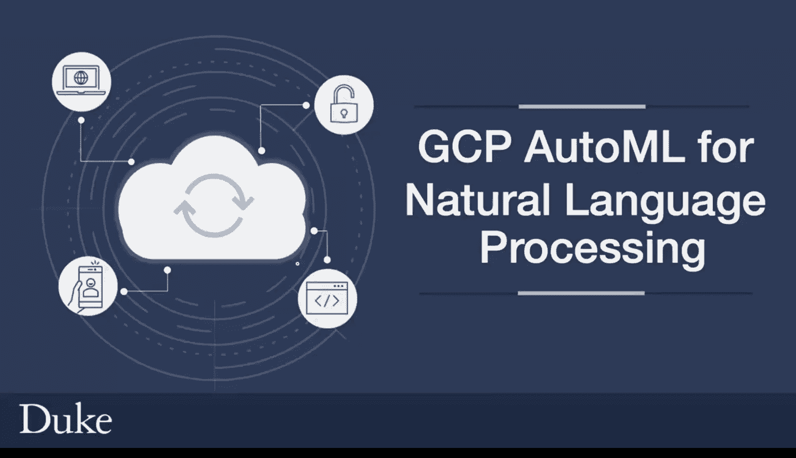
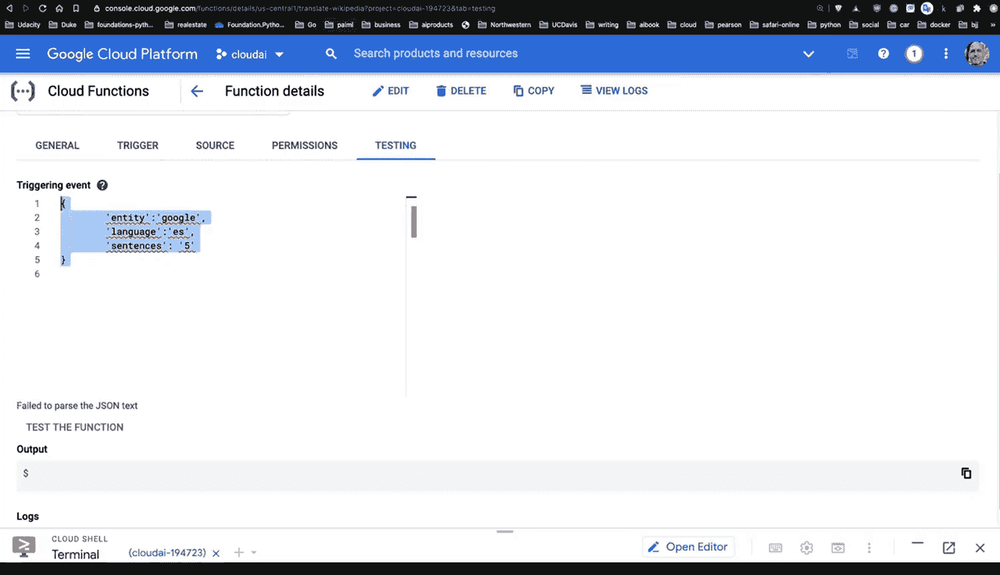
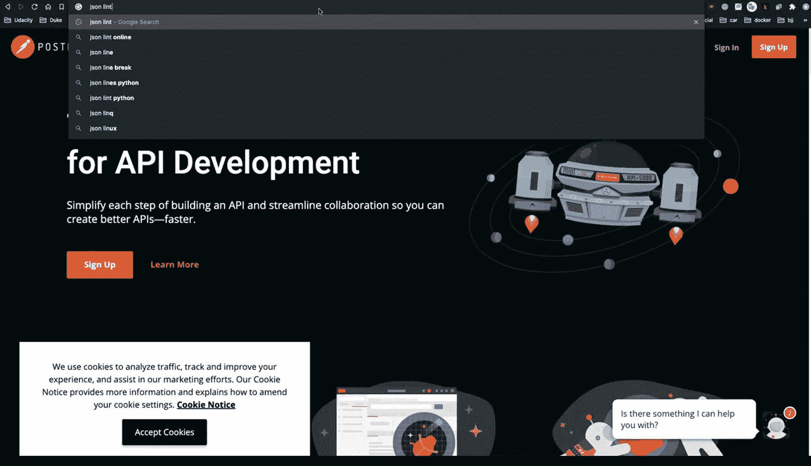
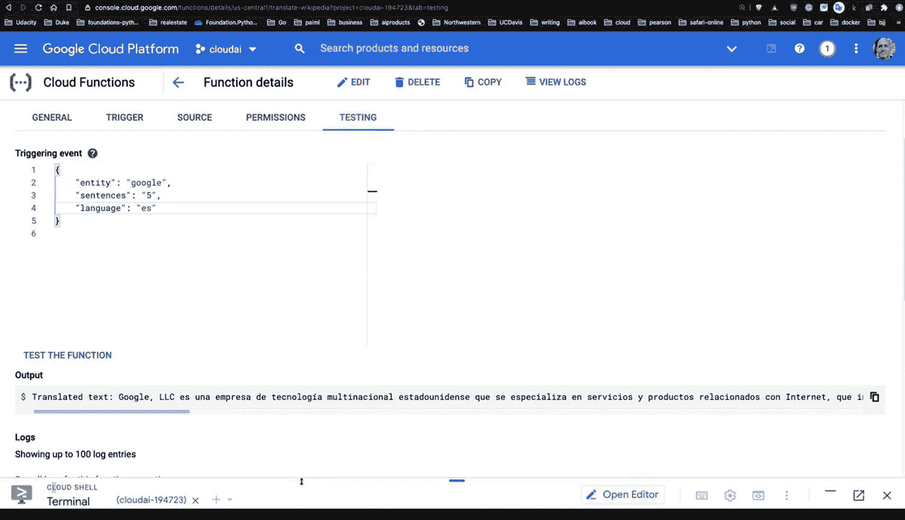
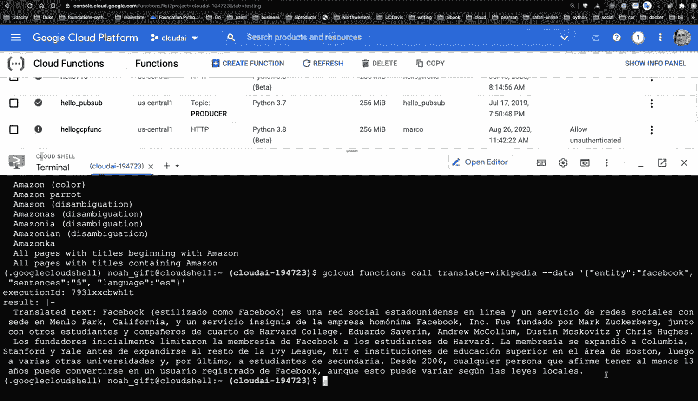

#  135：GCP自动机器学习与自然语言处理



在本节课中，我们将学习如何利用Google Cloud Platform（GCP）的云函数（Cloud Functions）和AI API，构建一个能够执行自然语言处理（NLP）操作的生产级Web服务。我们将从创建一个简单的“Hello World”函数开始，逐步将其扩展为一个能够调用维基百科API和GCP翻译服务的复杂应用。

## 概述

GCP的云函数允许开发者无需管理服务器即可部署代码。我们将创建一个云函数，它首先作为一个简单的回声服务，然后集成GCP的自然语言处理API，实现从维基百科获取内容并自动翻译的功能。

## 创建基础云函数

上一节我们介绍了GCP云服务的概念，本节中我们来看看如何创建一个基础的云函数端点。

首先，在GCP控制台中创建函数。我们将其命名为类似 `hello-serverless` 的名称。创建时，需要指定一个运行时环境，例如Python。系统会提示设置一个**入口点**，这意味着当Web服务被远程调用时，将首先执行这个函数。

以下是创建函数的核心步骤代码框架：
```python
# 这是一个云函数的基本结构
def hello_serverless(request):
    # 函数逻辑将在这里编写
    return 'Response'
```
创建完成后，GCP会提供一个唯一的URL端点，全球用户都可以通过此URL访问该服务。

## 测试与调用函数

函数部署后，我们可以立即进行测试。测试有两种主要方式：

1.  **通过控制台测试**：在GCP控制台的函数详情页，有一个“测试”标签页。我们可以手动输入JSON格式的载荷（Payload）来触发函数。
2.  **通过命令行调用**：使用 `gcloud` 命令行工具，可以更灵活地从终端调用函数。

例如，通过命令行调用的格式如下：
```
gcloud functions call hello-serverless --data ‘{“message”: “Hello from Shell”}’
```
通过测试，我们确认函数可以接收请求并返回响应，这构成了一个可用的Web服务基础。

## 集成AI API构建复杂应用

我们已经有了一个可工作的Web服务，现在可以为其添加更强大的功能。接下来，我们将把GCP的自然语言处理（NLP）API集成到云函数中。





我们将修改函数代码，使其能够：
1.  接收一个实体名称（如“Google”）、目标语言和句子数量作为输入。
2.  调用维基百科API获取该实体的摘要文本。
3.  使用GCP的翻译API将摘要翻译成目标语言。
4.  返回翻译后的结果。

以下是实现此功能的核心代码逻辑：
```python
from google.cloud import translate_v2 as translate
import wikipedia

def translate_wikipedia(request):
    request_json = request.get_json()
    entity = request_json[‘entity’]
    language = request_json[‘language’]
    sentences = request_json[‘sentences’]

    # 获取维基百科内容
    summary = wikipedia.summary(entity, sentences=sentences)

    # 使用GCP进行翻译
    translate_client = translate.Client()
    result = translate_client.translate(summary, target_language=language)

    return result[‘translatedText’]
```
部署这个新函数后，我们再次通过控制台或命令行进行测试。例如，我们可以请求将“Facebook”的维基百科摘要翻译成西班牙语。



通过这种方式，我们快速构建了一个功能完整的、可扩展的NLP微服务，而无需关心服务器运维、扩展性或网络基础设施。

## 总结




本节课中我们一起学习了如何利用GCP云函数构建无服务器应用。我们从创建一个简单的回声服务开始，逐步将其增强为一个集成了外部API（维基百科）和GCP核心AI服务（翻译API）的复杂自然语言处理管道。整个过程展示了云函数的强大之处：开发者只需专注于业务逻辑代码，即可快速部署出健壮、可扩展的生产级服务。