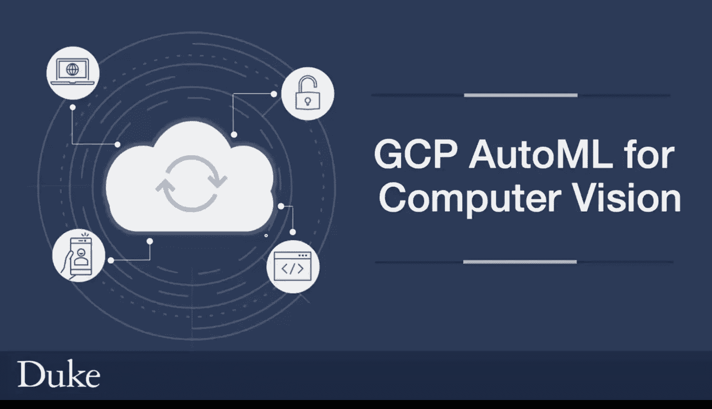
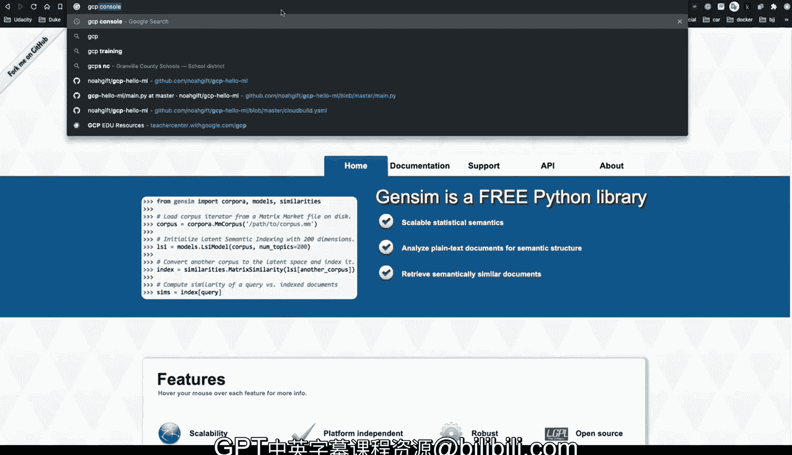
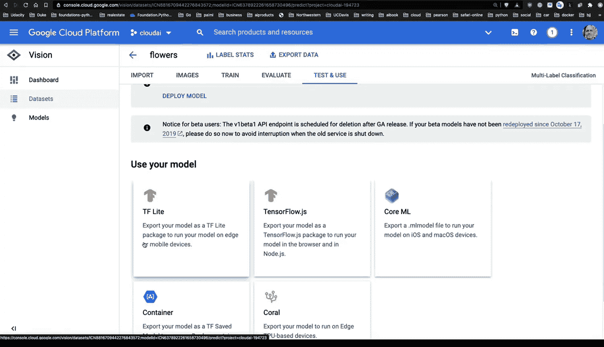
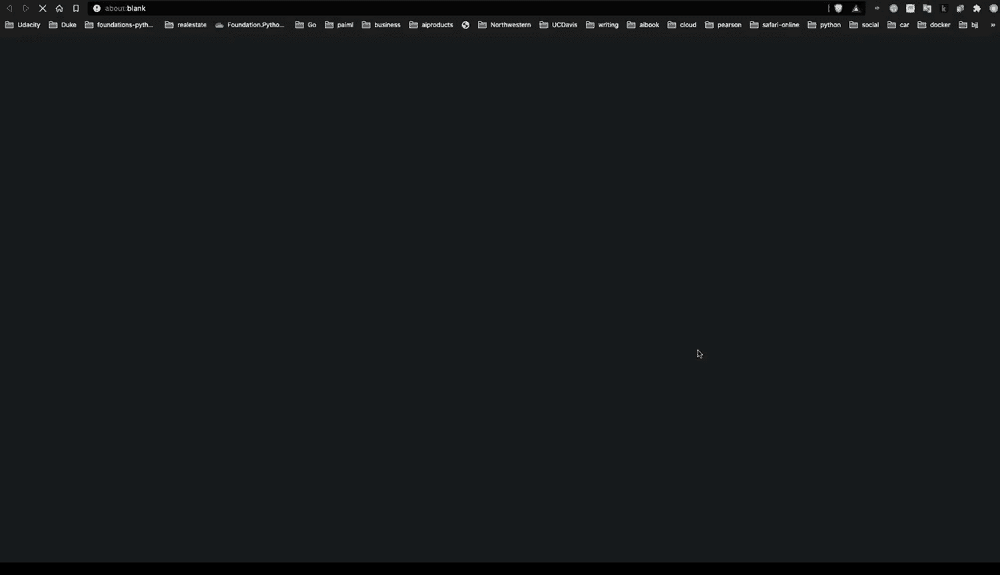
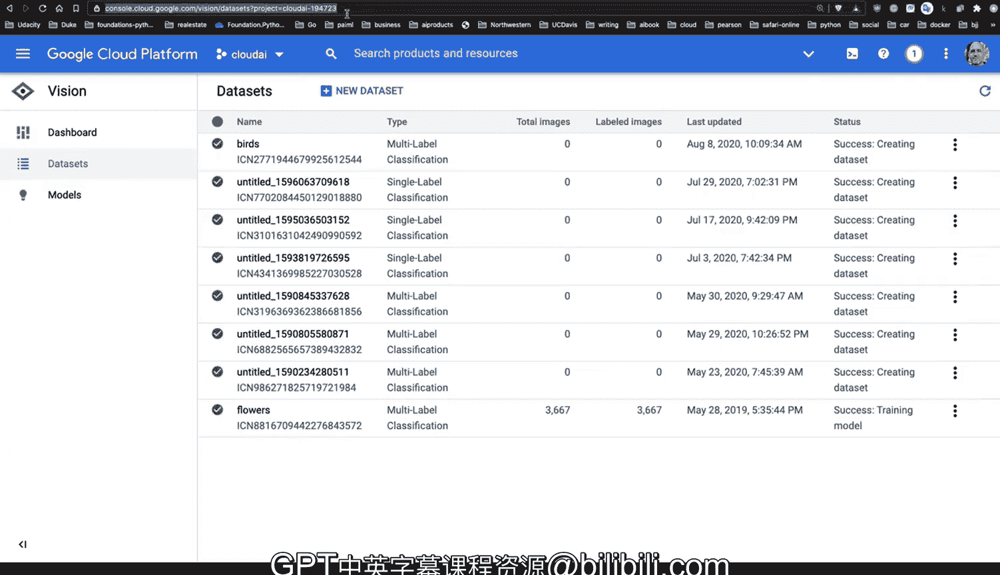

#  136：GCP自动机器学习计算机视觉

在本节课中，我们将要学习Google Cloud Platform（GCP）上的自动机器学习（AutoML）计算机视觉功能。我们将了解如何创建数据集、训练模型，并探讨将模型部署到云端或移动设备（边缘）的两种主要方式。

## 概述

GCP提供了强大的自动机器学习计算机视觉能力。通过AutoML Vision，用户可以轻松创建自定义的图像分类模型，而无需深厚的机器学习专业知识。

## 创建数据集

首先，我们需要创建一个数据集来训练模型。以下是创建数据集的步骤。

在GCP的AutoML界面中，点击“新建数据集”。你可以选择任务类型，例如“单标签分类”。这种分类适用于为每张图像分配一个标签的场景，比如区分“猫”或“狗”。

接下来，你需要提供训练数据。有两种主要方式：
*   从本地上传图像文件。
*   提供一个CSV文件，该文件指向存储在Google Cloud Storage中的一批图像。

数据格式示例如下：在CSV文件中，每一行包含一个指向图像的URI（例如 `gs://my-bucket/cat.jpg`）和对应的标签（例如 `cat`）。你需要同时准备训练数据和测试数据。上传完成后，所有数据会被存储起来。

## 浏览与可视化数据

上一节我们介绍了如何创建和上传数据集，本节中我们来看看如何浏览这些数据。

上传图像后，你可以在界面中查看所有已上传的图像。该界面提供了优秀的可视化功能，允许你通过筛选器切换来浏览不同类别的数据。这有助于在训练前直观地检查数据质量。

## 训练模型

浏览完数据后，下一步就是训练模型。点击“训练”按钮即可开始训练一个新模型。

在训练设置中，你有两个关键的部署选择：
*   **云端部署**：模型将托管在GCP云上。如果你希望构建一个接收用户输入并进行预测的在线服务，这是完全可行的选择。
*   **边缘部署**：模型可以下载并部署到移动设备等边缘设备上运行。

## 模型部署选项

### 边缘部署

边缘部署的优势在于模型可以离线运行在终端设备上。在训练完成后，进入“测试与使用”环节，你可以直接下载模型文件。

例如，你可以选择“Android Quickstart”选项，通过点击按钮在云端完成训练，然后将模型下载并部署到物理安卓设备上。这种方式的最大优点是**代码量极少**，最终你可以将训练好的模型直接集成到移动应用中。

### 云端部署

另一种选择是云端部署。如果选择将模型部署在云端，在“测试与使用”环节，系统会为你提供一个可调用的API端点。

虽然调用它会启动服务器并产生费用，但之后你就可以让用户通过这个端点提交数据（例如手写样本图片）。这意味着你可以将图像数据提交到Cloud Vision API，点击训练后，系统会快速启动一个端点。之后，你的应用程序只需调用该端点并传入图像数据，就能获得预测结果，从而为计算机视觉应用构建一个完整的端到端流程。

## 功能核心：自定义训练

无论是边缘还是云端部署，AutoML Vision的核心功能都允许你**从零开始，使用自己的数据来定制和训练模型**。这为你提供了高度的灵活性和所有权，使得解决方案能完美契合你的特定业务需求。

## 总结

本节课中我们一起学习了GCP AutoML计算机视觉的基本工作流程。我们了解了如何创建数据集、可视化数据、训练模型，并重点探讨了将模型部署到“边缘”设备或“云端”的两种不同方式及其适用场景。整个过程旨在降低机器学习应用的门槛，实现低代码甚至无代码的模型开发与部署。