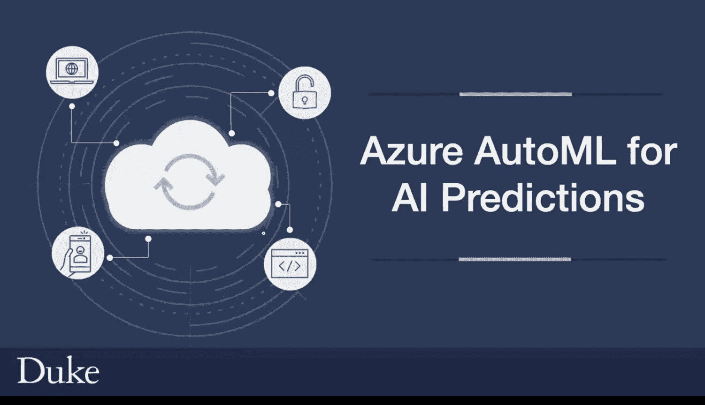
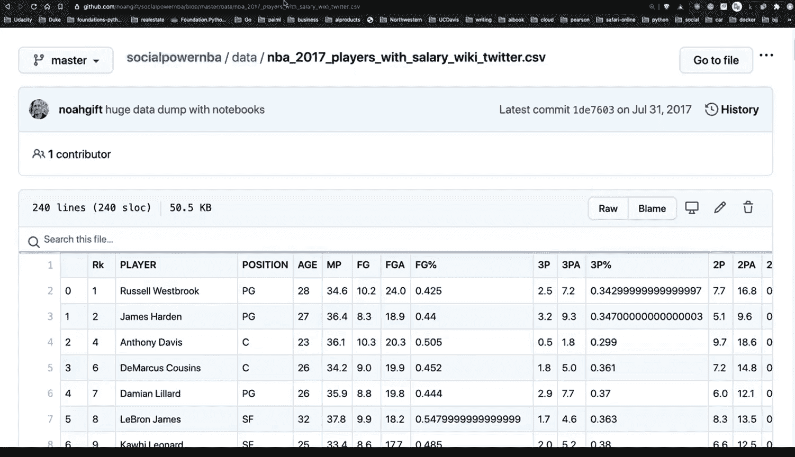
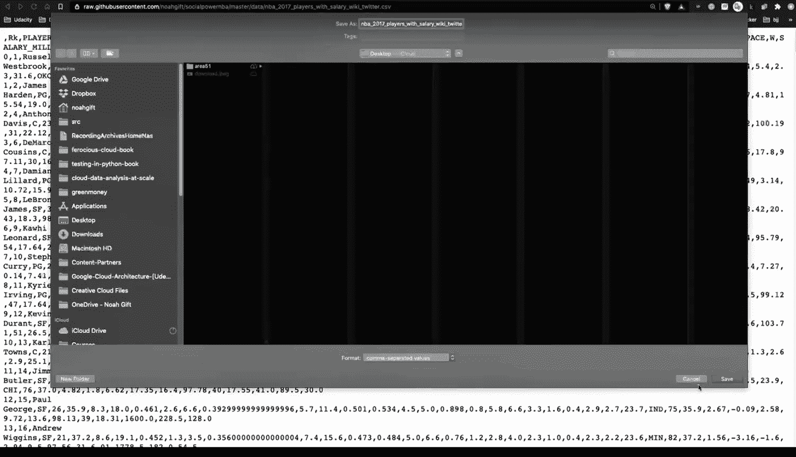
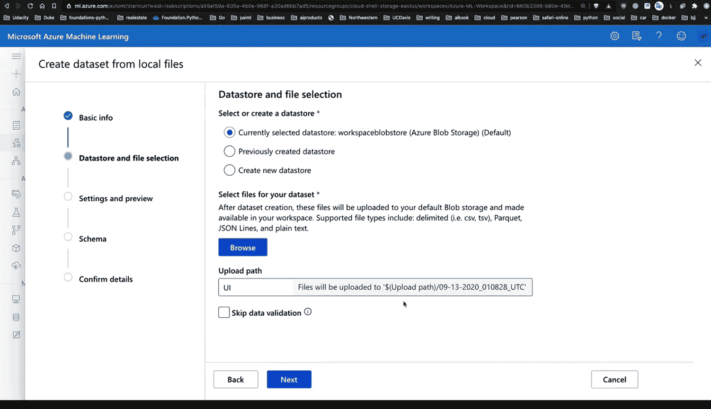
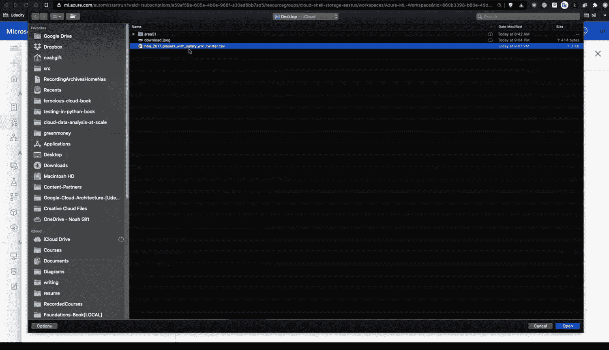
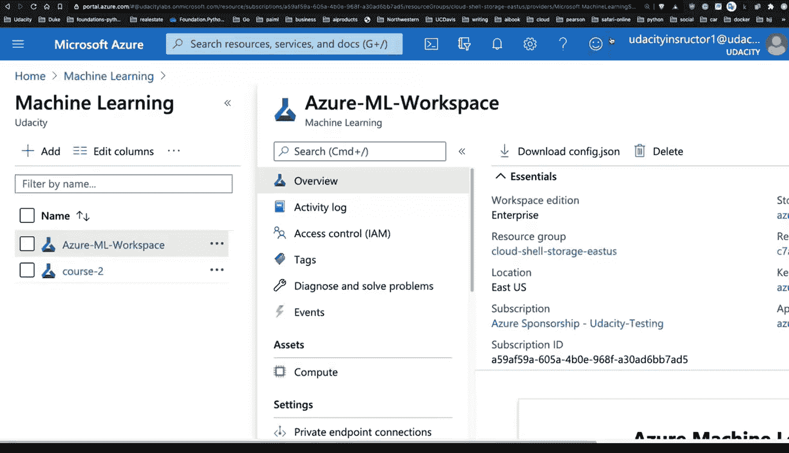
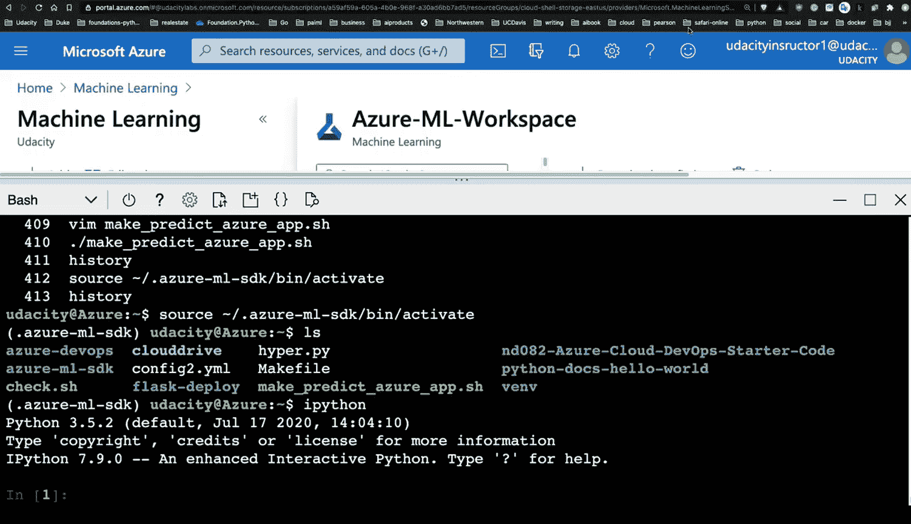
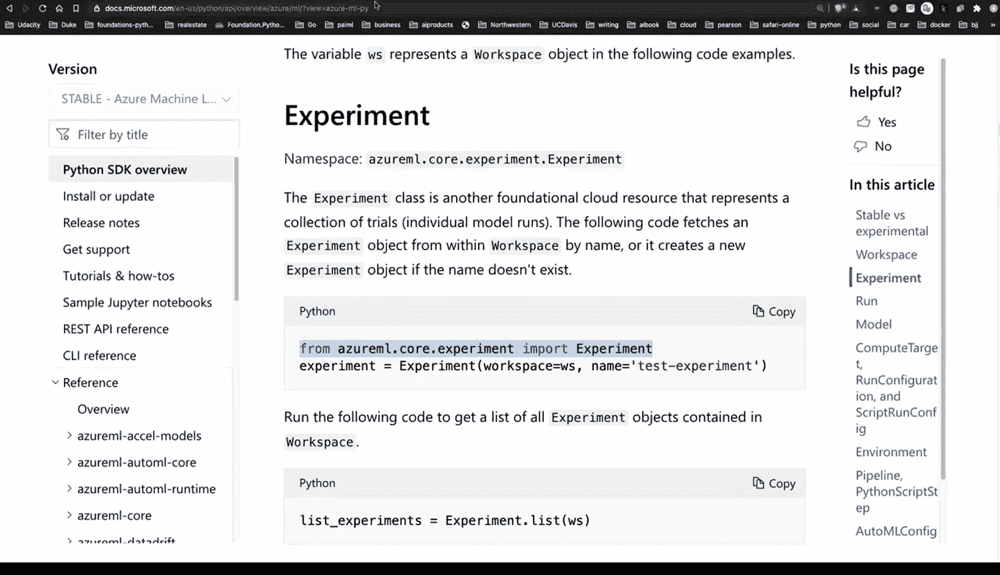
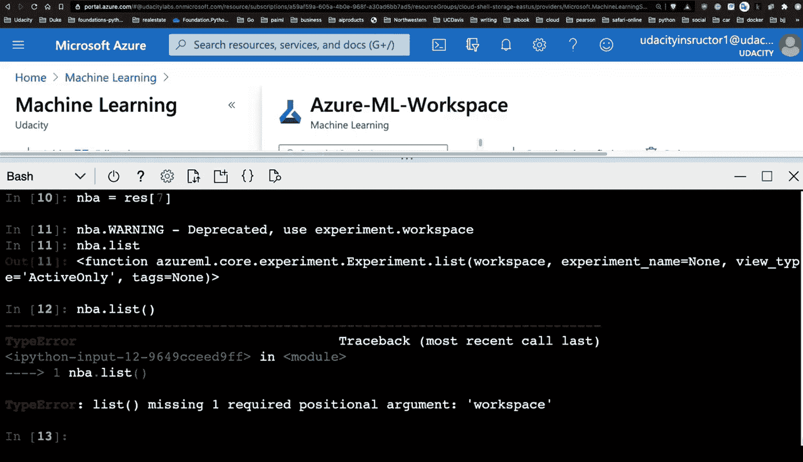
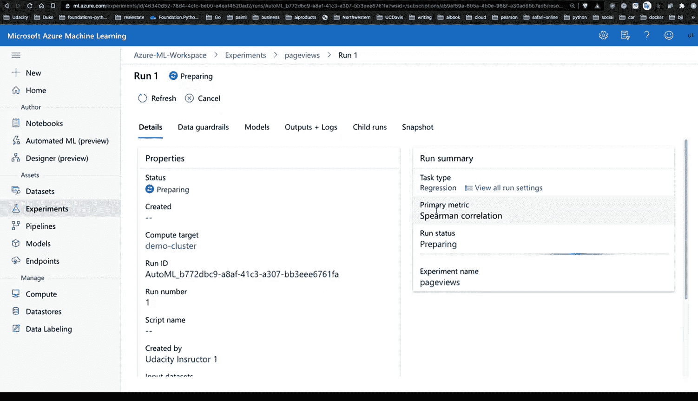

#  137：Azure自动机器学习AI预测 📊🤖



在本节课中，我们将学习如何使用Azure机器学习服务中的自动机器学习功能，来快速构建一个预测模型。我们将以一个NBA球员数据集为例，预测球员的薪资，并探索模型给出的有趣洞察。



---



## 访问Azure机器学习服务

首先，我们需要进入Azure门户。在主页找到并进入“机器学习”服务。



进入机器学习工作区后，我们可以启动工作室。在工作室中，有一个名为“自动ML”的功能，我们将从这里开始。



---

## 准备与上传数据

为了演示，我将使用一个包含NBA球员信息的公开数据集。这个数据集包含球员、位置、三分球命中数、薪资以及维基百科页面浏览量等信息。

以下是数据准备步骤：
1.  下载数据集文件。
2.  在自动ML界面中，点击“新建自动ML运行”。
3.  选择“从本地文件”创建数据集。
4.  将数据集命名为“NBA_salary”，并选择“表格数据”类型。
5.  上传文件，并使用文件第一行作为列标题。
6.  确认数据架构后，创建数据集。

上传完成后，我们可以浏览数据集，查看各列的统计摘要，例如缺失值数量和数据分布。这有助于我们快速了解数据质量。

---

## 配置并运行回归预测实验

上一节我们准备好了数据，本节中我们来看看如何配置一个预测任务。我们的目标是预测球员的薪资（一个连续数值），因此这是一个回归问题。

以下是创建回归实验的步骤：
1.  选择我们刚创建的“NBA_salary”数据集。
2.  点击“下一步”，创建一个新实验，命名为“predict_salary”。
3.  在配置中，选择“salary”列作为我们要预测的目标。
4.  选择一个计算集群来运行实验。
5.  在任务类型中，选择“回归”，因为薪资是连续数值。
6.  点击“完成”开始自动训练。

自动ML将自动尝试多种回归算法（如决策树、随机森林、梯度提升等），并组合成集成模型，以找到最佳预测方案。

---

## 分析模型结果与洞察

实验运行完成后，我们可以查看结果。系统会展示性能最佳的模型，通常是一个“投票集成”模型。

我们来看一下关键评估指标：
*   **R平方**：约为56%，说明模型能解释薪资变异的56%，这是一个不错的结果。
*   **平均绝对误差**：约为3（百万美元），这是预测值与实际值的平均差距。

但更有趣的是模型提供的**特征重要性**解释。它告诉我们哪些因素对预测薪资影响最大：

1.  **罚球命中率**：这是最重要的特征，但可能并不直观。
2.  **年龄**：第二重要的特征。
3.  **上场时间**：比较符合直觉。
4.  **防守篮板** 和 **社交媒体影响力**：令人惊讶的是，Twitter粉丝数和维基百科页面浏览量比投篮尝试次数更重要。

通过分析特征贡献，我们发现：
*   罚球命中率与薪资呈正相关，即罚球越准，薪资倾向于越高。
*   年龄对薪资的影响有正有负，分布相对均衡。
*   社交媒体影响力（页面浏览量）对薪资有显著的正面影响。

这些洞察可能对球员经纪人很有价值，例如，他们可以建议球员重点提升罚球命中率和社交媒体曝光度。



---

## 通过代码调用模型



上一节我们分析了模型结果，本节中我们来看看如何通过编程方式与训练好的实验进行交互。我们可以使用Azure Machine Learning Python SDK来列出实验或部署模型为API。



以下是一个示例代码框架，展示如何连接到工作区并列出实验：

```python
# 导入必要的库
from azureml.core import Workspace
from azureml.core.experiment import Experiment

# 从配置文件加载工作区
ws = Workspace.from_config()

# 列出工作区中的所有实验
experiment_list = Experiment.list(ws)
for exp in experiment_list:
    print(exp.name)

# 假设我们的实验名为 'predict_salary'，可以获取它
salary_experiment = Experiment(ws, name='predict_salary')
# 接下来可以获取实验中的最佳运行，并部署为Web服务等
```



通过这种方式，我们可以将训练好的模型集成到自己的应用程序（例如Flask Web应用）中，实现自动化的预测流程。

---

## 扩展实验：尝试其他预测任务

自动ML的灵活性在于可以快速针对不同目标进行实验。我们可以用同一份数据尝试预测其他变量。

以下是两个额外的实验思路：
1.  **预测页面浏览量**：创建一个名为“predict_page_views”的新实验，选择“page_views”作为目标列，同样使用回归任务。这可以预测哪位球员最受公众关注。
2.  **预测球员位置**：创建一个名为“position_prediction”的新实验，选择“position”作为目标列。由于位置是类别（如后卫、前锋），这次我们选择**分类**任务。

启动这些实验后，自动ML会分别为我们构建合适的模型。这样，无需手动编写和调优大量代码，我们就能探索数据中多种不同的关系。

---

## 总结

本节课中我们一起学习了Azure自动机器学习的核心工作流程。我们从上传NBA数据集开始，配置并运行了一个回归模型来预测球员薪资。通过分析结果，我们获得了关于影响薪资因素的有趣洞察，例如罚球命中率和社交媒体影响力的重要性。最后，我们还了解了如何通过Python SDK以编程方式与实验交互，并扩展了实验以尝试分类等其他预测任务。




自动机器学习大大降低了机器学习的入门门槛，让数据科学家和开发者能快速构建、评估和部署有效的预测模型。