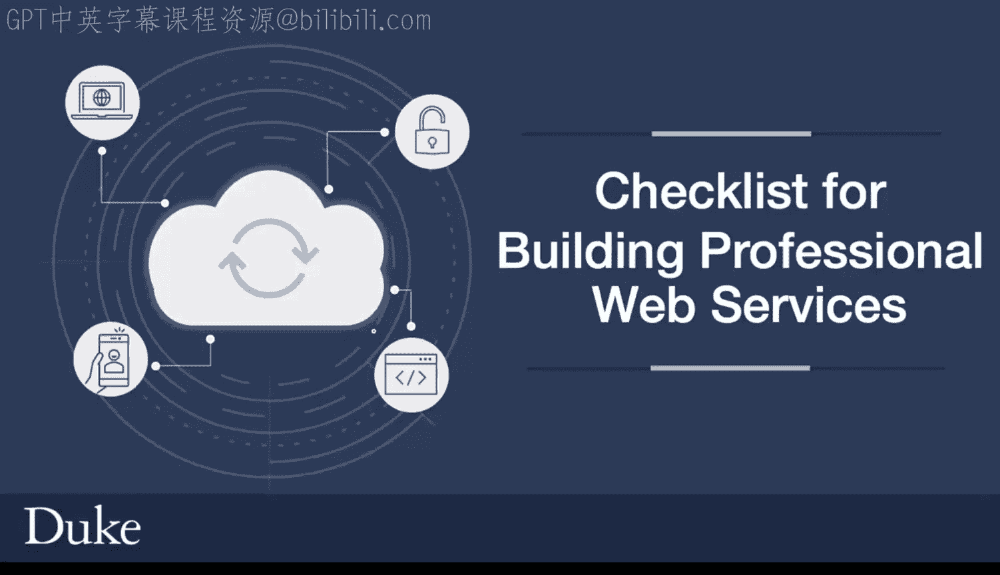
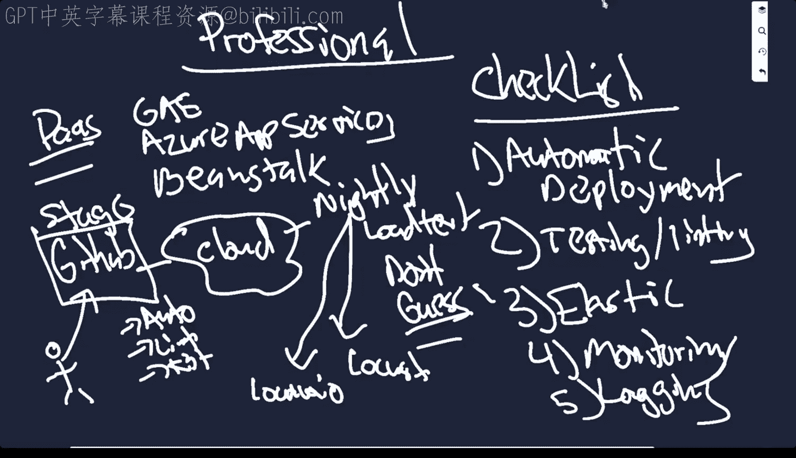
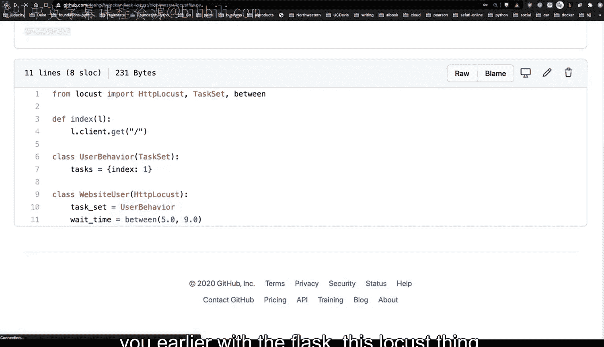
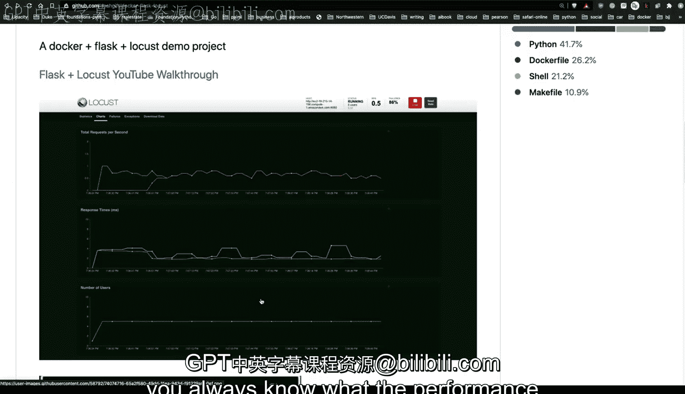

#  142：构建专业Web服务清单 📋

在本节课中，我们将学习如何构建一个专业的Web服务。核心在于建立一个系统化的检查清单，以确保服务的自动化部署、弹性伸缩、监控与测试等关键环节都得到妥善处理。

---

## 专业Web服务的检查清单

构建专业Web服务时，你需要一份检查清单。这份清单确保服务在开发、部署和运维的各个环节都符合高标准。

以下是构建专业Web服务时必须考虑的关键项目：

1.  **自动化部署流程**：你必须拥有一个自动化的部署流程。这是专业云开发的必备条件。
2.  **测试与代码检查**：你需要建立测试和代码检查机制。这非常重要且功能强大。
3.  **弹性伸缩能力**：你需要确保你的服务具备弹性伸缩能力。
4.  **监控与日志记录**：你需要添加监控和日志记录功能。例如，当服务出现问题时，你如何能及时知晓。

上一节我们介绍了专业Web服务的核心检查项目，本节中我们来看看如何将这些项目融入一个具体的工作流程。

---

## 核心工作流程：不要猜测，始终验证

核心建议是采用以下工作流程。在弹性方面，我们的原则是：**不要猜测，始终验证**。猜测会让你陷入麻烦。

具体流程如下：

1.  **代码提交**：开发者将代码提交到GitHub仓库。
2.  **自动化部署与检查**：代码提交后，系统自动将其部署到云端。在此过程中，系统会执行代码检查、运行测试等任务。
3.  **触发定期负载测试**：部署完成后，我建议触发一个定期（例如每晚）的测试。这可以通过两种服务实现：
    *   **Loader.io**
    *   **Locust**

你为什么要这样做？因为任何事情都可能发生。即使你使用的是可以自动伸缩的平台即服务工具，也不要猜测其表现。这就像你家里需要安装烟雾报警器一样——你不能假设今天安全，明天就一定安全。因此，在预发布环境中设置一个夜间负载测试，可以验证你的应用性能，而不是仅仅猜测它运行良好。

如果你同时配置了像AWS CloudWatch这样的监控和日志服务，你就能更好地掌握应用状态。

---

## 负载测试工具示例

以下是两个可用于实施夜间负载测试的工具示例。

### 示例一：Flask + Locust

这里有一个使用Flask和Locust的示例。这是一个很好的参考，展示了你可以如何实现。本质上，你可以添加一个非常简单的测试来确保应用不会在负载下崩溃。部署过程中的测试可能关注业务逻辑，而这种负载测试是更高层次的验证。为什么不设置它在夜间自动运行呢？

### 示例二：Loader.io

另一个我使用过的工具是Loader.io。我非常喜欢这个简单的基于云的负载测试工具。它的工作方式是：你登录后，可以配置测试，让它发送大量请求。你可以安排它在夜间运行。测试完成后，它会生成图表，显示你的应用实际能处理多少流量。它基本上和前面提到的Flask Locust工具做同样的事情：发起大量请求来测试你的应用。

---

## 核心原则总结

这不是一个二选一的问题。即使你构建在具有优秀弹性能力的服务之上，你仍然需要验证它。我的建议是：在预发布环境中设置夜间测试，这样你就能始终了解你应用程序的性能能力。

---

本节课中我们一起学习了构建专业Web服务的核心检查清单，并探讨了通过自动化工作流程和定期负载测试来“验证而非猜测”服务性能的重要性。掌握这些实践，是确保Web服务具备专业性、可靠性和可扩展性的关键。