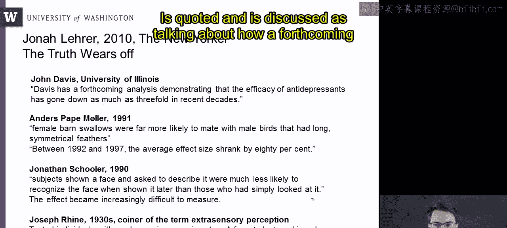
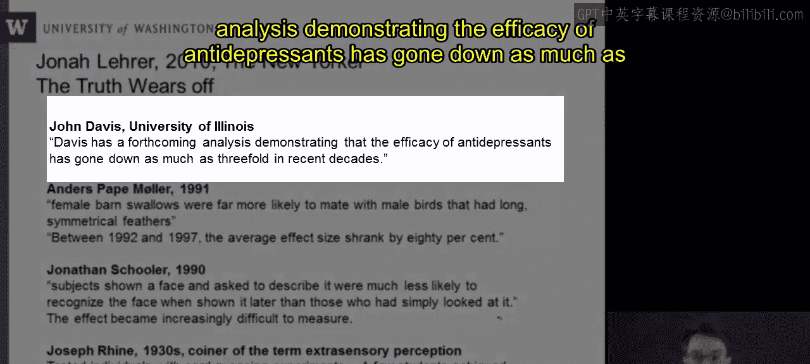
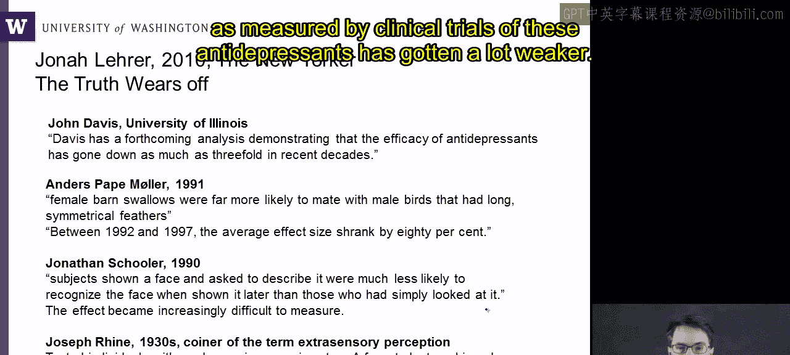
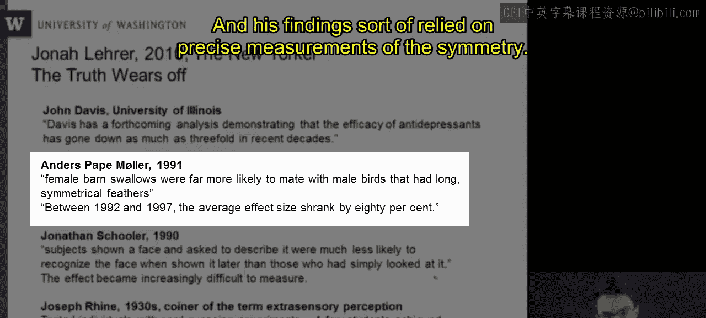
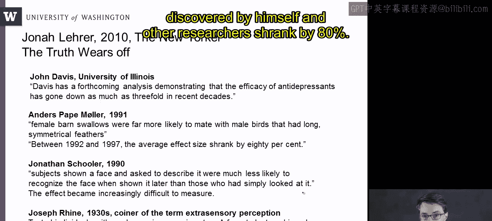
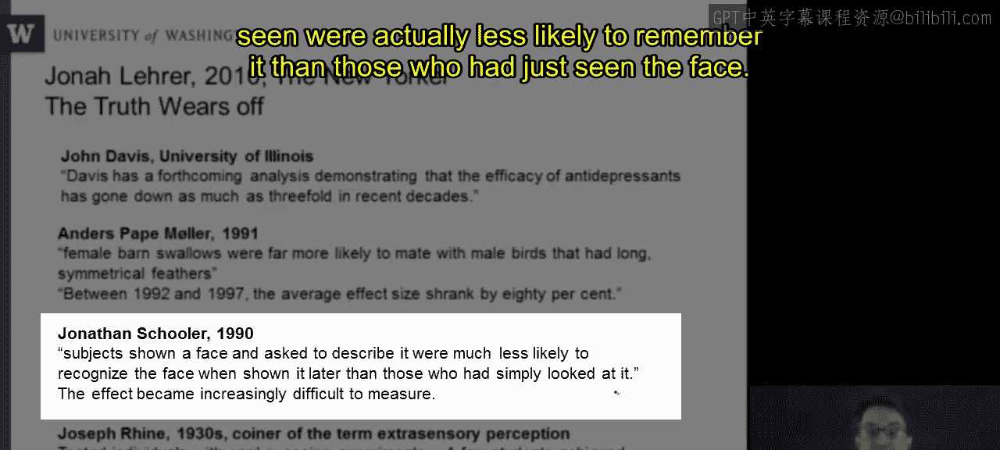
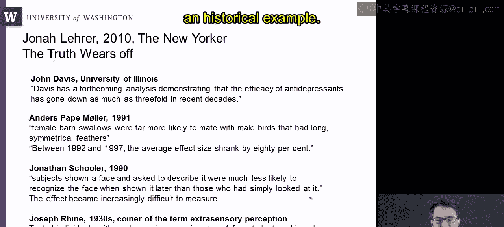
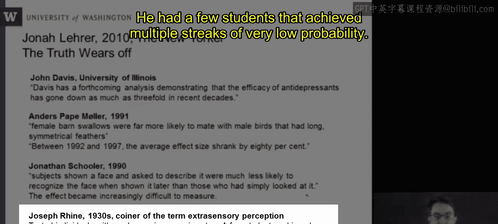
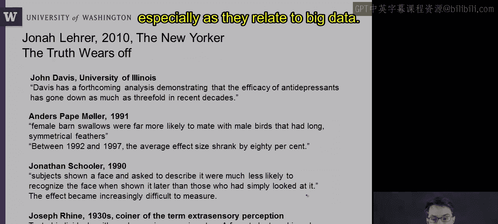

#  001：预测分析入门

在本节课中，我们将从信息学转向分析学，重点学习统计估计与预测的核心概念。我们将探讨如何利用之前学到的工具来实现这些概念，并理解为什么数据分析的核心常常归结为求和与平均等基本运算。

## 课程背景与目标

上一节我们介绍了信息学，即数据的**管理、操作与集成**。本节中，我们来看看分析学，特别是**统计估计与预测**。这部分内容建立在信息学基础之上，您将能运用已学的工具来实现新的分析技术。

一个重要的观点是，人们通常认为的“分析”中，有80%本质上可归结为进行**求和**与**求平均**的能力。理解问题和解决方案的难度可能因人而异，但就实现而言，并不算太复杂。

## 从“坏科学”现象谈起：效应衰退

为了开启这个话题，我们来看一篇2010年《纽约客》的文章。需要说明，这并非严谨的研究论文，其许多观点也未必可取。但文章提出了一个值得探讨的现象：科学领域的统计结果似乎随着时间推移而变弱，这被称为“**效应衰退**”。

以下是文章中提到的几个例子：

*   **抗抑郁药效减弱**：伊利诺伊大学的研究员约翰·戴维斯指出，近几十年来，证明抗抑郁药有效性的临床分析结果效力下降了多达三倍。
*   **燕子择偶研究**：安德斯·穆勒研究发现，雌燕更倾向于与羽毛长且对称的雄燕交配。但在随后的五六年里，该效应的**效应量**（effect size）缩小了80%。
*   **言语遮蔽效应**：乔纳森·斯库勒在1990年发现，被要求用语言描述一张面孔的人，其记忆效果反而不如仅观看面孔的人。这个反直觉的效应后来也变得越来越难以测量和复现。
*   **超感官知觉（ESP）实验**：20世纪30年代，约瑟夫·班克斯·莱因通过猜牌实验试图测量ESP。他发现一些受试者初期能连续猜中多张牌，但随后表现下降，即出现了“衰退效应”。

文章触及了对这一现象的正确解释，但也提出了一些可能带有神秘色彩的错误解释。

## 本节的探索路径

在接下来的几个小节中，我们将以“效应衰退”现象作为案例，深入探讨**统计学和统计估计**。我们将以此为契机，介绍统计学的基本概念，以及一些与大数据相关的、更为进阶的统计概念。

---

本节课中，我们一起学习了课程从信息学到分析学的过渡，并引入了“效应衰退”这一有趣现象作为后续探讨统计学的起点。下一节，我们将开始深入统计估计的核心原理。