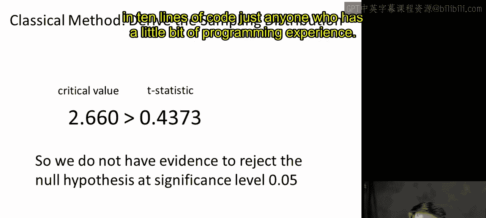

#  005：推导抽样分布 📊

在本节课中，我们将学习如何推导两个样本均值之差的抽样分布。这是进行假设检验（如t检验）的核心步骤。我们将从理解抽样分布的基本概念开始，逐步推导出计算标准误差和t统计量的公式。

## 抽样分布的性质

上一节我们介绍了抽样分布的概念。本节中我们来看看如何描述两个样本均值之差的抽样分布。

该分布可以通过其**均值**和**方差**来描述。这至少基于两个原因成立：
1.  我们假设了基础总体服从正态分布，因此可以推断出 `T_bar - S_bar` 的分布也是正态的。
2.  根据**中心极限定理**，无论总体分布如何，只要样本量足够大，样本均值的分布也会趋近于正态分布，而正态分布正是由均值和方差这两个参数描述的。

那么，我们感兴趣的统计量 `T_bar - S_bar` 的均值是多少？它就是T样本的均值减去S样本的均值，即 `μ_T_bar - μ_S_bar`。

## 方差的计算

接下来，我们探讨 `T_bar - S_bar` 的方差。这里需要明确，我们讨论的是**均值**的方差，而不是样本本身的方差。具体来说，是如果我们重复实验成千上万次，每次计算得到的T组样本均值的波动情况。

`T_bar - S_bar` 的方差等于 `T_bar` 的方差加上 `S_bar` 的方差，公式表示为：
`Var(T_bar - S_bar) = Var(T_bar) + Var(S_bar)`

这从方差定义可以推导，但直观上也容易理解：两个样本各自的均值波动越大，它们之间差值的可能范围也就越广。需要注意的是，这个公式成立的前提是我们假设了两个样本是**独立**的。

## 从理论到估计

目前，我们已经知道 `T_bar - S_bar` 的抽样分布可以用均值和方差描述，并且将方差表达为两个均值方差之和。但我们无法直接计算 `Var(T_bar)`，因为我们不可能重复无数次实验。

以下是解决这个问题的步骤：
1.  根据中心极限定理，我们可以用**总体方差除以样本量**来近似均值的方差：`Var(T_bar) ≈ σ_T² / n_T`。
2.  由于我们不知道总体方差 `σ²`，我们用**样本方差** `s²` 来估计它。
3.  将上述估计代入，我们得到方差的实用计算公式：
    `Var(T_bar - S_bar) ≈ s_T² / n_T + s_S² / n_S`

这样，我们就用实际可以计算的样本统计量（样本方差和样本量）重新表达了抽样分布的方差。

## 计算标准误差与t统计量

回到最初的问题：如何计算**估计的标准误差**？标准误差就是抽样分布的标准差估计值。因此，我们对方差估计值取平方根即可：
`SE ≈ sqrt( s_T² / n_T + s_S² / n_S )`

现在，我们可以构建最终的**t统计量**。t检验的统计量计算公式为：
`t = (T_bar - S_bar - 0) / SE`
其中，`0` 是我们的零假设值（即假设两组均值无差异）。将我们计算出的均值差和标准误差代入，就能得到一个具体的t值。

## 做出统计决策

得到t值后，我们不能立即判断其显著性，还需要**自由度**和**t分布**。t分布的形状类似于正态分布，但尾部更厚，它对样本量更敏感：样本量越大，t分布越接近正态分布。

自由度的计算有一个特定公式（韦尔奇-萨特斯韦特近似）：
`df ≈ (s_T²/n_T + s_S²/n_S)² / [ (s_T²/n_T)²/(n_T-1) + (s_S²/n_S)²/(n_S-1) ]`

获得自由度和选定显著性水平（如0.05）后，我们可以查阅t分布临界值表。如果计算出的t统计量的绝对值小于对应自由度和显著性水平下的临界值，我们就**没有足够证据拒绝零假设**，认为观察到的差异可能由偶然因素导致。

## 总结

本节课中我们一起学习了推导两独立样本均值差抽样分布的全过程：
1.  我们明确了 `T_bar - S_bar` 的抽样分布可由其均值和方差描述。
2.  我们推导出该方差等于两组样本均值方差之和：`Var(T_bar) + Var(S_bar)`。
3.  我们利用中心极限定理和样本方差，将理论方差转化为可计算的估计形式：`s_T²/n_T + s_S²/n_S`。
4.  通过取平方根，我们得到了估计标准误差 `SE`。
5.  最后，我们构建了t统计量 `(T_bar - S_bar)/SE`，并了解到需要通过比较t值与特定自由度下t分布的临界值来进行统计推断。

这个过程虽然逻辑严密，但步骤较为繁琐。在接下来的内容中，我们将看到一种利用计算模拟（如重抽样方法）来实现同样严谨推断的替代方案，该方法通常只需少量代码即可完成。