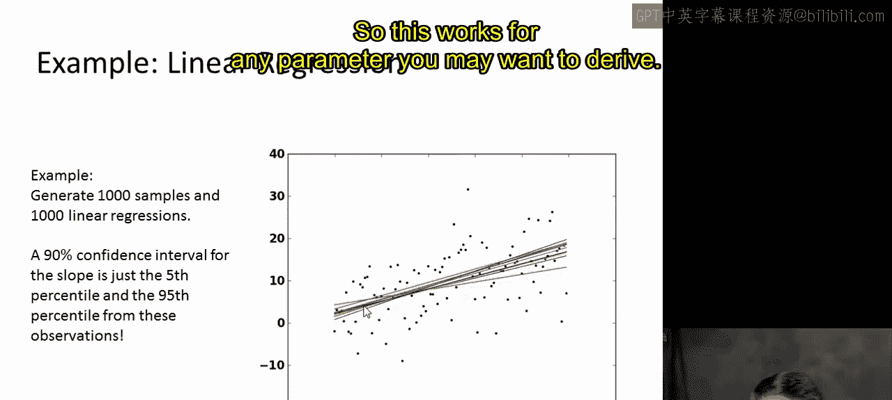

#  008：自助法 📊

在本节课中，我们将学习一种强大的统计方法——自助法。我们将了解其核心思想、操作步骤，以及如何用它来计算置信区间和评估统计量的变异性。

---

## 概述

我们已经讨论了如何判断一个结果是否具有统计显著性。然而，仅仅知道是否显著还不够，我们还需要了解效应的大小以及统计量在重复实验中可能取值的范围。经典方法通过查表和使用标准误差来计算置信区间，但自助法提供了一种更直接、更灵活的计算方式。

上一节我们介绍了显著性检验，本节中我们来看看如何使用自助法来估计统计量的置信区间。

## 自助法的核心思想

自助法的核心思想非常简单：**通过从原始数据集中有放回地重复抽样，来模拟重复实验的过程**。这样，我们就能生成大量“新”的数据集，并在每个数据集上计算我们关心的统计量（例如均值、均值差、回归系数等），从而得到该统计量的一个经验分布。

## 自助法的操作步骤

以下是执行自助法的具体步骤：

1.  **准备原始数据集**：假设我们有一个包含 `n` 个观测值的原始数据集。
2.  **生成自助样本**：从原始数据集中**有放回地**随机抽取 `n` 个观测值，构成一个新的数据集。这个新数据集称为一个“自助样本”。由于是有放回抽样，同一个原始观测值可能在新样本中出现多次或一次也不出现。
3.  **计算统计量**：在这个自助样本上，计算我们感兴趣的统计量（例如，样本均值）。
4.  **重复过程**：将步骤2和步骤3重复很多次（例如1000或10000次）。
5.  **分析结果**：现在我们得到了该统计量的一个经验分布。我们可以通过这个分布来计算置信区间（例如，取第2.5百分位数和第97.5百分位数作为95%置信区间的上下限）。

## 为何要“有放回”抽样？

这是一个关键点。自助法要求**有放回**抽样，原因如下：

*   **模拟独立同分布**：经典统计理论通常假设我们的数据是独立同分布地从某个总体中抽取的。有放回抽样能确保每个自助样本内的观测值是独立的（因为每次抽取都是独立的），从而更好地模拟从原始数据所代表的“经验分布”中独立抽样的过程。
*   **避免样本退化**：如果进行无放回抽样，当自助样本大小等于原始样本大小时，每次抽到的样本都将是原始数据集本身的一个排列，缺乏变异性。即使允许样本大小不同，无放回抽样也会导致后续抽到的观测值依赖于之前抽到的结果，破坏了独立性假设。

## 一个简单的例子

假设我们有一个原始数据集：`[1, 2, 3, 4, 5, 6]`，其均值为 `3.5`。

*   我们进行第一次自助抽样，可能得到样本：`[4, 3, 4, 1, 6, 2]`，其均值为 `(4+3+4+1+6+2)/6 = 3.33`。
*   我们重复这个过程成千上万次，每次计算一个均值。
*   最终，我们得到成千上万个均值，构成了均值的一个经验分布。我们可以基于这个分布来计算均值的置信区间。

## 应用于我们的实验数据

在我们的药物实验中，我们需要分别对测试组和标准组的数据进行自助抽样。

具体操作是：
1.  从测试组原始数据中有放回地抽取一个自助样本。
2.  从标准组原始数据中有放回地抽取一个自助样本。
3.  计算这两个自助样本的均值差。
4.  将步骤1-3重复大量次数（如10000次）。
5.  分析这10000个均值差的结果。

通过这个过程，我们可以绘制出均值差的直方图。例如，图中可能会显示，均值差为0的点（即无效应）完全落在由第2.5百分位数和第97.5百分位数（图中红色竖线）定义的95%置信区间之内。这直观地证实了我们之前的结论：没有足够的证据拒绝零假设（即药物无效），因为观察到的效应（例如均值差为12.4）很可能只是偶然发生的。

## 自助法的广泛应用

自助法不仅限于计算均值或均值差的置信区间，它可以应用于各种统计量和模型参数。

例如，在**线性回归**中：
1.  我们有一个包含许多数据点的原始数据集。
2.  我们从中进行有放回抽样，生成大量自助样本。
3.  在每个自助样本上重新拟合线性回归模型，得到一条回归线。
4.  我们会得到许多条斜率相近但又不完全相同的回归线。
5.  通过分析这些斜率的分布，我们就可以为“真实的”回归线斜率构建一个置信区间。

## 注意事项与总结

本节课中我们一起学习了自助法。它是一种强大且直观的重抽样技术，让我们无需依赖严格的分布假设（如正态分布），就能估计统计量的变异性和置信区间。其核心在于通过有放回抽样从现有数据中模拟出大量“新”数据集，从而逼近统计量的抽样分布。

**关键要点总结**：
*   **目的**：估计统计量（如均值、回归系数）的置信区间和变异性。
*   **核心操作**：`bootstrap_sample = random.choice(original_data, size=len(original_data), replace=True)`
*   **关键要求**：**有放回**抽样，以保证样本间的独立性，模拟从经验分布中独立抽样的过程。
*   **优势**：灵活，适用于多种统计量，对总体分布假设要求低。
*   **结果解释**：通过大量重复计算得到的统计量经验分布，我们可以直接计算百分位数来获得置信区间。

需要注意的是，虽然自助法非常稳健，但在某些极端情况下（如数据量非常小、或统计量本身不光滑时）可能需要谨慎使用。不过，对于大多数实际数据分析问题，它都是一种极其有价值的工具。