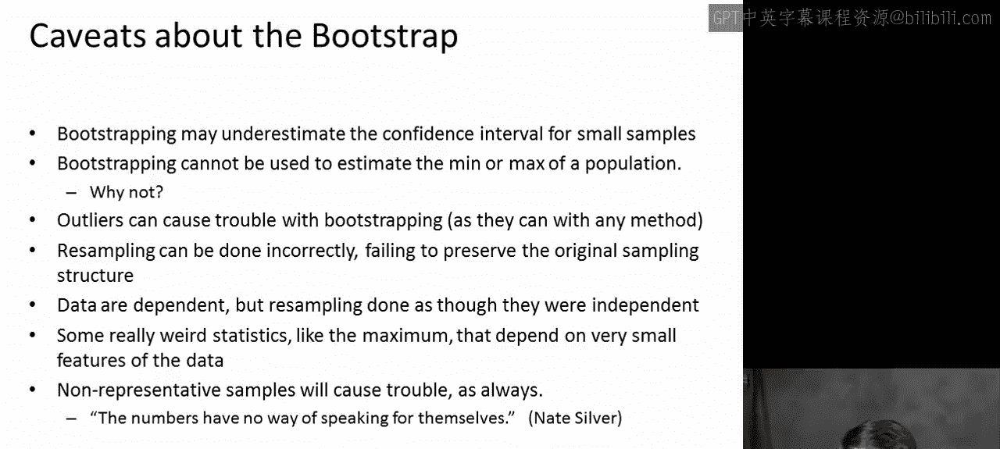

#  009：重抽样注意事项 📊

在本节课中，我们将探讨重抽样方法（特别是置换检验和自助法）的注意事项。我们将理解为何需要区分显著性检验和置信区间估计，并了解自助法在特定情况下的局限性。

---

上一节我们介绍了置换检验和自助法。本节中，我们来看看使用这些方法时需要注意的关键事项。

首先，一个核心问题是：为什么不能直接用置信区间来判断显著性？毕竟，如果置信区间不包含零值，似乎就表明差异显著。

原因是，计算置信区间时，我们**已经假设**所观察到的差异（例如均值差）是真实存在的。而显著性检验（如置换检验）的起点是**零假设**，即假设两组数据没有差异。两者逻辑起点不同。

以下是一个直观的例子来说明其重要性：
假设我们只有两个数据值：一个来自治疗组（生存36天），一个来自安慰剂组（生存27天）。两组均值差为 `9`。

*   **使用自助法计算95%置信区间**：由于样本极小，自助重抽样产生的差异值几乎总是 `9` 或 `-9`。因此，置信区间会非常窄，例如 `[9, 9]`，这似乎强烈表明差异显著。
*   **使用置换检验计算P值**：当我们随机打乱标签多次，大约一半的情况差异为 `9`，另一半为 `-9`。得到的P值约为 `0.5`，远高于通常的显著性阈值（如0.05），表明**观察到的差异并不显著**。

这个例子清晰地表明：
> **正确的流程是：首先基于零假设使用置换检验判断显著性；如果结果显著，再使用自助法估计置信区间。**

---

接下来，我们讨论自助法的一些注意事项和局限性。

自助法非常稳健，比许多经典方法假设更少。但在某些情况下需要谨慎使用。

以下是自助法的主要注意事项：

1.  **小样本可能低估变异性**：对于非常小的样本，自助法可能无法充分捕捉总体变异性，从而导致置信区间过窄。不过，在大数据场景下，这通常不是主要问题。
2.  **不适用于估计极值**：自助法**不能**可靠地估计总体最小值或最大值等统计量。原因是极值对异常点极其敏感。自助抽样是**有放回**的，可能漏掉那个决定最大值的单一异常点，从而导致对极值分布的估计有偏。
3.  **需保持原始数据结构**：进行重抽样时，必须模拟原始实验的数据生成过程。例如，在比较两组数据时，应分别对每一组进行自助抽样，而不是混合所有数据后再抽样。如果数据结构更复杂（如分层抽样），抽样设计也需要在重抽样中复现。
4.  **数据需满足独立性假设**：标准自助法要求数据点是独立同分布的。如果数据存在自相关（如时间序列数据），直接应用自助法无效。

对于非独立数据（如时间序列），有时可以采用一些创造性技巧。例如，可以将一个长序列分割成多个**不重叠的区块**，将每个区块视为一个独立的“观测”，在区块级别计算统计量，然后对这些区块进行重抽样。这种方法被称为“区块自助法”。

---

最后，我们必须认识到，任何统计方法，包括重抽样，都无法替代对数据本身的理解。

正如统计学家Nate Silver所言：“**数字无法为自己说话。**” 重抽样是一种强大的计算工具，但它不能消除数据中固有的偏差，也无法弥补拙劣的实验设计。

无论使用重抽样方法还是经典方法，理解**数据的来源、采集过程以及背后的实验设计**都至关重要。统计学的“帽子”要求我们始终对数据的背景保持敏感。

---

**本节课总结**

本节课我们一起学习了重抽样方法的注意事项：
1.  明确了**显著性检验（置换检验）** 和**置信区间估计（自助法）** 需分步进行，逻辑起点不同。
2.  探讨了自助法的局限性，包括对小样本、极值估计的谨慎态度，以及必须**保持数据结构**和**数据独立性**的要求。
3.  强调了无论方法多么强大，对**数据背景和生成过程的理解**始终是做出正确统计推断的基石。