#  010：异常值与秩变换 📊

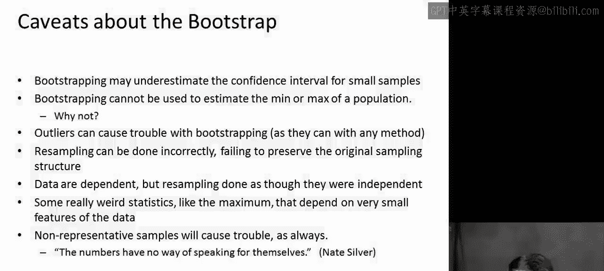

在本节课中，我们将学习如何处理数据中的异常值。异常值对重采样方法和经典统计方法都可能造成问题。我们将重点介绍一种简单而强大的技术——秩变换，它能有效缓解异常值的影响，并适用于许多数据科学场景。

## 异常值的问题

上一节我们讨论了重采样方法，本节我们来看看数据中一个常见的挑战：异常值。异常值是指那些与数据集中其他观测值显著不同的极端值。它们会扭曲统计分析结果，例如使均值产生严重偏差，并影响许多统计模型的性能。

## 秩变换：核心概念

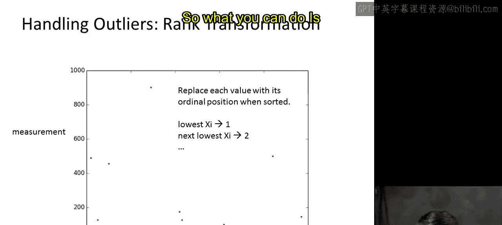

为了解决异常值问题，我们可以使用秩变换。其核心思想非常简单：**将每个数据点的原始值替换为其在排序后数据集中的序数位置**。

具体步骤如下：
1.  将数据集中的所有值从小到大排序。
2.  将最小的值赋值为1，次小的值赋值为2，依此类推。
3.  将转换后的秩值（1, 2, 3...）映射回原始数据点的顺序。

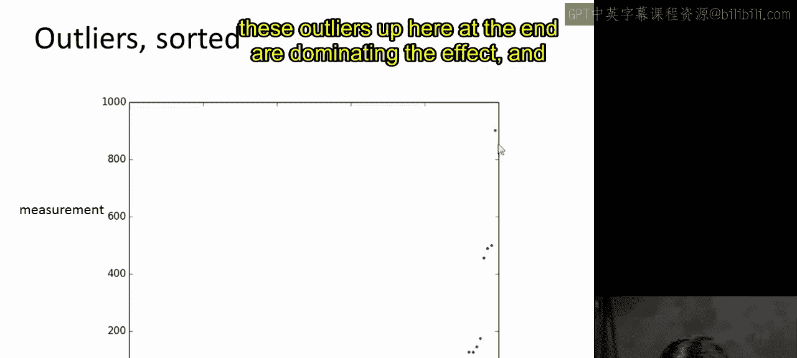

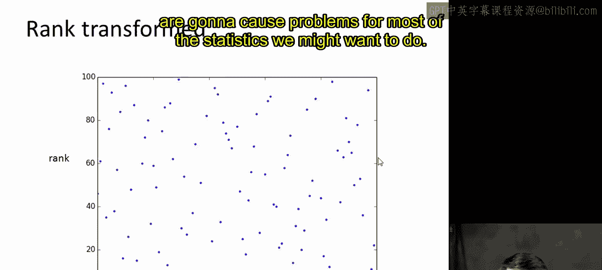

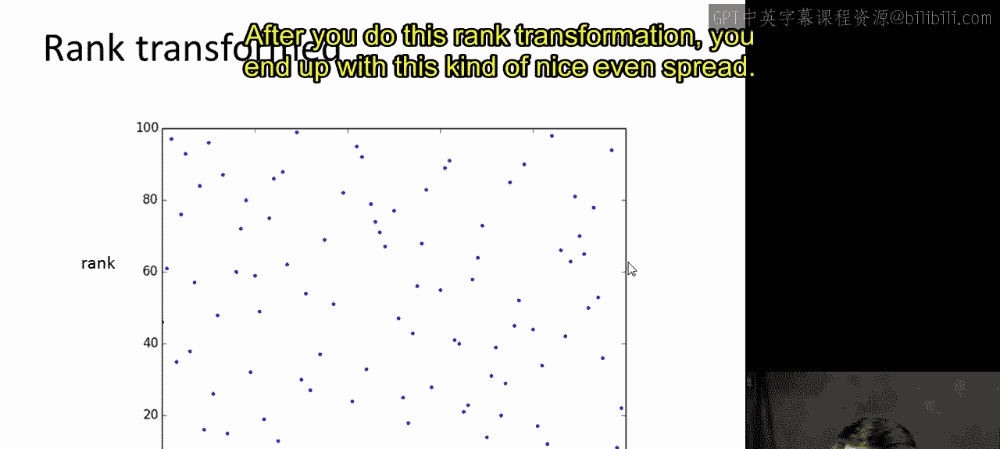

用公式表示，对于一个包含 `n` 个观测值的数据集 `X = [x1, x2, ..., xn]`，其秩变换 `R(X) = [r1, r2, ..., rn]`，其中 `ri` 是 `xi` 在排序后序列中的位置。

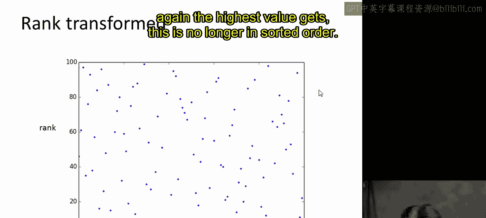

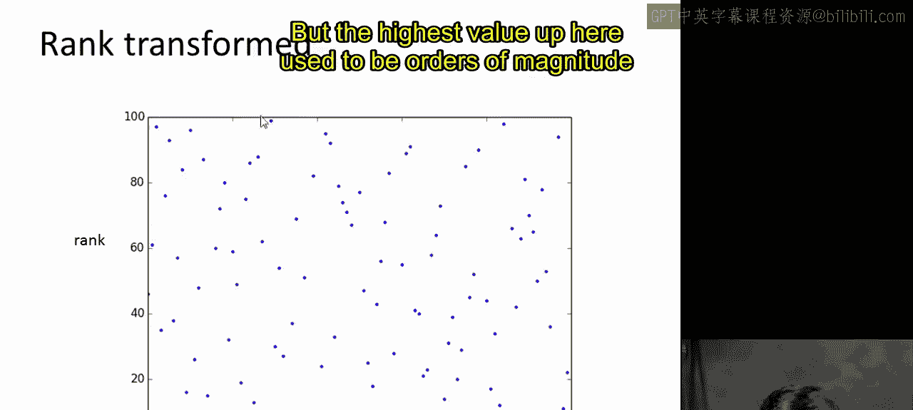

## 秩变换的效果

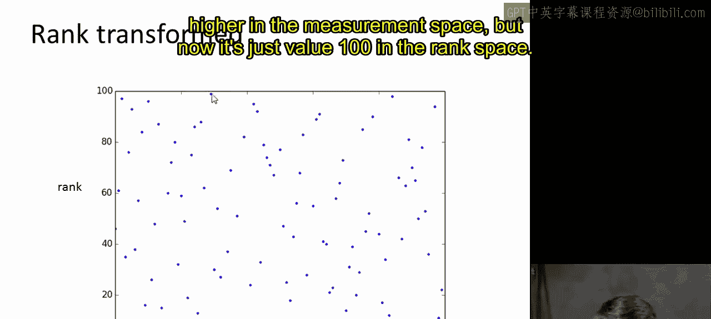

通过一个例子可以直观理解秩变换的效果。假设原始数据中存在一些极高的异常值，而大量数据聚集在较低值附近。

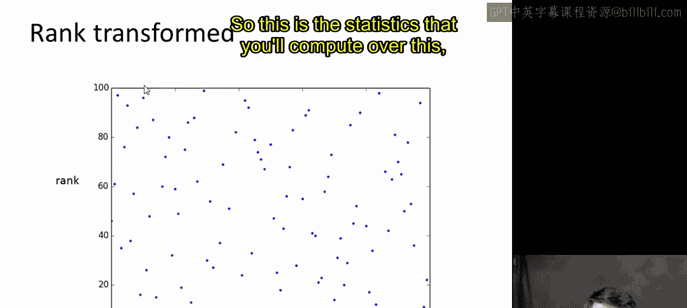

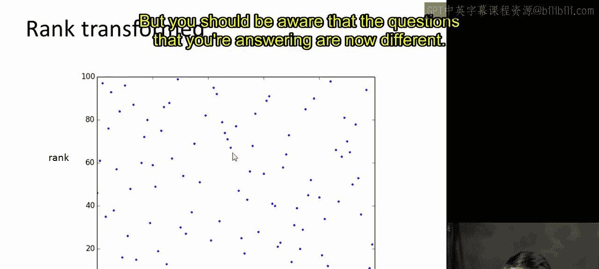

原始数据图显示，低值区域存在明显的结构，但少数极高的异常值主导了整个数据范围，掩盖了下方的结构。

执行秩变换后，数据被均匀地映射到一个从1到n（数据点总数）的区间。原本极高的异常值，其数值可能比其他值大几个数量级，但转换后，它只是变成了一个较大的秩（例如100），而不再具有压倒性的数值优势。这使得数据的内部结构变得清晰可见。

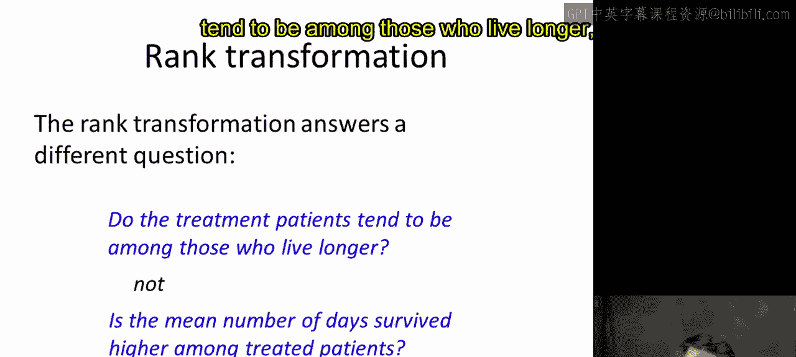

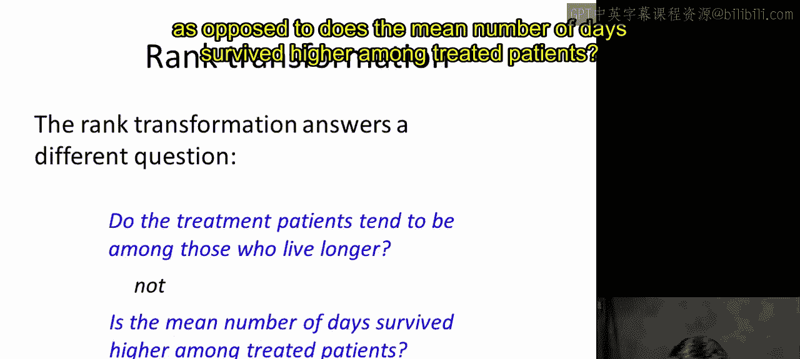

## 秩变换的适用场景与注意事项

秩变换非常实用，但必须注意，**它改变了我们所回答的问题的性质**。

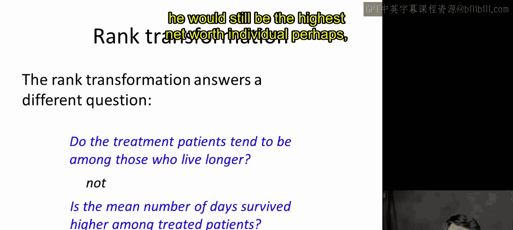

以下是秩变换适用的一些场景：

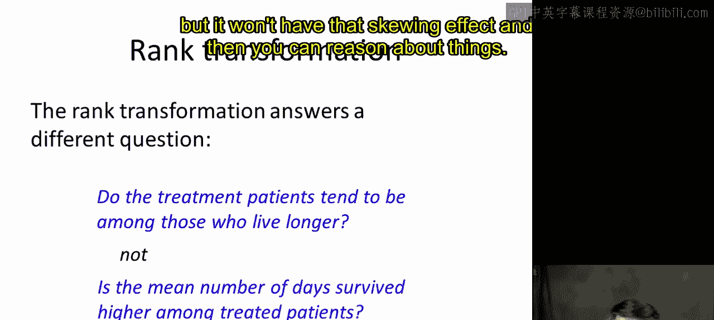

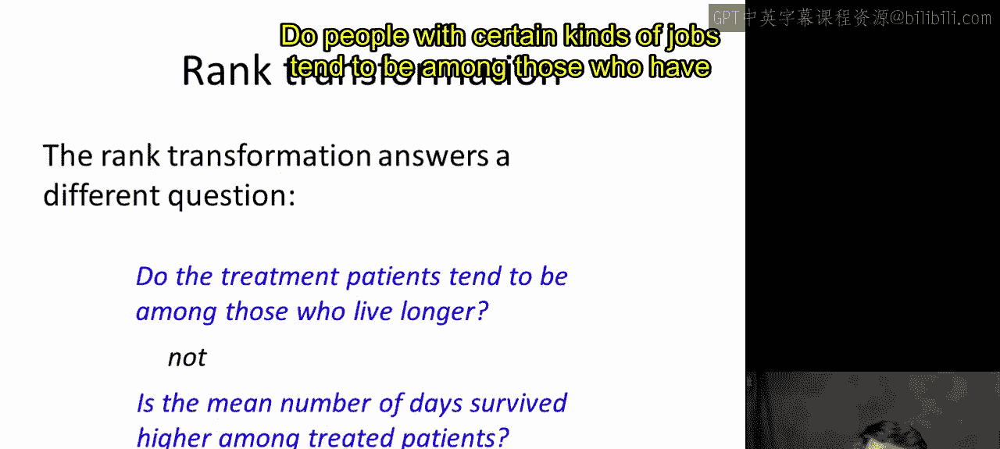

*   **比较组间趋势**：例如，在医疗实验中，我们不再问“接受新疗法的患者平均存活天数是否更高？”，而是问“接受新疗法的患者是否倾向于在存活时间较长的患者群体中？”。
*   **处理高度偏态数据**：例如分析收入或净资产数据时，如果样本中包含像比尔·盖茨这样的极端值，他会严重拉高平均值。秩变换后，他仍然是最高秩，但其极端数值不再扭曲整体分布，我们可以转而研究“从事特定职业的人是否更可能属于净资产最高的群体？”。
*   **消除尺度差异**：秩变换能自然地处理不同尺度间的比较。例如，比较不同城市的生活成本或薪资时，绝对值差异很大，但通过秩变换可以研究“某个职业在A城市是否属于高收入阶层，在B城市是否也属于高收入阶层？”，而无需担心具体货币数值和购买力差异。

**关键点**：使用秩变换后，你进行的统计推断是关于数据的**序数关系**（排名先后），而非原始的**基数关系**（具体数值大小）。这对于研究相对位置、百分位数或分组趋势的问题非常有效。

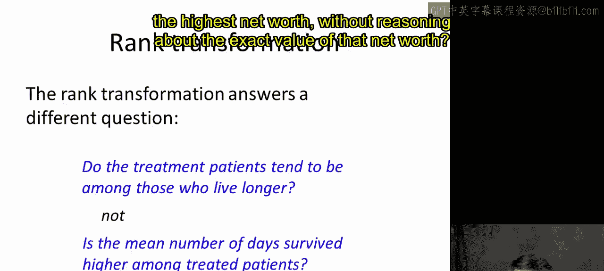

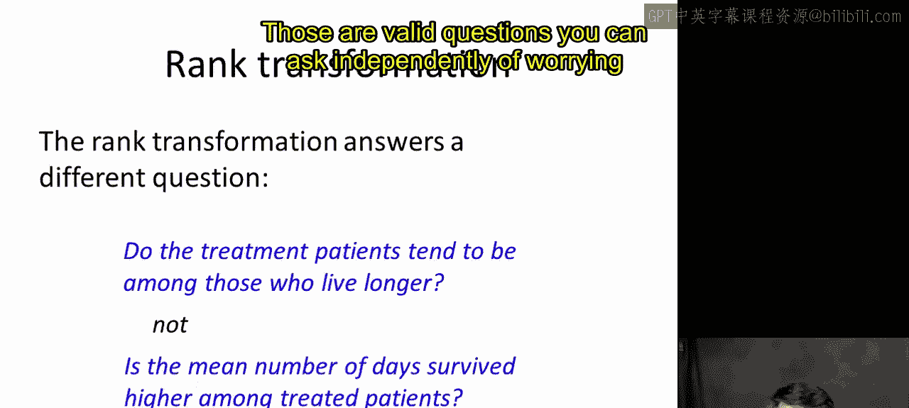

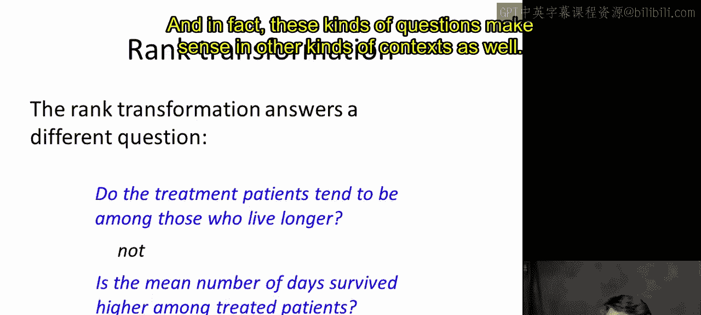

## 总结

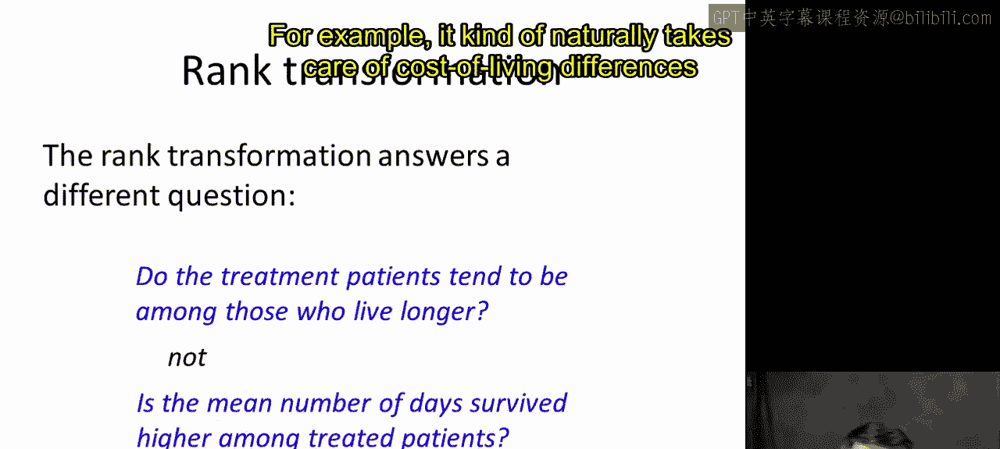

本节课我们一起学习了处理异常值的一种有效技术——秩变换。我们了解到异常值如何干扰统计分析，掌握了秩变换将数据值转换为排序秩的基本原理，并通过实例看到了它如何消除极端值的影响，使数据分布更均匀。最后，我们明确了秩变换改变了分析问题的角度，它适用于关注相对排名、组间趋势或需要消除尺度差异的场景，但在需要基于原始数值进行解释时则需谨慎使用。