#  011：卡方检验示例 📊

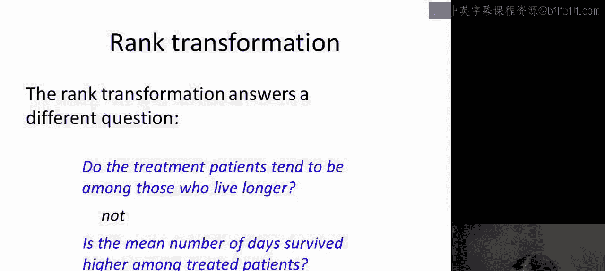

在本节课中，我们将学习如何将重抽样方法应用于另一种统计推断场景：**卡方检验**。卡方检验主要用于分析**分类数据**之间的关系，例如探讨健康与财富之间是否存在关联。

## 概述

上一节我们介绍了重抽样的基本思想。本节中，我们来看看如何将其应用于**卡方检验**。卡方检验用于衡量两个分类变量之间的关系，或者观察数据与期望分布之间的差异。

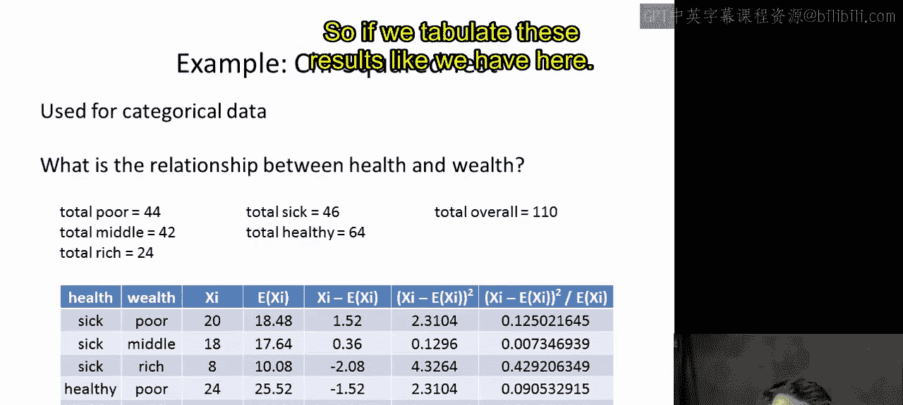

## 卡方检验的应用场景

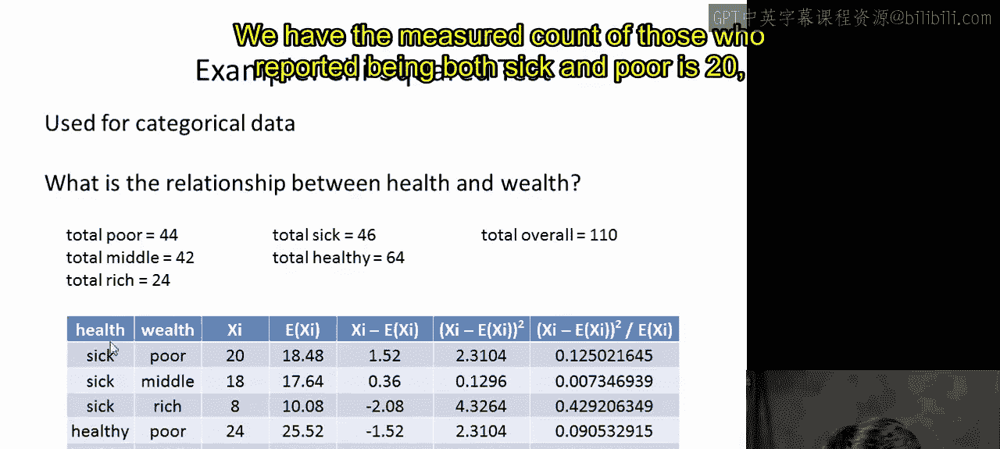

卡方检验适用于分类数据。例如，我们想研究健康与财富之间的关系。这里，我们将“健康”定义为三个类别：贫穷、中产、富有；将“财富”定义为两个类别：生病或健康。我们通过调查获取每个组合类别的计数，并试图理解它们之间的关系。

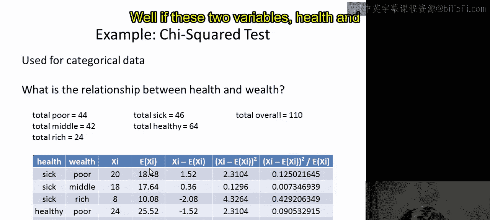

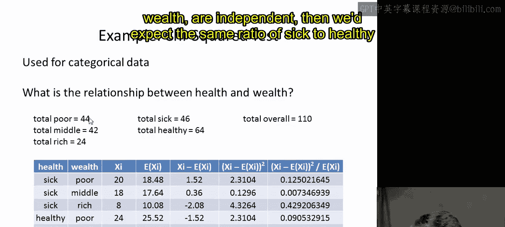

## 计算期望值与卡方统计量

首先，我们需要将调查结果制成列联表。假设我们测量到“生病且贫穷”的人数为20，其他组合也有相应的计数。

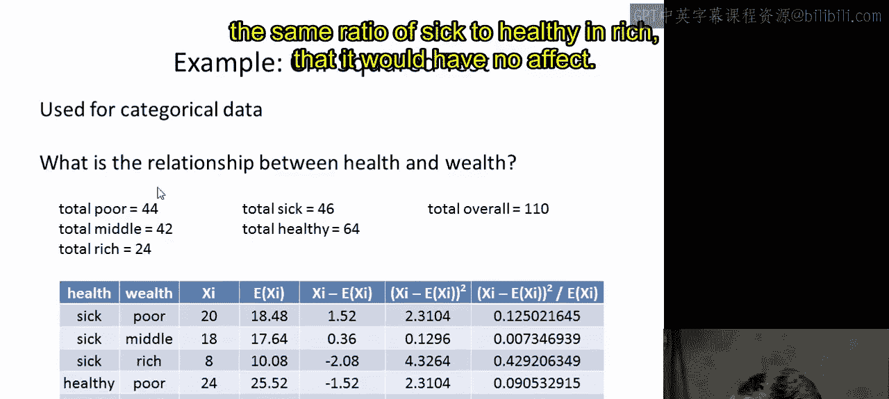

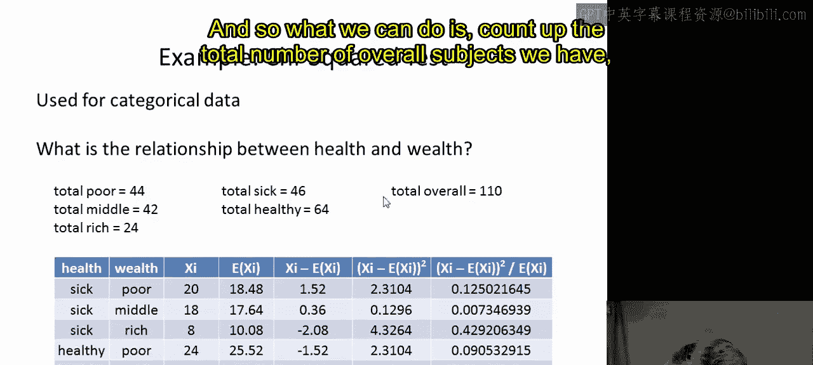

**如何计算我们用于衡量差异的期望值呢？**

如果健康和财富这两个变量是独立的，那么我们会期望“生病与健康”的比例在贫穷、中产和富有人群中是相同的。也就是说，财富对健康比例没有影响。

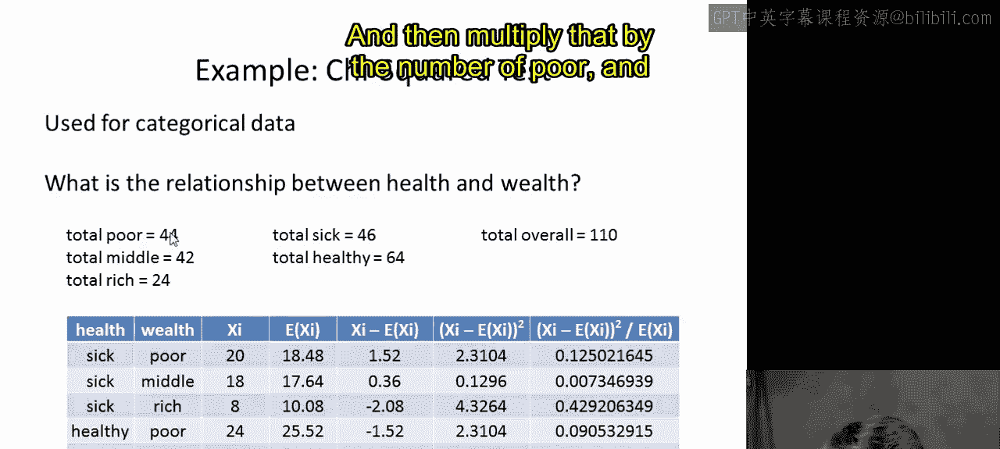

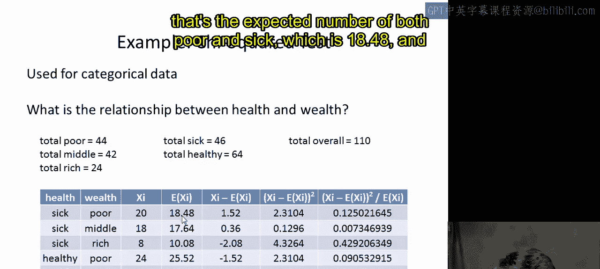

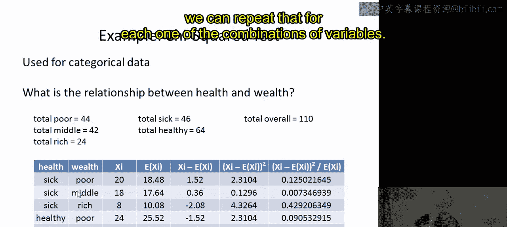

具体计算步骤如下：
1.  统计所有受试者的总数（例如110人）。
2.  计算“生病”人数占总人数的比例：`46 / 110`。
3.  将此比例乘以“贫穷”的总人数，即可得到“生病且贫穷”的期望人数：`(46 / 110) * 贫穷总人数 = 18.48`。
4.  对每个变量组合重复此计算。

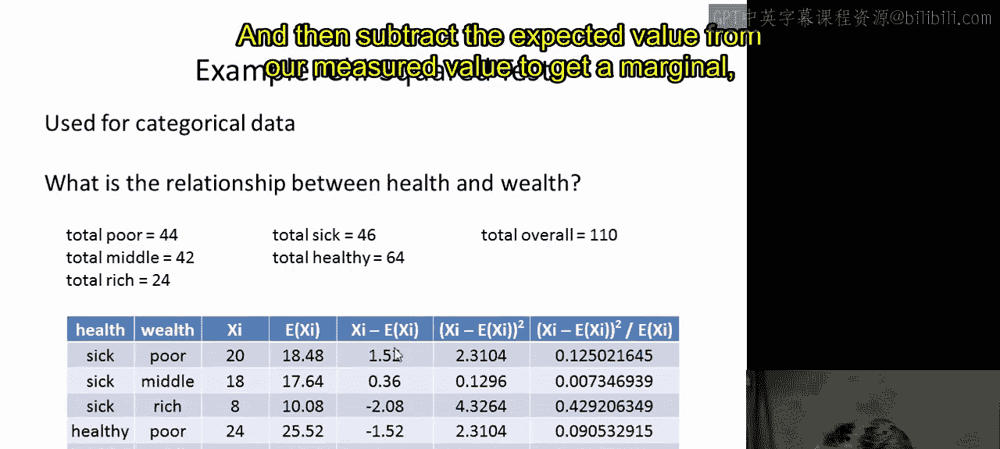

得到期望值后，我们按以下步骤计算卡方统计量：
1.  用观测值减去期望值，得到残差。
2.  将残差平方。
3.  再除以期望值。
4.  最后，将所有组合的上述计算结果相加，得到总的卡方统计量。

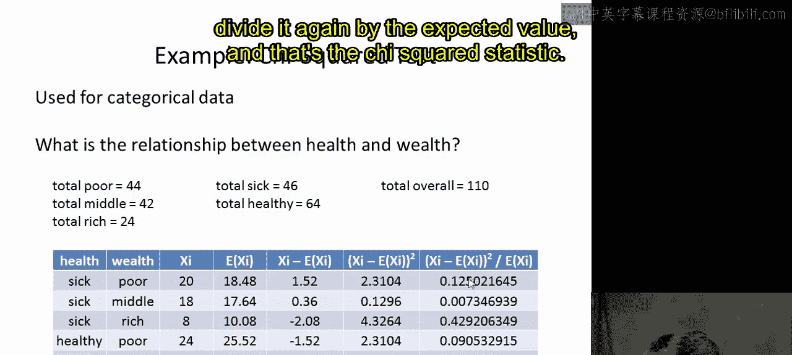

这个卡方统计量就是我们进行显著性检验的基础。

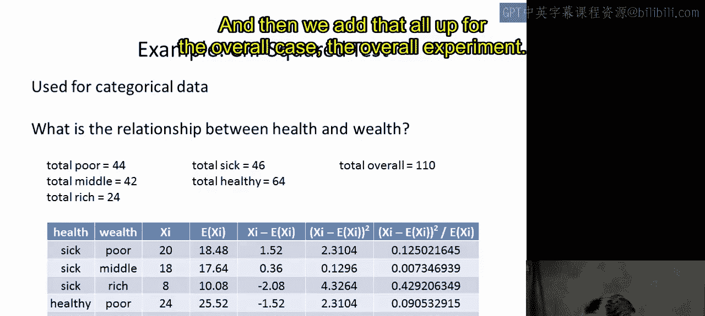

## 使用重抽样方法进行检验

我们之前讨论过打乱标签和自助重抽样法。在这里，需要注意的是，卡方统计量的计算依赖于边际值（即每行的总数和每列的总数）。

因此，我们需要设计一个**重标记或打乱过程**，在保持边际值不变的前提下，改变列联表内部的值。这样我们才能进行检验。

思路如下：
将每个观测值视为一个单一的复合标签（例如“生病_贫穷”、“生病_中产”、“健康_富有”），而不是两个独立的标签。然后，我们可以像往常一样进行**打乱检验**。由于我们打乱的是这些复合标签，边际值（如贫穷总人数、健康总人数）必然会保持不变。

## 卡方检验的注意事项

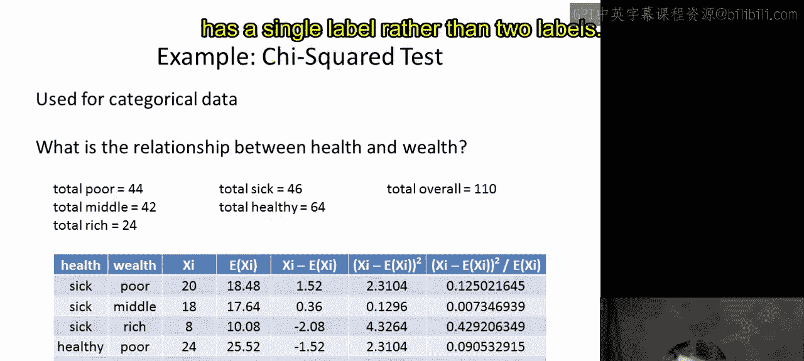

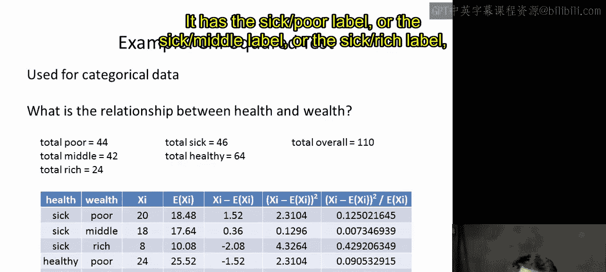

关于卡方检验，需要提及的一点是，它仅在**每个类别的观测数至少为10**时才有效。如果某个类别的观测数少于10，则使用卡方检验是无效的，因为样本将不服从卡方分布。

## 总结

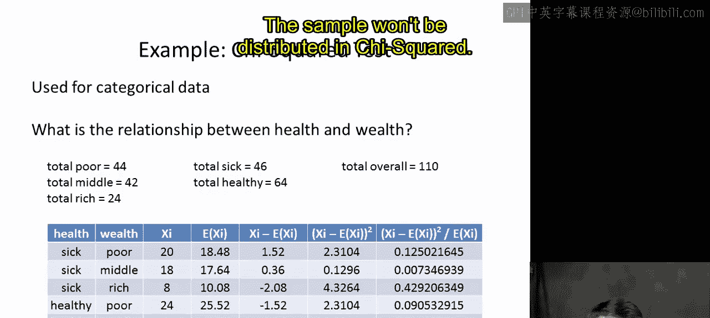

本节课中，我们一起学习了如何将重抽样方法应用于**卡方检验**。我们了解了卡方检验用于分析分类变量关系的基本原理，掌握了计算期望值和卡方统计量的步骤，并探讨了通过打乱复合标签来进行重抽样检验的具体方法。最后，我们记住了卡方检验有效性的一个重要前提条件。