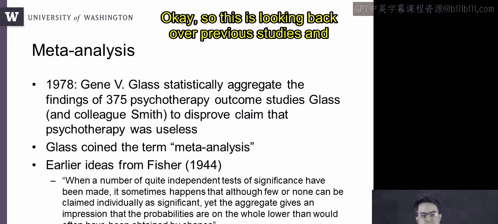
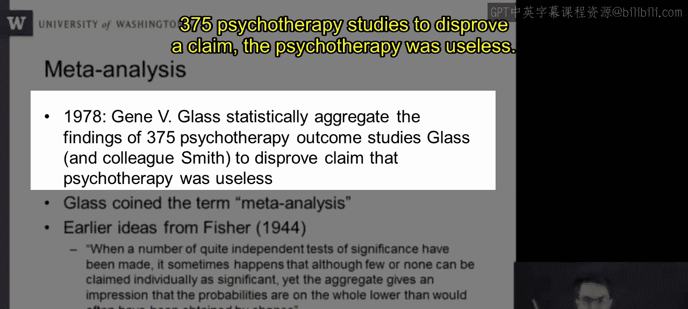
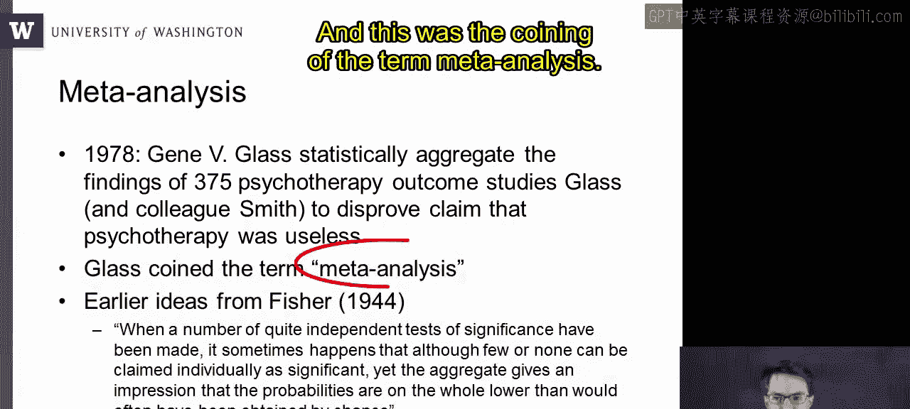

#  014：元分析 📊

在本节课中，我们将要学习元分析（Meta-analysis）的概念。这是一种通过整合先前多项独立研究的结果，以获得更全面、更可靠结论的统计方法。它在评估存在发表偏倚的研究领域时尤为重要，并且在大数据科学中，当我们整合来自不同来源的数据时，理解元分析的原理也至关重要。

## 元分析的起源与概念

上一节我们讨论了发表偏倚，与之相关的一个重要概念就是元分析。

元分析的核心是回顾并整合先前多项研究的结果。在1978年，统计学家格拉斯（Glass）通过统计方法汇总了**325项心理治疗研究**的结果，以证明“心理治疗无效”这一主张。这项工作标志着“元分析”这一术语的正式诞生。

这种方法建立在早期统计学家（包括费希尔）的思想之上。费希尔曾指出：当进行了一系列独立的显著性检验时，有时虽然单独看每一项结果都不显著，但综合起来却能给人留下深刻印象，即整体上由偶然性导致的概率会更低。这意味着，**个体研究可能显得微弱，但我们可以通过聚合它们来得到一个更有力的结果**。

## 元分析在大数据科学中的重要性

我想特别强调元分析思想在大数据科学背景下的重要性，原因有二：

1.  你经常需要处理并非由你自己收集的数据，因此将其视为一项元分析实验可能非常有用。
2.  大数据之所以“大”，通常是因为它由多个不同来源的数据组合而成。理解何时可以以及如何进行这种组合至关重要。

## 如何进行元分析？

那么，我们如何进行元分析呢？方法其实相当简单。

其基本思想是计算各项独立研究结果的**加权平均值**。

以下是定义权重的两种常见方法：

*   **按样本量加权**：这是一种非常简单的方法，即给予样本量更大的研究更高的权重。其权重公式为：
    `w_i = n_i / Σn_j`
    其中，`w_i` 是第 `i` 项研究的权重，`n_i` 是该项研究的样本量，`Σn_j` 是所有研究的总样本量。
*   **按逆方差加权**：这是一种更复杂的方法，权重为方差的倒数（即 `1 / 方差`）。方差高的研究（可能因为样本量小或其他原因）精度较低，因此被赋予较低的权重。标准误的平方（`1 / SE^2`）是计算这种权重的一种常见方式。

这里重要的是理解其背后的直觉：**给予更精确（方差更小、样本量更大）的研究更高的权重**，而不是仅仅记忆公式。

## 注意事项与异方差性

当然，和往常一样，这里有一个重要的注意事项。上述讨论基于**固定效应模型**，它假设每项独立研究都在测量同一个真实的效应量。

此外，在讨论发表偏倚的漏斗图时，我们看到了另一种现象：图形一侧方差高，另一侧方差低。描述这种现象的通用术语是**异方差性**。它指的是**方差本身并非常数**。

例如，在某个图表中，方差在两端高，在中间低。异方差性本身不一定是问题，估计值仍然是无偏的。但它会增加整体的误差估计，导致统计功效降低。因为你最终会得到一个非常高的误差数值，即使你在预测方面做得相当不错。

为了说明这一点，我生成了一个模拟数据图。我故意让方差沿着X轴变化，然后根据某种分布对Y值进行抽样。这里的关键点是，尽管重复绘制回归线多次，其变化并不大。问题在于，你可能会因为忽略了真实效应而增加误差并失去统计功效。

## 总结

本节课中，我们一起学习了元分析。我们了解了它的起源——通过整合多项研究（如325项心理治疗研究）来获得更强大的结论。我们探讨了其核心方法：对独立研究结果进行加权平均，并介绍了按样本量加权和按逆方差加权两种权重定义方式。我们还指出了固定效应模型的假设前提，并引入了异方差性的概念，即方差不恒定可能对统计功效产生影响。理解元分析对于批判性评估现有文献以及在大数据项目中审慎地整合多源数据都具有重要意义。