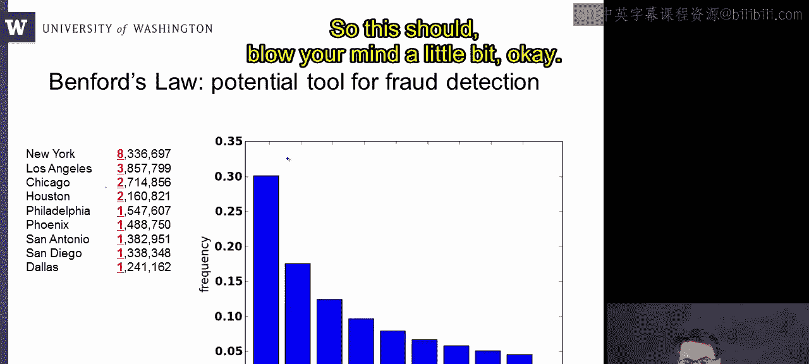

#  015：欺诈检测与本福特定律 📊

在本节课中，我们将探讨科学发现“衰退效应”的另一个原因——欺诈，并学习一个用于检测数据欺诈的统计工具：本福特定律。

上一节我们介绍了科学发现“衰退效应”的多种原因，本节中我们来看看另一个重要因素：人为错误与欺诈。

## 欺诈现象的上升趋势 📈

有证据表明，学术不端行为正在增加。衡量这种现象的一种方式是观察论文撤稿的数量。根据诺登在2011年《自然》杂志上发表的文章，从2001年到2011年，论文撤稿数量增加了十倍，而同期发表的论文总数仅增加了1.44倍。

以下是来自PubMed和Web of Science两个数据库的撤稿数量趋势图。需要说明的是，这两个数据库均不包含计算机科学领域的论文。

可以看到，撤稿数量显著上升。

## 欺诈检测工具：本福特定律 🔍

我们不深入探讨欺诈现象的所有细节，但希望介绍一个有时用于检测欺诈的统计工具：本福特定律。

如果你不熟悉本福特定律，这是一个非常有趣且值得了解的定律。它**预测了数据中首位数字的分布**。

如果不深入思考，你可能会凭直觉认为，在随机数据中，首位数字的分布应该是均匀的，即数字1到9出现的概率大致相等。但事实证明，在许多情况下，其分布并非如此。

本福特定律预测的分布是：数字1作为首位数字出现的频率最高，约为30%，数字2次之，依此类推，数字9出现的频率最低。这种分布模式可能会让你感到惊讶。

## 本福特定律的实际案例 📊

在解释其原理之前，我们先看一些实际案例。这些案例取自一个名为testingbenfordslaw.com的网站，该网站收集真实数据并绘制图表。

以下是Twitter用户粉丝数量的首位数字分布：

列表中的数字是粉丝数量。可以看到，粉丝数首位数字为1的Twitter用户占32.62%（图中蓝条），红点则是本福特定律的预测值。首位数字为2的占16.66%，同样与预测值（红点）接近。整体拟合度相当不错。

以下是其他遵循本福特定律的数据集示例：

*   **恒星与地球的距离（以光年计）**：其分布与本福特定律的预测惊人地接近。
*   **2010年5月至9月英国政府支出**：同样，实际数据与本福特定律的预测高度吻合。
*   **Google图书中独特一元语法（1-gram）的数量**：我们几周前讨论过一元语法，它本质上就是单个词语。其分布也与预测相当吻合。

你可能会认为这个网站存在选择偏差，只挑选了符合该定律的数据集。虽然我不能完全保证没有这种可能，但通过一些阅读和（希望我已建立的）一点信任，我希望能够说服你，这并非完全由网站选择性展示数据所致。

## 总结 ✨

本节课中我们一起学习了：
1.  **欺诈是导致科学发现“衰退效应”的原因之一**，论文撤稿数量的显著上升是这一现象的体现。
2.  **本福特定律是一个有用的统计工具**，它描述了自然产生的、跨度多个数量级的数据集中，首位数字的非均匀分布规律（数字1出现频率最高，约为30%）。
3.  我们通过**Twitter粉丝数、恒星距离、政府支出、Google图书词频**等多个真实数据集，验证了本福特定律的预测能力。

理解本福特定律有助于我们以批判性的眼光审视数据，并在某些情况下，识别出可能的人为篡改或欺诈痕迹。