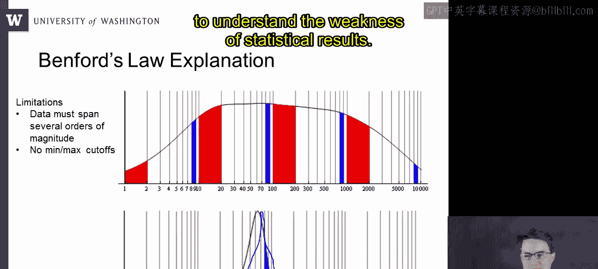

#  017：本福特定律的可视化解释

在本节课中，我们将学习本福特定律，并通过一个模拟实验来直观地理解其背后的概率原理。我们将探讨该定律的适用条件，并了解它在实际中（如欺诈检测）的应用。

## 概率分布的可视化

上一节我们介绍了本福特定律的基本概念，本节中我们来看看其概率分布的具体形态。

下图展示了一个模拟实验的结果。需要说明的是，图中的X轴是对数刻度，这可能会造成一些视觉上的误导。但我们可以通过观察条形的高度来理解其含义。

*   Y轴代表抽到特定首位数字的概率。
*   蓝色条形对应数字1。
*   绿色条形对应数字2，依此类推。

这个图表是通过以下模拟生成的：从一个分布中随机选取数字，然后按照上一节描述的方式（即按顺序放入“帽子”并抽取）进行处理。我们放入一个数字，然后测量抽到首位数字为1的值的概率。

## 概率变化的逻辑

以下是模拟过程中概率变化的逻辑：

*   当放入数字1时，抽到首位为1的卡片的概率是100%。
*   当放入数字2时，概率降至50%。
*   当放入数字3时，概率降至33%，以此类推。
*   当达到数字10时，概率再次上升到一个较高的百分比，并在10、11、12、13、14等数字期间保持较高水平。
*   当达到数字20时，概率又有所下降。

这就是图表中概率先攀升（经过十位数区间），然后又急剧下降的原因。

## 核心机制与公式

此模型的核心在于：当你处理到首位为2的数字时，首位为1的数字总是已经在“帽子”里了；处理到3时，首位为1和2的数字也总已在其中，依此类推。

最终，这些概率峰值由数字1引领。虽然这是一个对数坐标图，面积表示并不完全准确，但曲线下的面积确实代表了抽到该数字的概率，并且数字1的概率实际上是最高的。

关于本福特定律的概率，还有其他模型和思考方式。该定律本身也存在一个**闭合形式的表达式**：

**P(d) = log₁₀(1 + 1/d)**

其中，`d` 代表首位数字（1到9）。

## 定律的适用条件与局限性

本福特定律并非总是成立。其关键适用条件是：数据集必须跨越**多个数量级**。

*   如果数据范围很窄，例如仅在50到90之间随机选取，那么你根本不会得到首位是1的数字。
*   如果数据范围是1到100，虽然会有一点这种效应，但并不普遍。
*   理想情况下，数据需要跨越很多个数量级。

下图说明了这一点：红色区域代表抽到首位数字为1的概率，蓝色区域代表抽到首位数字为8的概率。

只要跨越足够多的数量级，首位为1的区域面积就会大得多。但如果范围很窄，概率就更多地由数据分布本身决定，而没有足够的机会让数字1对应的曲线下面积变大。

## 总结与应用

本节课中我们一起学习了本福特定律的可视化解释。我们通过模拟实验观察了首位数字的概率分布，理解了其“先到先得”的核心机制，并掌握了其数学表达式 `P(d) = log₁₀(1 + 1/d)`。

最后，我们了解到该定律可用于检测欺诈（例如财务数据造假），并将这一点联系回我们最初的背景：试图理解某些统计结果中感知到的、日益增加的弱点或异常。

