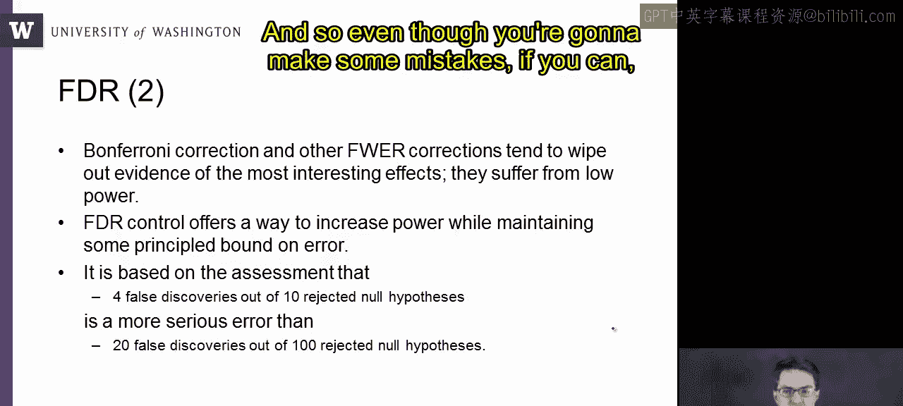

#  019：多重假设检验与错误发现率


在本节课中，我们将学习如何在进行多重假设检验时控制错误。我们将重点介绍两种经典方法：邦费罗尼校正和Šidák校正，并探讨一种更灵活的控制指标——错误发现率。

## 多重假设检验问题

上一节我们介绍了进行多次统计检验时，犯至少一次第一类错误的概率会显著增加。本节中，我们来看看如何通过校正显著性水平来控制这个“族错误率”。

## 推导校正后的显著性水平

我们将从整体的显著性水平α出发，推导出每个独立检验应使用的校正后显著性水平α_c。

我们设定整体显著性水平α等于“至少有一个检验显著”的概率。这个概率可以表示为1减去“所有检验都不显著”的概率。

假设各检验相互独立，那么“所有检验都不显著”的概率就是每个检验“不显著”概率的乘积。如果进行k次检验，这个概率就是 `(1 - α_c)^k`。

因此，我们得到以下公式：
```
α = 1 - (1 - α_c)^k
```

现在，我们求解α_c：
```
1 - α = (1 - α_c)^k
(1 - α)^(1/k) = 1 - α_c
α_c = 1 - (1 - α)^(1/k)
```

这个公式就是Šidák校正。

## 两种校正方法的比较

以下是邦费罗尼校正与Šidák校正的直观比较。


上图放大了0.05显著性水平附近的区域，可以清楚看到两种校正的差异。

*   **邦费罗尼校正**：它将整体显著性水平α平均分配给k次检验，即 `α_c = α / k`。这使得无论进行多少次检验，犯错的概率都被恒定地控制住了。
*   **Šidák校正**：其公式为 `α_c = 1 - (1 - α)^(1/k)`。如图所示，Šidák校正比邦费罗尼校正更为保守，即对显著性水平的要求更严格。

需要记住的是，这两种基于族错误率的校正方法都被认为**过于保守**。使用它们会牺牲过多的**统计功效**，可能导致一些真正有意义的效应无法被检测出来。

## 引入错误发现率

由于族错误率控制方法过于保守，我们引入一种更灵活、统计功效更高的控制指标——**错误发现率**。

为了更好地理解FDR，我们回顾一下假设检验的结果分类，并使用一套新的标记符号：



*   **T/F** 代表原假设实际为 **真/假**。
*   **D/ND** 代表我们的检验结果是 **拒绝/不拒绝** 原假设（即做出/未做出“发现”）。

根据这个表格：
*   **错误发现** 是实际为真却被我们拒绝的情况。
*   **发现总数** 是所有我们拒绝原假设的次数。

**错误发现率** 的定义是：
```
FDR = 错误发现的次数 / 发现的总次数
```

直观地说，如果你做了10次检验并拒绝了10次原假设，其中有4次是错的，这非常糟糕。但如果你做了100次检验，拒绝了50次，其中有20次是错的，虽然错误绝对数更多，但错误比例（40% vs 20%）和探索出的真实效应数量（30个 vs 6个）却不同。

FDR控制的理念在于，发现真实效应是有价值的。只要能将错误发现的比例控制在一定范围内，我们愿意接受一定数量的错误，以换取更高的统计功效和发现更多真实效应的能力。

## 总结


本节课中我们一起学习了多重假设检验的校正方法。我们首先推导了Šidák校正公式，并比较了它与邦费罗尼校正的保守程度。接着，我们指出了基于族错误率的校正方法因过于保守而导致统计功效过低的问题。最后，我们引入了**错误发现率**这一更灵活的控制指标，它允许在控制错误比例的同时，保留更高的统计功效来发现真实存在的效应。