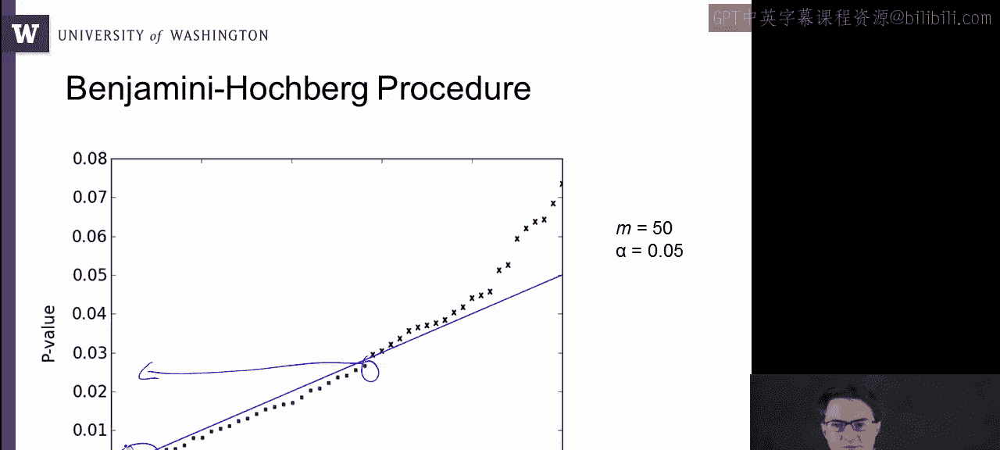

#  020：多重假设检验与Benjamini-Hochberg程序

在本节课中，我们将学习如何控制多重假设检验中的错误发现率。具体来说，我们将介绍Benjamini-Hochberg程序，这是一种用于管理大量假设检验时假阳性比例的统计方法。

## 概述

当同时检验多个假设时，传统的显著性水平（如α=0.05）会导致假阳性结果的数量急剧增加。Benjamini-Hochberg程序提供了一种方法，可以在控制错误发现率的同时，进行多重比较。

## Benjamini-Hochberg程序的工作原理

上一节我们介绍了多重假设检验带来的问题，本节中我们来看看Benjamini-Hochberg程序的具体步骤。

该程序通过调整每个假设的P值比较阈值来控制错误发现率。其核心思想是对P值进行排序，并应用一个随排名递增的、更严格的显著性阈值。

以下是该程序的具体操作步骤：

1.  **计算并排序P值**：首先，计算所有M个假设的P值。然后，将这些P值按从小到大的顺序进行排序。排序后，P值最小的假设（即证据支持最强的假设）排在第一位。
2.  **应用调整后的阈值条件**：对于排序后的第i个假设（i为其排名，从1到M），将其P值与一个调整后的阈值进行比较。这个阈值比原始的显著性水平α更为严格。
    *   调整后的阈值公式为： **(i / M) * α**
    *   其中，**i** 是假设的排名顺序，**M** 是假设的总数，**α** 是预设的显著性水平（通常为0.05）。
3.  **确定拒绝域**：从排名最高的假设开始向下检查，找到**最大的排名i**，使得该假设的P值满足：**P(i) ≤ (i / M) * α**。
4.  **做出决策**：拒绝所有排名小于或等于上一步中找到的i的假设的原假设。换句话说，接受所有排名高于i的假设。

## 程序示例与图解

为了更直观地理解，我们来看一个包含50个假设（M=50）、α=0.05的例子。

根据调整公式，每个假设需要满足的条件如下：
*   第1个假设：P(1) ≤ (1/50)*0.05 = 0.001
*   第2个假设：P(2) ≤ (2/50)*0.05 = 0.002
*   ...
*   第50个假设：P(50) ≤ (50/50)*0.05 = 0.05

可以看到，对排名靠前的假设，条件非常严格；随着排名增加，条件逐渐放宽，直到最后一个假设恢复到原始的α水平。

下图展示了这个过程：

图中，X轴代表假设的排名顺序（i），Y轴代表P值。每个点代表一个排序后的假设。斜线代表调整后的阈值线 **y = (i / M) * α**。

我们的目标是找到位于这条线下方（或线上）的、排名最大的点（图中用“X”标出）。然后，拒绝所有排名小于或等于该点的假设（即该点左侧的所有点）。在这个例子中，我们大约拒绝了30个假设，接受了20个。

## 程序的理论保证

Benjamini和Hochberg证明，遵循此程序，可以将错误发现率控制在预期水平以下。

具体而言，他们证明错误发现率满足：**FDR ≤ (T / M) * α**

其中：
*   **FDR** 是错误发现率。
*   **T** 是所有假设中，原假设为真的总数。
*   **M** 是假设的总数。
*   **α** 是预设的显著性水平。

## 总结

本节课中我们一起学习了Benjamini-Hochberg程序。它是一种强大的统计工具，用于在同时进行大量假设检验时控制错误发现率。其核心步骤包括：对P值排序、应用一个随排名递增的调整阈值 `(i / M) * α`，并据此做出拒绝或接受原假设的决策。这种方法在基因组学、金融、互联网A/B测试等涉及海量比较的数据科学领域尤为重要。