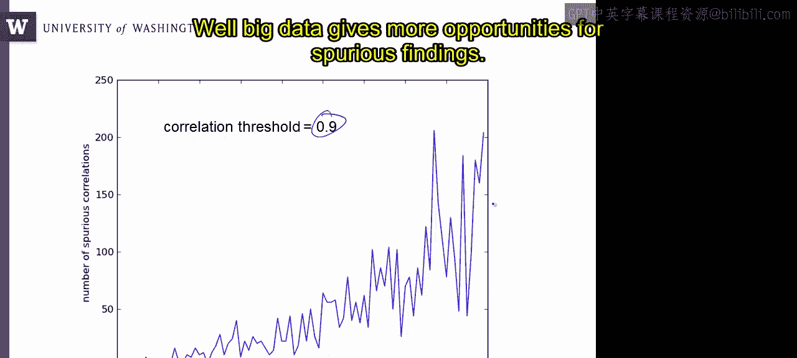

#  022：虚假相关与大数据陷阱 📈

在本节课中，我们将要学习大数据分析中一个常见的陷阱：虚假相关。我们将通过一个股票价格的模拟实验，来理解为什么在庞大的数据集中，我们很容易发现一些看似显著但实际上毫无预测能力的巧合模式。

## 大数据与虚假相关

上一节我们介绍了大数据的基本概念，本节中我们来看看大数据分析可能带来的一个特定问题。这与大数据有何关系？有一种观点认为，大数据存在一种“诅咒”，正如文森特·格兰维尔所指出的：当你在一个包含数十亿甚至数万亿数据点、数千个指标的庞大数据集中寻找模式时，你注定会发现一些没有预测能力的巧合。

他给出的例子是，考虑大量公司在一个月内的股票价格，然后检查所有股票对之间的相关性。实际上，分析不止于此，因为这可能是在完全相同的一个月期间内进行的。你可能还需要考虑时间滞后，例如，谷歌的股价可能在几天后影响到依赖谷歌的小公司的股价。

因此，你现在不仅仅是在比较每一对股票（例如500只股票的平方组合），你不仅仅是在检查这些时间序列的成对相关性，而且还在检查那些存在轻微时间偏移的序列之间的成对相关性。这些就是交叉相关分析程序。

## 相关性分析基础

以下是进行相关性分析的基本方法。非常基础的时间序列分析就是测量相关性，这里列出其公式。

两个数据集的协方差按以下方式计算：取数据点X_i，减去X的均值，再乘以Y_i减去Y的均值，然后将所有这些乘积相加，这就是协方差。

然后，你将协方差除以每个数据集的标准差的乘积，这样就得到了相关系数。

**公式表示如下：**
- 协方差：`Cov(X, Y) = Σ[(X_i - μ_X) * (Y_i - μ_Y)] / (n-1)`
- 相关系数：`ρ = Cov(X, Y) / (σ_X * σ_Y)`

## 股票价格模拟实验

那么这个实验具体是怎样的呢？我通过运行股票价格的随机漫步生成了这个图表。所有股票价格都从10美元的同一起点开始。

在模拟时间的每一个小时（即每一步），从正态分布中抽取一个样本，该分布的均值是当前股价，标准差是当前股价的1%。这个方法虽然不一定完全合理，但你可以直观地看到，它确实生成了类似股价走势的图形，并且这里确实产生了一些方差。

显然，这个过程是随机的。

## 实验结果分析

这张图显示了相关系数达到0.9水平（这是一个相当强的相关性）的数量，作为所追踪股票价格数量的函数。当我将股票数量从10只增加到100只时（虽然没有增加到文森特·格兰维尔在思想实验中所描述的500只），这就是你发现的虚假相关的数量。

需要指出的是，这个实验还没有考虑滞后的交叉相关，它只是直接计算了这两条时间序列在这一个月内的完全相关性，而且这个时间段也相当长。

## 核心结论

那么重点是什么？大数据意味着更多的机会，但也意味着**更多发现虚假结果的机会**。

本节课中我们一起学习了大数据分析中的虚假相关现象。我们通过一个模拟股票价格的实验，理解了在庞大的数据集中进行大量比较时，即使数据本身是随机生成的，也极有可能发现统计学上显著但实际无意义的强相关性。这提醒我们，在面对大数据分析结果时，必须保持谨慎，并深入理解其背后的因果关系，而不仅仅是统计关联。