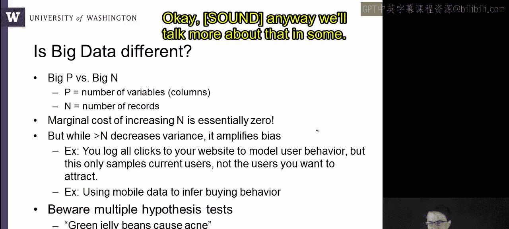

#  023：大数据有何不同 🧠

在本节课中，我们将探讨“大数据”与传统数据分析有何本质区别。我们将理解“大P”与“大n”的概念，并分析大数据带来的机遇与挑战，特别是关于统计偏差和多重假设检验的问题。

---

## 大P与大n：数据维度的区别

上一节我们介绍了数据分析的基本概念，本节中我们来看看大数据场景下的两个关键维度。

大数据的不同之处在于“大P”与“大n”的概念。其中：
*   **大P** 指的是列数，即特征或变量的数量。
*   **大n** 指的是行数，即观测记录的数量。

在我们之前进行的时间序列实验中，就是一个典型的“大P”场景。我们观察了越来越多的公司，并计算了它们之间所有可能的相关系数，因此数据量大致呈**二次方增长**。

---

## 大数据的机遇：近乎零的边际成本

关于大数据，一个关键特点是增加记录数量的**边际成本几乎为零**。收集数据的成本变得越来越低。

这非常强大。我们希望通过增加记录数量来增强统计功效，帮助我们获得越来越低的**P值**，从而更可靠地发现规律。

---

## 大数据的挑战：放大偏差

然而，大数据也会放大偏差。如果你收集的是错误的数据，或者观察的是错误的人群，你可能会得出完全错误的所谓“发现”。

以下是几个具体的例子：

*   **网站点击日志**：如果你记录网站的所有点击，你会得到一个非常庞大的数据集，可以非常精确地建模用户行为。但这只会建模你**现有用户**的行为。而建模用户行为的目的，可能恰恰是为了吸引**新客户**。例如，如果你的现有用户群是早期采用者，那么你建模的只是他们的行为，并未真正对更广泛的人群进行抽样。

*   **移动数据与民意调查**：这在总统选举等民意调查中会出现。如果你只通过手机进行抽样，那么你只采样了拥有手机的人群。这可能与你想要采样的总体不同，例如，它可能忽略了低收入群体或不同年龄段的群体。

---

## 多重假设检验的陷阱

正如我们指出的，在多重假设检验中需要格外小心。有一幅精彩的XKCD漫画非常清晰地阐明了这一点。

漫画中演示了“绿色软糖会导致痤疮”的谬误。故事是这样的：有20种不同颜色的软糖。在P值为0.05的显著性水平下，我们进行了20次实验，果然发现其中一种颜色的软糖确实会导致痤疮——但这纯粹是偶然预期的结果。我鼓励你去查找那幅漫画。

---

## 黑天鹅事件：不可预测的极端情况

另一个需要提及，并且我们后续可能会再次讨论的概念，是纳西姆·塔勒布提出的**黑天鹅事件**。

这是指本质上**不可预测**的事件，或者其分布不遵循正态分布（钟形曲线分布）的情况。在正态分布中，钟形曲线的尾部意味着极端值出现的概率呈指数级下降。但在某些情况下，极端值并非指数级罕见，它们确实会发生。

塔勒布使用的例子是：如果一只火鸡要建模你的行为，它会越来越确信你**对它没有恶意**，并且心怀善意。因为你每天都来喂它，照顾它，关心它的福祉。但在感恩节前一天，它却被宰杀了。这就是塔勒布对黑天鹅事件的论证。

“黑天鹅”本身指的是人们曾经不相信黑天鹅存在，后来却发现它们确实存在，因此它是一个**意料之外的事件**。

---

本节课中我们一起学习了大数据区别于传统数据的核心维度（大P与大n），认识了大批量数据带来的统计功效提升，也重点剖析了其可能放大数据偏差、导致多重检验谬误以及难以预测“黑天鹅”极端事件的挑战。理解这些区别与风险，是进行负责任的大数据科学分析的第一步。