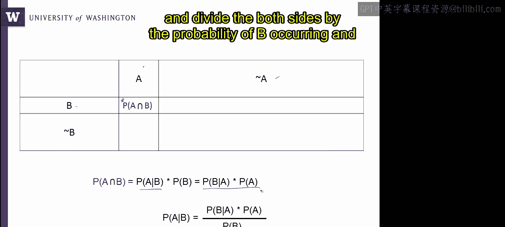
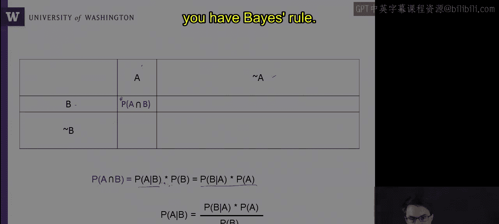

#  026：贝叶斯定理 🧠

在本节课中，我们将学习贝叶斯定理。我们将探讨贝叶斯方法与频率主义方法的核心区别，并详细拆解贝叶斯定理的组成部分及其推导过程。

## 贝叶斯与频率主义方法对比

上一节我们介绍了统计学中的两种主要思想流派。本节中，我们来看看它们之间的核心区别。

下图是对这两种方法的快速总结。

频率主义方法关注于**仅使用数据**来做出决策。而贝叶斯方法则**结合了先验信念和数据**。

这既是贝叶斯方法的优势，也是其弱点。优势在于，如果你拥有良好的先验信息，可以将其纳入分析。弱点在于，你必须实际引入这些信息，并且这个过程具有一定的主观性，不同的人可能会有不同的先验信念。

## 贝叶斯定理详解

理解了基本区别后，现在我们来深入探讨贝叶斯定理本身。

贝叶斯定理涉及几个核心术语，以下是它们的定义：

*   **先验概率**：在收集新数据之前，假设为真的概率。例如，在全球人口中，身高超过某个特定值的人所占的比例。
*   **边际概率**：在所有可能的假设下，观察到当前这组特定数据的概率。
*   **似然**：在假设为真的条件下，观察到当前这组数据的概率。
*   **后验概率**：这是我们通常试图计算的核心，即在收集到数据后，假设为真的概率。

## 贝叶斯定理的推导

了解了各个组成部分后，我们可以通过一个简单的网格来直观地推导贝叶斯定理。

一种很好的解释方法是构建一个如下的 2x2 网格，其中包含事件 A 和事件 B，以及它们的补集（非 A 和非 B）。

图中蓝色方框代表事件 A 和 B 同时发生的概率，记作 **P(A ∩ B)**。

这个概率可以通过两种方式表达：
1.  事件 B 发生的概率，乘以在 B 发生的条件下 A 发生的概率：**P(A ∩ B) = P(A|B) * P(B)**
2.  事件 A 发生的概率，乘以在 A 发生的条件下 B 发生的概率：**P(A ∩ B) = P(B|A) * P(A)**

由于这两种方式描述的是同一个概率，因此我们可以令它们相等：

**P(A|B) * P(B) = P(B|A) * P(A)**

然后，将等式两边同时除以 **P(B)**，就得到了贝叶斯定理的标准形式：

**P(A|B) = [P(B|A) * P(A)] / P(B)**

其中：
*   **P(A|B)** 是后验概率。
*   **P(B|A)** 是似然。
*   **P(A)** 是先验概率。
*   **P(B)** 是边际概率。

## 总结

本节课中，我们一起学习了贝叶斯定理。我们首先对比了贝叶斯方法与频率主义方法的核心思想，然后详细解释了贝叶斯定理中的先验、似然、边际概率和后验概率等关键概念。最后，我们通过一个简单的概率网格，一步步推导出了贝叶斯定理的公式。理解这个推导过程有助于我们更深刻地掌握贝叶斯推理的本质，即如何利用新的数据来更新我们对某个假设的信念。