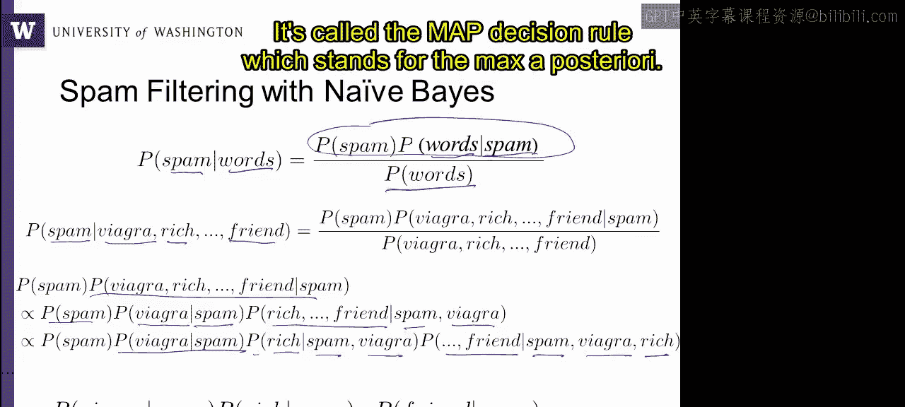

#  028：朴素贝叶斯垃圾邮件过滤 📧

在本节课中，我们将学习如何应用贝叶斯规则来解决一个经典的大数据问题：垃圾邮件过滤。我们将了解如何利用邮件中的词语来计算一封邮件是垃圾邮件的概率，并介绍“朴素贝叶斯”这一核心假设如何简化计算过程。

---

上一节我们介绍了贝叶斯规则的基本概念，本节中我们来看看如何将其应用于垃圾邮件过滤。

我们的任务是：**判断一封电子邮件是否为垃圾邮件**。更具体地说，我们关心的是在已知邮件内容（词语）的条件下，该邮件是垃圾邮件的概率。

根据贝叶斯规则，这个概率可以表示为：

**P(垃圾邮件 | 词语) = [ P(垃圾邮件) * P(词语 | 垃圾邮件) ] / P(词语)**

其中，分子部分 `P(垃圾邮件) * P(词语 | 垃圾邮件)` 是关键。分母 `P(词语)` 是一个与邮件是否为垃圾邮件无关的常数，它不会影响我们最终的分类决策（是垃圾邮件还是非垃圾邮件）。因此，在实际决策时，我们可以忽略分母，只比较分子的大小。

---

当我们说“词语”时，指的是邮件中出现的所有词语。因此，上述概率可以更具体地重写为：

**P(垃圾邮件 | 出现“Viagra”， 出现“rich”， 出现“friend”...)**

现在，让我们关注分子部分 `P(垃圾邮件) * P(词语 | 垃圾邮件)`。根据条件概率的链式法则，它可以被展开成一个非常复杂的连乘形式：

**P(垃圾邮件) * P(“Viagra” | 垃圾邮件) * P(“rich” | 垃圾邮件 且 出现“Viagra”) * P(“friend” | 垃圾邮件 且 出现“Viagra” 且 出现“rich”) * ...**

这个公式计算起来极其复杂，因为每个词语出现的概率都依赖于前面所有词语是否出现。

---

这就是“朴素贝叶斯”假设发挥作用的地方。该假设认为：**邮件中各个词语的出现是相互独立的**。也就是说，看到“rich”这个词的概率，不会因为已经看到了“wealth”这个词而改变。

显然，这个假设在现实中并不完全成立（词语之间有关联性），但它极大地简化了计算。在朴素贝叶斯假设下，复杂的条件概率连乘被简化为：

**P(垃圾邮件) * P(“Viagra” | 垃圾邮件) * P(“rich” | 垃圾邮件) * P(“friend” | 垃圾邮件) * ...**

现在，每个 `P(词语 | 垃圾邮件)` 都可以从数据中轻松估计。

---

那么，如何获得这些概率呢？方法是通过已标注的数据进行统计。

以下是具体步骤：
1.  准备一个已标注为“垃圾邮件”和“非垃圾邮件”（或“正常邮件”）的邮件数据集。
2.  对于垃圾邮件数据集，统计每个词语出现的频率。
3.  计算 `P(词语 | 垃圾邮件)`，其公式为：
    **（包含该词语的垃圾邮件数量） / （垃圾邮件总数）**
4.  同样地，计算 `P(垃圾邮件)`，即所有邮件中垃圾邮件的先验概率。

---

有了这些概率后，我们就可以对一封新邮件进行分类了。一个简单而有效的决策规则是 **MAP（最大后验概率）决策规则**：比较邮件属于“垃圾邮件”和“非垃圾邮件”这两个类别的后验概率，并将邮件分配给概率更高的那个类别。

具体来说，我们分别计算：
*   **垃圾邮件得分** = `P(垃圾邮件) * Π P(词语 | 垃圾邮件)`
*   **非垃圾邮件得分** = `P(非垃圾邮件) * Π P(词语 | 非垃圾邮件)`

然后比较这两个得分，得分高的类别就是我们的预测结果。

---

本节课中我们一起学习了朴素贝叶斯分类器在垃圾邮件过滤中的应用。我们了解了如何用贝叶斯公式形式化这个问题，认识了“条件独立性”这一核心的朴素假设如何将复杂计算变得可行，并掌握了通过已标注数据估计概率以及使用MAP规则进行分类决策的完整流程。尽管其“朴素”的独立性假设在现实中可能不严格成立，但朴素贝叶斯因其简单、高效且通常效果良好的特点，仍然是文本分类任务中的一个经典且强大的基线方法。