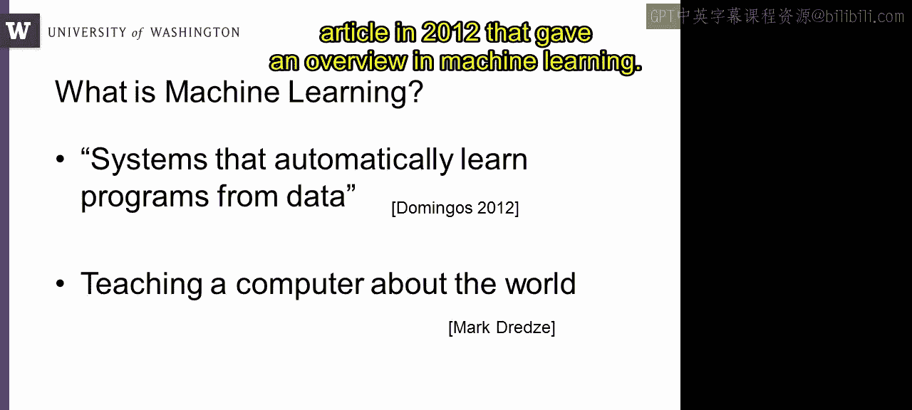
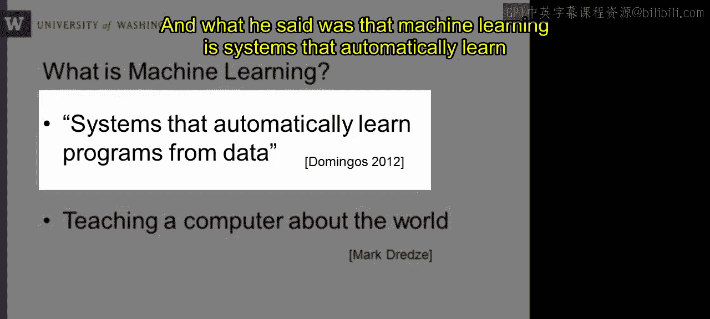
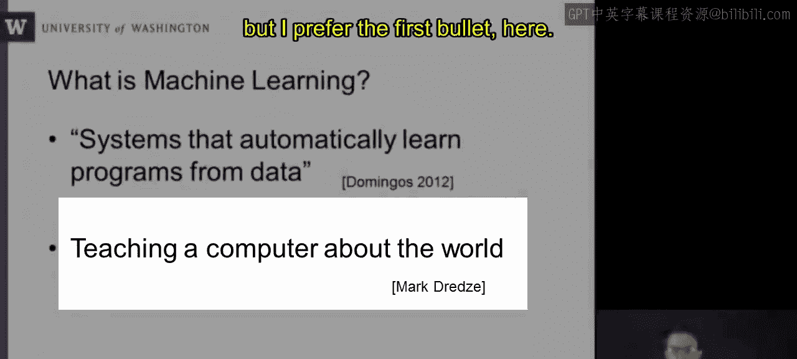
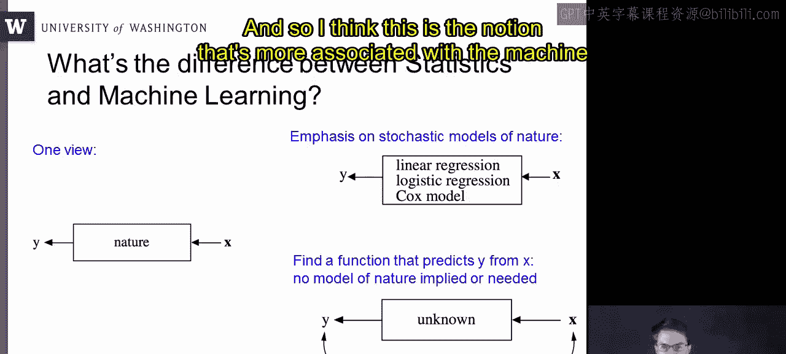

#  029：统计与机器学习 📊🤖

## 概述
在本节课中，我们将探讨统计方法与机器学习之间的核心区别。我们将从实验设计、假设检验和统计估计等话题出发，过渡到更侧重于算法的机器学习视角，并理解两者在目标和方法论上的不同。

---

在之前的几个小节中，我们介绍了实验设计、假设检验和统计估计中的精选主题。我们通过所谓的“衰退效应”来引出这些话题，即科学结果随时间推移可重复性降低，或其效应量在重复实验中逐渐减小。

我们发现，诸如发表偏倚和统计方法误用等因素可以解释这种效应的很大一部分。此外，我们还讨论了贝叶斯视角，它允许你在此处融入先验知识，但也为分析中引入主观性打开了大门。这是它在20世纪初被广泛排斥的原因之一，但得益于允许大规模对复杂分布进行采样的计算技术，它正在复兴。我们当时没有深入细节，但我希望在课程结束前能再次讨论。

因此，在接下来的几个小节中，我想讨论一个更偏向算法的视角，这个视角与术语“机器学习”和“数据挖掘”联系更紧密。

---

## 什么是机器学习？
华盛顿大学的Pedro Domingo在2012年写了一篇出色的《ACM通讯》文章，概述了机器学习。他说，机器学习是**从数据中自动学习程序的系统**。

这意味着，当你手动编写程序时，你明确地说明了如何将一组输入映射到某个期望的输出，你给出了一个执行此操作的“配方”。但关键在于，给定足够多的输入和期望输出的示例，你可以**推断出**映射它的程序，而不是必须明确地编写它。

所以有个玩笑是：既然可以学习程序，何必费心编写程序呢？另一种观点是“教计算机认识世界”，但我可能更喜欢这里的第一个要点。

---

## 统计与机器学习的区别
值得花几分钟时间讨论一下统计学和机器学习之间的区别。可能不值得投入大量时间或思考，因为术语最初并不精确。它们是在特定的历史背景下发展起来的，反映了不同的文化，而不是你可以推理的某种明确定义的概念。

不过，有一篇发表于2001年的论文（虽然现在有点久了）讨论了一种特定的差异，尽管它并非特指机器学习，但它捕捉到了我认为真正显著的差异。

下图左侧的模型是，该领域的所有参与者都试图做以下事情：观察到自然界能够将输入映射到输出，而我们希望能够通过计算来预测它。

以下是两种不同的攻击方式：

*   **统计学家**通过尝试通过某种随机过程来建模世界来解决这个问题。在论文中，他们谈论的是数据建模，即对产生你所见数据的过程进行建模。其理念是，一旦你有了一个世界模型，你就可以用它来假设性地抽取更多样本，并对整个总体进行推理。
*   **另一种更偏向算法的观点**是：我们认为自然界很难建模，而且我们并不真正关心是否拥有它的精确模型。我们试图做的只是**衡量我们从给定输入预测所见输出的性能**。因此，我们生成的模型（程序）是否真实反映了自然界中正在发生的实际过程并不重要，我们并不声称它做到了。但我们声称的是，它在进行预测方面做得相当不错。

无论如何，我认为这种观念与机器学习方法联系更紧密。

---

## 总结
本节课中，我们一起学习了从统计推断到机器学习算法的视角转变。我们明确了机器学习的核心是**从数据中自动学习程序**，并探讨了统计学（侧重于**对数据生成过程进行建模**）与机器学习（侧重于**构建能做出准确预测的模型，而不必解释底层过程**）之间的根本区别。理解这种区别有助于我们在解决实际问题时选择合适的方法论。