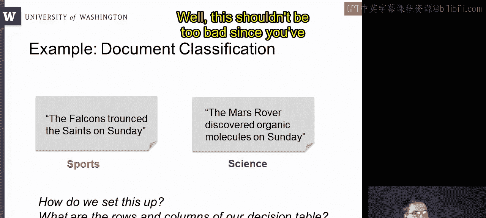

#  030：核心概念与示例 🎯

在本节课中，我们将学习机器学习的基本概念，包括分类与回归、监督学习与无监督学习的区别。我们将通过一个经典的“是否打高尔夫球”的预测示例和一个文档主题分类的示例来具体说明这些概念。

---

## 机器学习基础：1.1：一个简单的预测示例 ⛳

上一节我们介绍了机器学习的基本目标。本节中我们来看一个具体的预测示例。

假设我们想预测某人是否会去打高尔夫球（或其他户外活动），并且我们认为这取决于天气状况。我们考虑的输入特征包括：
*   **天气展望**：晴朗、多云或下雨。
*   **温度**：炎热、凉爽或温和。
*   **湿度**。
*   **风力**。

我们的目标是学习一个函数，它接收这些输入，并输出“是”或“否”，即是否去打高尔夫球。

最直观的预测方法是尝试使用一条简单的规则。例如，我们可能认为“只在晴天打球”。但这条规则并不成立，因为我们能找到反例，比如在阴天我们也可能打球。

我们可能会说，“如果下雨且刮风，我们就不打球”。这条规则虽然成立，但还有其他情况我们也不打球。因此，能够准确预测输出的函数，可能无法用一条简单的规则来表达。这超出了我们仅凭直觉就能处理的范围。我们需要一种**有原则的方法**来构建更复杂的模型。

---

## 机器学习基础：1.2：分类与回归 📊

上一节我们通过一个具体问题引出了对复杂模型的需求。本节中我们来明确一下这类问题的术语。

“高尔夫球”问题是一个**分类问题**的示例。在这个问题中，我们要预测的属性（标签）是**类别型**的。在本例中，它有两个值：`是`（1）或`否`（0）。

如果要预测的属性是**数值型**的，例如根据天气预测高尔夫球的得分，那么这就更接近于一个**回归问题**。特别是当所有输入特征也都是数值型时，它就成为一个经典的回归案例（当然也有方法处理类别型特征）。

我们之前讨论过回归，即用曲线拟合数据。当你使用拟合出的曲线进行预测时，可以看到它与处理类别型数据的分类问题在思路上是**类似**的。

---

## 机器学习基础：1.3：监督学习与无监督学习 🧠

上一节我们区分了预测任务的类型。本节中我们来看看机器学习模型是如何被“教导”的。

我们刚刚给出的高尔夫球示例是**监督学习**的一个例子。在监督学习中，你会获得输入数据和对应的期望输出（标签），目标是学习它们之间的关系。我们通过训练一个模型来实现这一点。

此外还有**无监督学习**的概念。在无监督学习中，你没有任何标签，只获得数据本身，目标是理解数据中潜在的结构。例如聚类算法或降维算法就属于无监督学习。

---

## 机器学习基础：1.4：无监督学习示例：文档主题发现 📄

上一节我们介绍了无监督学习的概念。本节中我们来看一个可以同时用两种学习方式处理，但目前作为无监督学习示例的问题。

假设你获得了一个庞大的文档集合，你想判断某个文档属于什么主题。例如，如果你看到短语“猎鹰队在周日大胜圣徒队”，你可能会猜测这篇文档是关于**体育**的。而如果你看到“火星车在周日发现了有机分子”，你可能会猜测这篇文档是关于**科学**的。

那么，如何将这个问题构建为一个机器学习问题呢？之前的例子中，我们有行（记录）和列（特征），目标是给定输入预测输出。在这里，行和列分别是什么？这对于已经完成过几次作业的你们来说应该不难。

---

在本节课中，我们一起学习了机器学习的基础概念。我们通过“是否打高尔夫球”的示例，理解了**分类问题**与寻找简单规则的局限，从而引出了对更复杂模型的需求。我们明确了**分类**（预测类别标签）与**回归**（预测数值）的区别。最后，我们介绍了**监督学习**（有标签数据）与**无监督学习**（无标签数据，探索结构）的根本不同，并通过文档主题发现的例子进行了说明。这些概念是理解后续更复杂算法的基础。