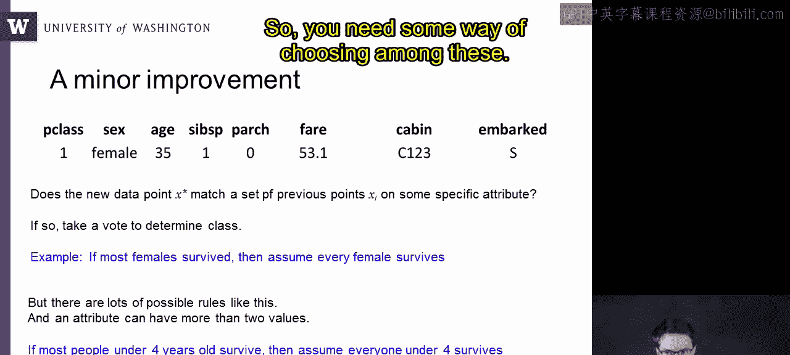

#  032：使用简单规则进行分类 🧠

在本节课中，我们将学习如何使用简单规则进行分类。我们将以泰坦尼克号乘客数据集为例，探讨如何通过数据探索和构建基础分类器来预测乘客是否幸存。

---

首先，我们考虑一些具体的算法技术。为了说明这些技术，我们将使用泰坦尼克号乘客数据集。该数据集可在网络上获取，并已用于多种目的，同时它也是Kaggle平台上的一个竞赛项目，常被用作入门训练。

该数据集为每位乘客（或训练集中的子集）提供了一条记录，包含描述乘客的各种属性以及他们是否在沉船事件中幸存。数据列包括：
*   **Survived**：幸存状态，0表示未幸存，1表示幸存。
*   **Pclass**：船舱等级（如头等舱、二等舱、三等舱）。
*   **Sex**：性别。
*   **Age**：年龄。
*   **SibSp**：在船上的兄弟姐妹数量。
*   **Parch**：在船上的父母与子女数量。
*   **Fare**：支付的票价（美元）。
*   **Cabin**：客舱号（存在大量缺失值）。
*   **Embarked**：登船港口代码。

处理此类问题时，第一步通常是检查数据。如果数据能传达信息，我们不应忽视它。更重要的是，如果数据没有传达明显信息，这可能意味着自动学习模式会比较困难。

一种方法是开始绘制这些不同列的散点图。例如，你可能会想到“妇女和儿童优先”的原则，猜测儿童更可能幸存。因此，可以绘制年龄与票价的散点图。在下图中，蓝色点代表幸存，红色点代表未幸存。可以看到，在非常年幼的儿童周围似乎有一些蓝色点聚集，但除此之外，并没有非常明显的模式。

另一种方法是绘制年龄与性别的散点图。这里使用了一个技巧：将分类数据（如性别）作为数值属性绘制，这是一个相当有用的方法。为了避免所有值完全重叠（例如所有男性都在同一X坐标上），我们添加了一点“抖动”，这样就能看出每个位置上有多少红点和蓝点。从这个图中可以观察到，“妇女和儿童优先”的原则似乎确实成立，女性区域（右侧）的蓝点明显多于红点，但年龄本身提供的信息并不十分明确。

---

接下来，我们看看如何构建分类器。一个非常朴素的分类器，作为起点示例，是所谓的“死记硬背分类器”。其逻辑是：当看到一条新记录时，在训练集中寻找一个在所有属性上都完全匹配的现有示例。如果找到完全相同的记录，就将其归为已知的类别。如果没找到，则只能猜测。这个分类器并不特别实用。

对此的一个微小改进是遵循以下规则：给定一个我们从未见过的新乘客记录，检查它是否在某个特定属性上与现有示例匹配。如果匹配，则在具有相同属性值的所有乘客中进行投票，根据多数人的结果来决定新乘客的类别。

例如，看到一位新乘客是女性，就回顾所有其他女性乘客的记录。如果幸存女性多于未幸存女性，就判定这位新乘客也幸存了。然而，像这样的规则有很多，每个属性的每个值都可以形成一条规则。特别是，一个属性可能不止两个值（如男/女）。因此，我们需要某种方法在这些规则中进行选择。

---

本节课中，我们一起学习了如何通过探索泰坦尼克号数据集来理解数据模式，并介绍了两种基础的简单规则分类器：完全匹配的“死记硬背分类器”和基于单一属性多数投票的改进分类器。这些方法虽然简单，但为理解更复杂的分类算法奠定了基础。