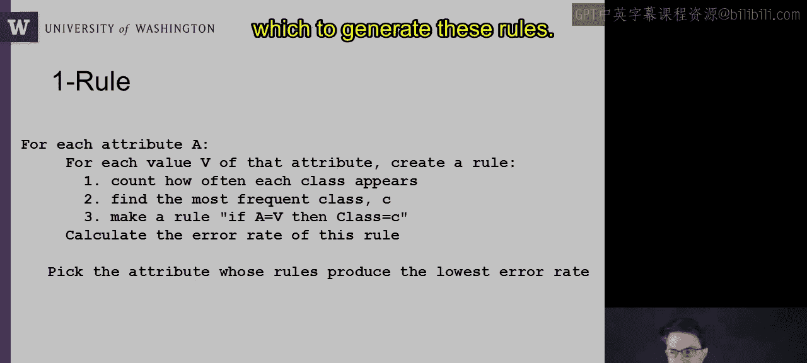

#  033：学习规则

在本节课中，我们将学习如何从数据中构建和评估简单的预测规则。我们将介绍假设的表示方法、使用混淆矩阵和准确率进行评估，并探讨一种名为“单一规则”的搜索算法来寻找最佳规则。

## 假设的表示

上一节我们介绍了数据科学的基本概念，本节中我们来看看如何将预测模型表示为规则。

假设的表示基于规则。每条规则本身就是一个假设。例如，一条规则可以是：“如果性别为女性，则预测为幸存；否则预测为未幸存。”

## 规则的评估

了解了如何表示规则后，我们需要知道如何判断哪些规则是好的。这涉及到对规则的评估。

一种评估方法是构建一个**混淆矩阵**。混淆矩阵是一个行数和列数相等的方阵，每一行和每一列对应一个唯一的类别标签。矩阵的对角线元素表示预测正确的样本数量。

以下是使用规则“如果性别为女性，则预测为幸存；否则预测为未幸存”时得到的混淆矩阵示例：

*   预测为“未幸存”且实际为“未幸存”的样本有 **468** 个。
*   预测为“幸存”且实际为“幸存”的样本有 **233** 个。
*   预测为“幸存”但实际为“未幸存”的样本有 **109** 个。
*   预测为“未幸存”但实际为“幸存”的样本有 **81** 个。

混淆矩阵有助于直观检查，但为了自动构建程序，我们通常需要一个单一数值指标。这个指标就是**准确率**。

准确率的计算公式为：
`准确率 = (正确预测的样本数) / (规则覆盖的总样本数)`

对于上述规则：
`准确率 = (468 + 233) / (468 + 233 + 109 + 81) ≈ 0.79 或 79%`

这意味着该规则在约79%的情况下是正确的，错误率为21%。对于一个如此简单的模型来说，这个结果并不差。

## 探索更复杂的规则

为了尝试改进模型，我们可以观察其他属性。例如，观察乘客的舱位等级（一等舱、二等舱、三等舱）。

从数据模式中，我们可以发现：
*   一等舱乘客的幸存率似乎更高。
*   二等舱中，儿童的幸存率似乎高于成人。

这提示我们可以构建更复杂的规则。但作为对比，这里有一个仅基于舱位的简单规则示例：“如果是一等舱或二等舱，则预测为幸存；如果是三等舱，则预测为未幸存。”

使用这条规则计算出的准确率约为67%，比基于性别的规则要差一些。

## 规则的搜索策略

我们已经掌握了规则的表示和评估方法，但如何从所有可能的规则中找到最好的那一个呢？这就需要搜索策略。

对于“单一规则”模型，一种可行的搜索策略是**穷举枚举**。其核心思想是：针对数据集中的每一个属性，以及该属性的每一个可能取值，生成一条对应的规则，然后评估所有规则，选择整体错误率最低的那一组。

以下是“单一规则”算法的步骤：

1.  **遍历每个属性**：对于数据集中的每一个属性 `A`。
2.  **遍历每个属性值**：对于属性 `A` 的每一个可能取值 `V`。
3.  **生成规则**：创建规则 “如果 `A` 等于 `V`，则预测类别为 `C`”。其中，类别 `C` 是在满足 `A=V` 条件的样本中出现最频繁的类别。
4.  **计算错误率**：评估这条规则在训练数据上的错误率。
5.  **选择最佳属性**：比较所有属性对应的规则集的**整体错误率**，选择错误率最低的那个属性。由该属性所有取值构成的规则集合，就是最终的“单一规则”模型。

请注意，“单一规则”指的是一组基于**同一个属性**不同取值的规则集合（例如，针对“性别”属性的“男”和“女”两个值生成的规则），而不是多条独立的规则。

## 总结

本节课中我们一起学习了如何构建和评估用于预测的简单规则。我们首先将假设表示为“如果-则”形式的规则，然后使用混淆矩阵和准确率来量化规则的性能。最后，我们介绍了一种名为“单一规则”的穷举搜索算法，该方法通过系统地评估每个属性来寻找最佳的单一规则集。这种方法虽然简单，但为理解更复杂的机器学习模型奠定了基础。