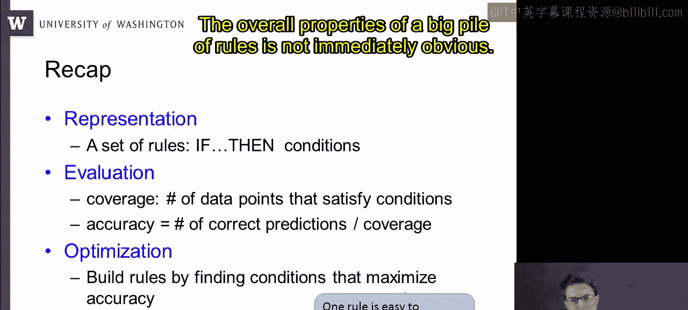

#  035：规则回顾 📚

在本节课中，我们将回顾基于规则的学习方法。我们将探讨如何构建规则、两种主要的规则生成策略（从一般到具体和从具体到一般），以及当多个规则被触发时如何解决冲突。最后，我们将总结基于规则方法的核心概念、评估策略和优化过程。

---

## 规则构建策略 🔍

上一节我们介绍了规则的基本概念，本节中我们来看看构建规则的两种主要策略。

第一种策略是从一般到具体。我们从一个空规则开始，逐步添加约束条件，直到规则开始错误地分类一些负例为止。这个过程旨在通过添加约束来消除负例，最终只留下正例。

第二种策略是从具体到一般。我们从一个特定的数据实例开始，构建一个能精确描述该实例的规则，即该规则包含该实例的每一个属性约束。然后，我们逐一移除条件，以尝试覆盖更多的正例，并在规则开始覆盖某些负例时停止。

以下是两种策略的简要对比：

*   **从一般到具体**：起点是空规则，通过添加约束来“收紧”规则。
*   **从具体到一般**：起点是描述单个实例的完整规则，通过移除约束来“放宽”规则。

---

## 规则冲突解决 ⚖️

一旦我们拥有了这组规则，就需要使用它们进行预测。一个可能出现的情况是，对于某个特定的数据点，可能有多个规则被触发。

因此，我们需要某种方式来解决冲突。例如，可以选择最具体的规则，或者选择最一般的规则。也可以应用一些领域知识来为每条规则分配优先级，并以此来解决平局情况。

---

## 方法总结与回顾 📝

本节我们一起学习了基于规则方法的简要介绍。

*   **表示方法**：核心表示是一组 **`if-then`** 规则，这些规则包含数量不等的条件。
*   **评估策略**：评估一个规则的好坏，需要计算其**覆盖率**，并通过**正确预测数 / 覆盖率**来衡量其准确率。
*   **优化与搜索策略**：搜索策略是通过逐步寻找能最大化准确率的条件来构建规则。你可以选择从一般到具体，也可以选择从具体到一般。我们尚未深入讨论这些选择之间的各种权衡。

基于规则方法的一个关键启示（除了为下一部分内容做铺垫外）是：单个或少数几条规则非常直观且易于解释；而一大组规则的总体特性可能并不那么显而易见。

---

本节课中，我们一起回顾了基于规则的学习方法，涵盖了其构建策略、冲突解决机制以及核心的方法论框架。