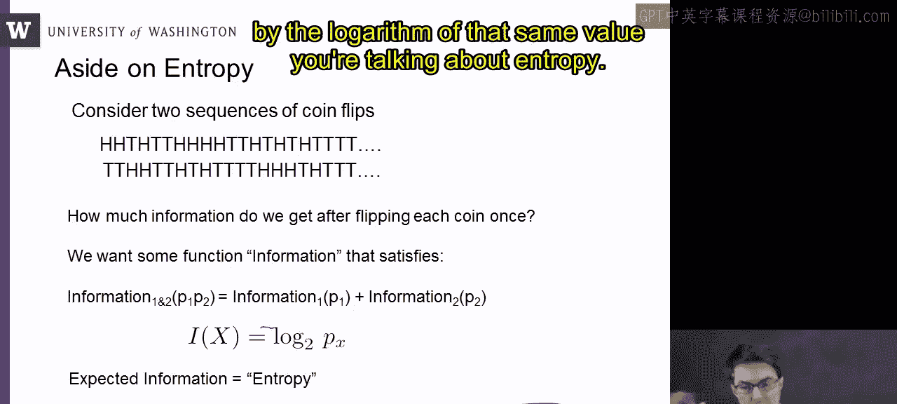

#  037：熵与信息增益


在本节课中，我们将学习决策树算法中的一个核心概念——熵。熵用于衡量一个数据集合的“不纯度”或“不确定性”。我们将了解熵的数学定义，以及它如何帮助我们判断决策树中某个节点是否有助于进行分类。

上一节我们介绍了决策树的基本概念，本节中我们来看看如何量化一个节点划分数据的好坏。

## 熵的定义与直觉

为了判断决策树中的一个节点是否有用，我们需要熵这个概念。考虑两个不同的抛硬币序列。我们想知道每次抛硬币后获得了多少信息。

讨论两个不同序列的原因，是我们希望建立这两个独立事件信息量之间的关系。我们希望信息函数满足以下性质：如果两个事件是独立的（例如公平硬币的两次抛掷），那么这两个事件同时发生所获得的总信息量，应等于各自事件信息量之和。

用数学公式表示，如果事件A和B独立，其概率分别为 `P(A)` 和 `P(B)`，那么：
```
信息(P(A) * P(B)) = 信息(P(A)) + 信息(P(B))
```
满足此性质的函数是对数函数，具体是**以2为底的对数**。因此，单个事件的信息量定义为：
```
信息(p) = -log₂(p)
```
（注：概率p小于1，其对数log₂(p)为负值。为了使信息量为正数，我们加上负号。）

## 从信息到熵

信息衡量的是单个事件发生带来的“惊喜度”。而**熵**衡量的是**一系列事件整体的平均不确定性或不可预测性**。

熵是信息的期望值。在概率论中，期望值总是将每个事件的概率乘以其对应的值（这里是信息量），然后求和。

因此，对于一个具有`n`种可能结果（例如分类标签）的数据集，其熵`H`的计算公式为：
```
H = - Σ (pᵢ * log₂(pᵢ))
```
其中，`pᵢ` 是第`i`类在数据集中出现的概率，求和遍及所有类别。

以下是理解该公式的关键点：
*   **概率 `pᵢ`**：数据集中属于第`i`类的样本比例。
*   **信息量 `-log₂(pᵢ)`**：一个样本被分类为第`i`类所带来的信息量。
*   **期望值**：熵 `H` 是所有类别信息量的加权平均（以概率为权重）。

## 熵的特性

熵的值具有明确的含义：
*   **熵为0**：表示数据集是“纯”的，所有样本都属于同一类别。此时不确定性最低。
*   **熵最大**（对于二分类问题，最大值为1）：表示数据集中两类样本均匀分布（各占50%），此时不确定性最高。

在决策树构建中，我们的目标就是通过选择特征进行划分，使得子节点的**熵尽可能降低**，即让数据变得更“纯”。



本节课中我们一起学习了熵的概念。熵是信息论的基础，它量化了数据集的不确定性。其计算公式 `H = - Σ (pᵢ * log₂(pᵢ))` 是决策树算法（以及许多其他机器学习算法）中衡量信息增益的核心工具。理解熵如何反映数据的纯度，是理解决策树如何做出划分决策的关键。下一节，我们将学习如何利用熵来计算“信息增益”，从而选择最佳的划分特征。