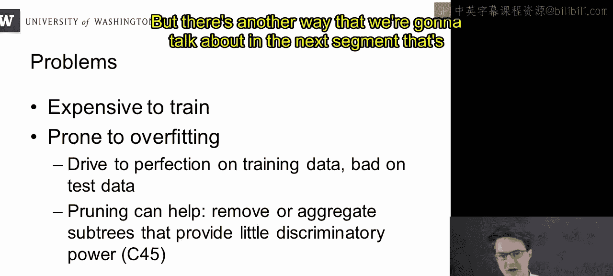

#  040：ID3算法详解

在本节课中，我们将学习一种经典的决策树构建算法——ID3算法。我们将了解其工作原理、步骤、优缺点，以及如何将其应用于数据集。

## 算法概述

ID3算法是一种用于构建决策树的经典算法。它适用于所有属性都是离散值的数据集。对于连续属性，可以通过将其划分到特定区间（分箱）来进行离散化处理。我们将在后续幻灯片中介绍具体方法。

## 算法步骤

以下是ID3算法的核心步骤：

1.  **选择最佳属性**：计算所有属性的信息增益，并选择信息增益最高的属性作为当前节点的分裂属性。
2.  **创建分支**：为所选属性的每一个可能取值创建一个分支。
3.  **划分数据**：根据所选属性的值，将当前节点的数据集划分到对应的子分支中。
4.  **递归构建**：对于每个子分支，在剩余属性集合和划分后的子数据集上，重复上述步骤，递归地构建子树。

## 停止条件

递归过程在满足以下任一条件时停止：

*   某个分支下没有剩余的样本数据。
*   某个分支下的所有样本都具有相同的类别标签，此时无需再做进一步决策。

通过这种方式，您可以将此算法应用于您的数据集，逐步构建出一棵决策树。

## 算法实现与复杂度

正如您所见，实现这个算法并不太困难。如果您不熟悉信息增益的概念，这可能是最具技巧性的部分，但我们已经详细讲解过。除此之外，编写一个执行此算法的程序是可以想象的。虽然构建这个数据结构需要一些簿记工作，但整体并不复杂。

## 算法的局限性

然而，ID3算法也存在一些问题：

*   **训练成本高**：在做出每个决策时，都需要反复检查数据集的很大一部分，导致训练过程计算开销较大。
*   **容易过拟合**：我们尚未深入探讨过拟合，但一般而言，过拟合意味着模型在训练数据上表现非常好，但在测试数据上表现很差，即模型泛化能力弱。您可以想象，决策树可能变得非常擅长对训练集做出精确决策，但当遇到一个从未见过的新样本时，可能会将其放入一个不一定正确的分类桶中。

## 应对策略

针对过拟合问题，有一些解决方法：

*   **剪枝**：可以尝试剪掉那些对特定条件过度专门化的树分支，即移除或合并那些不能提供太多判别能力的子树。

在下一节中，我们将讨论另一种非常强大的方法来解决这些问题。