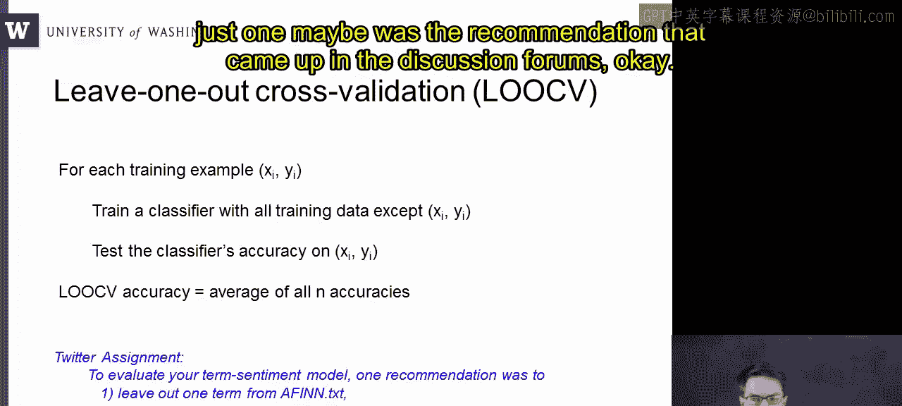

#  044：模型评估与留一法交叉验证

在本节课中，我们将要学习如何评估机器学习模型，并重点介绍一种重要的评估方法——留一法交叉验证。理解如何正确评估模型是避免过拟合、确保模型泛化能力的关键。

## 模型评估的重要性

上一节我们讨论了过拟合问题。但在此之前，我们需要先探讨如何评估一个模型并判断其好坏。我们在讨论规则和决策树时已经有所涉及，但本节将系统性地介绍你需要熟悉的主要术语。

或许从整个课程中需要掌握的最重要的一点是：**必须将数据划分为训练集和测试集**。在Kaggle等平台上，你通常会获得给定的训练集和测试集，但你应该将训练集再次进行划分。

## 训练集与测试集

以下是一个核心原则：**在用于训练的数据上评估模型是毫无意义的**。因为模型已经见过这些数据，评估结果自然会很好。这一点在如今看来似乎显而易见，但在80年代机器学习方法探索初期，人们并非立刻意识到这一点。当时需要一些时间，才能将统计学家的认知与机器学习群体探索的算法方法统一起来。

那么，如何正确评估呢？一种方法是直接预留一定比例的数据作为测试集，其余数据用于训练。

## 交叉验证方法

一种更积极的方法是进行**交叉验证**。其基本思想是：预留一部分数据用于测试，但重复此过程多次，每次预留不同的随机样本。

例如，**十倍交叉验证**是指：预留10%的数据作为测试集，在剩余90%的数据上训练模型，然后在预留的测试集上评估。重复此过程。K折交叉验证通常意味着预先将数据分成K个块，而不是每次随机抽样。两种方法都有效，且具有不同的特性，我们在此不深入细节。10%是一个合理的参考比例。

## 留一法交叉验证

这种方法的一个特例是**留一法交叉验证**。具体操作如下：从数据集中取出一个样本点，将其放在一边。在剩余的所有数据上训练模型，然后评估该被预留的单个数据点，看分类是否正确。对数据集中的每一个数据项都重复此过程，你就能对模型的整体表现有一个很好的了解。

这种方法有其优缺点，我们同样不深入讨论。最后，一个相关的、我们稍后会详细一点介绍的概念是**自助法**。它通过对数据集进行有放回的重采样来生成新样本集，因此可能产生重复数据。这种方法在统计分析中具有很好的性质，从中推导出的任何统计量，都是对实际总体统计量的一个非常好的估计。

## 留一法交叉验证详解

现在，我想用一页幻灯片专门讨论留一法交叉验证，因为它在本课程之前的内容中出现过。

对于每一个训练样本 **(X, Y)**，其中 **Y** 是类别标签，**X** 是所有其他属性（为简化表示，我们将它们归在一起），具体步骤是：
1.  使用除这个特定样本 **X** 之外的所有训练数据来训练一个分类器。
2.  在样本 **X** 上测试该分类器的准确性：分类正确还是错误？

然后，**留一法交叉验证的准确率** 就是你在所有被预留数据上表现的平均值。

## 课程中的实例

我们在之前的Twitter作业中见过这种方法。当时有一个建议，用于调试和评估你的**词汇情感模型**（不是推文情感模型）。建议是：从AFINN词表文件中取出一个词汇，看看你的模型为该词汇预测的情感是什么。你可以大致确认，当AFINN词表标注为积极时，你的模型预测是否也为积极；标注为消极时，预测是否也为消极。当然，这与你使用的具体推文数据集有关，但这是一个很好的合理性检查方法，以确保你产生了正确的值。

当时的一个挑战是：AFINN词表本身已经包含了大量明显的积极词和消极词，因此没有留下太多词汇用于测试。但根据留一法交叉验证的思想，这没关系。AFINN词表是输入的一部分，但从“训练集”中留出一些东西（尽管我们当时并不严格认为是在训练一个模型），在某种意义上，我们就是在进行“留一”操作，然后查看对你留出的那个“一”预测了什么值。

你也可以进行K折交叉验证，即留出一大批数据。但在课程讨论区中提出的建议，可能就是进行这种“留一”检查。

## 总结

本节课中，我们一起学习了模型评估的核心概念。我们明确了必须在独立于训练数据的测试集上评估模型。我们介绍了简单的训练-测试集划分，以及更稳健的交叉验证方法，特别是**留一法交叉验证**。我们还通过课程中的Twitter作业实例，看到了这种方法在实际中的应用。正确评估模型是构建可靠、泛化能力强的预测模型的基础。