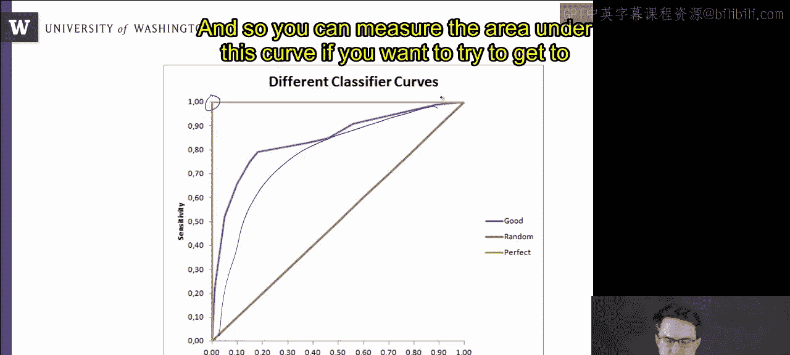

#  045：准确率与ROC曲线

在本节课中，我们将学习如何评估分类模型的性能。我们将从简单的准确率指标开始，探讨其局限性，并引入更复杂的评估工具，如混淆矩阵和ROC曲线，以帮助我们更全面地理解模型表现。

## 混淆矩阵详解

上一节我们介绍了准确率的概念，本节中我们来看看一个更详细的评估工具：混淆矩阵。混淆矩阵是评估二分类模型性能的基础工具。

它通过一个表格来展示预测结果与真实标签的对比情况。表格的列代表模型的预测类别（例如“预测为正类”和“预测为负类”），行代表数据的真实类别（例如“真实为正类”和“真实为负类”）。

以下是混淆矩阵的结构：

| | 预测为正类 | 预测为负类 |
| :--- | :--- | :--- |
| **真实为正类** | **a (真正例，TP)** | b (假负例，FN) |
| **真实为负类** | c (假正例，FP) | **d (真负例，TN)** |

在矩阵中，**a** 和 **d**（蓝色标记）是模型预测正确的数量，而 **b** 和 **c**（红色标记）是模型预测错误的数量。

基于此，准确率的计算公式为：
`准确率 = (a + d) / (a + b + c + d)`

## 准确率的局限性与基准

既然准确率计算如此直接，为什么不能一直使用它呢？在许多情况下，仅凭准确率一个数字可能不足以提供有意义的见解。

例如，如何解读90%的准确率？这算好还是坏？99%的准确率就一定非常优秀吗？答案取决于具体问题。因此，我们需要一个基准来进行比较，或者使用不同的评估指标。

以下是几种可能的基准：

*   **基准率**：简单地预测数据集中最频繁出现的类别。例如，在泰坦尼克号数据集中，如果大多数乘客幸存，那么基准模型就预测所有人都幸存。
*   **随机率**：对于二分类问题，通常可以假设随机猜测的准确率是50%。但也可以根据先验知识进行调整，例如，如果你知道60%的乘客没有幸存，就可以以此作为随机基准的概率分布。
*   **朴素基准**：一个比基准率稍“聪明”一点的模型，它使用一些简单的领域知识。例如，一个众所周知的规则是“所有女性都幸存”。在Kaggle等竞赛中，组织方常会提供一个初始解决方案，你的模型性能应该相对于这个基准进行衡量。

## 其他性能指标

除了准确率，我们还可以从混淆矩阵中计算出其他重要的性能指标。以下是几个关键概念：

*   **提升度**：常见于营销文献，用于衡量模型相对于随机选择的效果提升。
*   **精确率与召回率**：这两个概念源自信息检索领域。
    *   **精确率** 关注的是模型预测为正类的样本中，有多少是真正的正类。`精确率 = a / (a + c)`
    *   **召回率**（也称**灵敏度**）关注的是所有真实的正类样本中，有多少被模型正确地找了出来。`召回率 = a / (a + b)`
*   **ROC曲线与AUC**：这是本节的重点。ROC（受试者工作特征）曲线是一种综合性的评估工具。

## ROC曲线深入解析

ROC曲线试图捕捉两个核心概念：**灵敏度**和**特异度**。
*   **灵敏度**就是召回率，即模型正确识别正类样本的比例。
*   **特异度**是模型正确识别负类样本的比例。`特异度 = d / (c + d)`

对于一个固定的分类阈值，模型会产生一对（灵敏度， 1-特异度）值，在ROC图上形成一个点。然而，许多模型（如逻辑回归、SVM）会输出一个连续的概率值或分数。通过改变判断样本为正类的**概率阈值**，我们可以得到一系列的点，从而绘制出一条曲线。

例如，一个通过血液肌酐水平诊断疾病的模型。问题在于：肌酐水平多高才算“过高”？改变这个诊断阈值，就会得到ROC曲线上的不同点。

*   **完美分类器**的ROC曲线是一个经过左上角点(0,1)的折线，表示它能100%正确分类所有样本。
*   **随机猜测分类器**的ROC曲线是图中从(0,0)到(1,1)的对角线（红色虚线）。
*   实际模型的ROC曲线通常位于这两者之间。

为了用一个数值来概括模型的整体性能，我们计算**ROC曲线下的面积**，即**AUC**。AUC值越接近1，表示模型性能越好；AUC为0.5时，模型等同于随机猜测。

## 总结

本节课中我们一起学习了分类模型的核心评估方法。我们首先回顾了准确率及其局限性，然后深入介绍了混淆矩阵，它是计算多种指标的基础。接着，我们探讨了为准确率建立比较基准的重要性。最后，我们重点讲解了ROC曲线和AUC，它们通过综合考虑灵敏度和特异度，并利用可变阈值，为我们提供了评估模型性能更强大、更全面的视角。理解这些工具将帮助你在实际项目中更好地选择和优化模型。